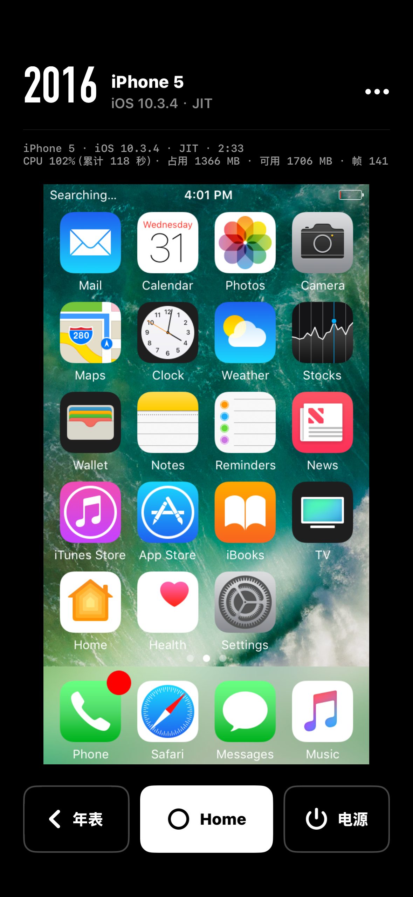
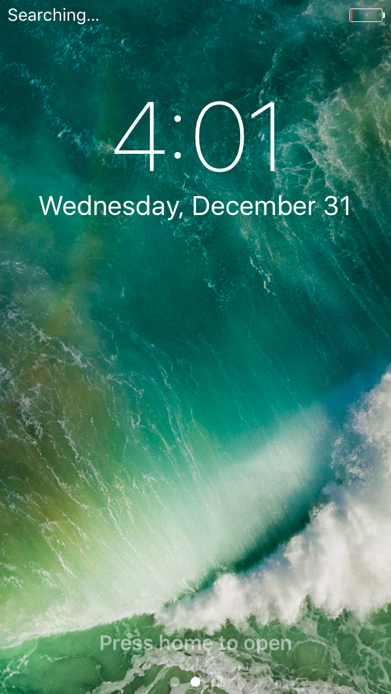
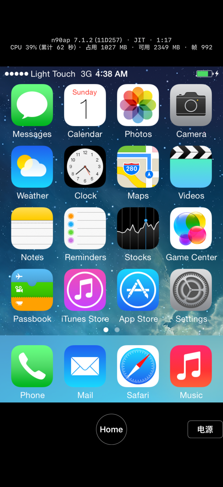

# Slide to Unlock

Run stock iPhone OS 1 through iOS 10 on an iPhone, for anyone who wants to revisit classic iOS.

The project was called Classic Touch until 2026-11-04; internal names such as the bundle ID `org.classictouch.app` and the Xcode target `ClassicTouch` still use it.

> Work in progress. Nothing has been released and there is no build to download.

  
  
  

## Status (2026-11-04)

| Year | Emulated device | Chip | OS | Mac | App in the iOS Simulator | App on an iPhone |
|---|---|---|---|---|---|---|
| 2007 | iPhone (original) | S5L8900 | iPhone OS 1.0 | Home screen | Home screen | Not tried |
| 2008 | iPod touch (2nd gen) | S5L8720 | iPhone OS 2.2.1 | Home screen | Home screen | Not tried |
| 2009 | iPod touch (2nd gen) | S5L8720 | iPhone OS 3.1.3 | Home screen | Home screen | 18 Pro, about 18 s |
| 2010 | iPhone 4 | A4 | iOS 4.3.5 | Lock screen | Home screen | Not tried |
| 2011 | iPhone 4 | A4 | iOS 5.1.1 | Through Setup Assistant | Home screen | Not tried |
| 2012 | iPhone 3GS | S5L8920 | iOS 6.1.6 | Home screen | Home screen | 18 Pro, about 23 s |
| 2013 | iPhone 4 | A4 | iOS 7.1.2 | Home screen | Home screen | 18 Pro, about 37 s |
| 2013 | iPod touch (5th gen) | **A5** (new machine) | iOS 7.1.2 | Home screen | Settings | 14 Pro, lock screen in 41 s (see below) |
| 2015 | iPod touch (5th gen) | **A5** (new machine) | iOS 9.3.5 | Settings | Settings | 14 Pro, 172 s |
| 2016 | iPhone 5 | **A6** (new machine) | iOS 10.3.4 | Settings, with wallpaper; wakes from screen off | Settings | 14 Pro, 102 s |

- Times are from boot to the home screen. On both phones JIT comes from [StikDebug](https://github.com/StikDebug/StikDebug) on the phone, with no computer needed (LocalDevVPN has to be on). On the iPhone 14 Pro (iOS 27.0.1), StikDebug prepares the 256 MiB code buffer in about 1.2 s.
- On the phone, the app's automatic slide-to-unlock for iOS 7 and 9 often fails, so 9.3.5 took 8 tries and 7.1.2 stayed on its lock screen; iOS 10 unlocks with a Home press. With JIT from a tethered Mac instead, 7.1.2 reached the home screen in 142 s.
- A5 and A6 are machines this project added to qemu-ios. As far as we know, no public emulator went past iOS 7.1.2 on the A4 before. See [`docs/reports/a5-step1.md`](docs/reports/a5-step1.md), [`docs/reports/a6-step1.md`](docs/reports/a6-step1.md), [`docs/reports/a6-app.md`](docs/reports/a6-app.md), [`docs/reports/ios-device-14pro.md`](docs/reports/ios-device-14pro.md) and [`docs/reports/stikdebug-14pro.md`](docs/reports/stikdebug-14pro.md).
- Graphics run on the phone's own GPU (OpenGL ES). The app opens on a timeline of systems; tap one to boot it. Switching systems restarts the app.

**Not done yet:** iOS 8; sound; multi-touch; downloading firmware and building devices on the phone itself. **Known issues:** the automatic slide-to-unlock on the phone (above); touch on the A5 is off by about 100 pixels vertically; iOS 10 shows the wrong battery level.

## How it works

The engine is [samhenrigold/qemu-ios](https://github.com/samhenrigold/qemu-ios) (a QEMU fork, GPL-2.0), which already runs iPhone OS 1 through iOS 7.1.2 on a Mac (the Mac app is [Light Touch](https://github.com/samhenrigold/LightTouchMac)). This repository adds two things: the iPhone app, and the new A5 and A6 machines.

| Directory | Contents |
|---|---|
| `app/` | The iOS app (XcodeGen project) |
| `patches/` | Patches to qemu-ios and FirmwareKit: the iOS build, the JIT protocol for iOS 26 and later, OpenGL ES 2.0 on EAGL, the A5/A6 machines |
| `scripts/ios/` | Cross-compiling the dependencies and QEMU, packing devices, test scripts for phones and the simulator |
| `tools/` | Mac tools for booting, unpacking firmware, disk fix-ups and analysis (A5/A6 ones are in `tools/a5/`) |
| `docs/` | The roadmap (`plan.md`), research and per-stage reports |

## Building from source

You need macOS, Xcode and [XcodeGen](https://github.com/yonaskolb/XcodeGen). In outline:

1. Clone upstream qemu-ios (pinned at `b225694505`) into `upstream/` and set up the work tree as described under "Setup" in [`tools/a5/README.md`](tools/a5/README.md).
2. Run `scripts/ios/fetch-sources.sh` to download the source packages of the cross-compiled dependencies (checked against the sha256 sums in `scripts/ios/sources.tsv`).
3. Run `scripts/ios/build-deps.sh iphoneos`, then `scripts/ios/build-qemu.sh iphoneos` and `scripts/ios/make-dylib.sh iphoneos` once with `TCG=jit` and once with `TCG=interp`. For the simulator, use `iphonesimulator` instead of `iphoneos`.
4. Run `cd app && xcodegen generate` and build in Xcode, signing with your own developer account.
5. Download firmware from Apple's servers yourself. Building and packing devices is described in the report for each machine in `docs/reports/`.

The details of every step, and the problems hit along the way, are in `docs/reports/`.

## Apple firmware

Neither this repository nor the app contains any Apple firmware, keys or Apple binaries. You download firmware from Apple's servers yourself, and the devices you build stay on your own computer and phone.

## Contributing

Issues and pull requests are welcome; please read [CONTRIBUTING.md](CONTRIBUTING.md) first. By taking part you agree to the [Code of Conduct](CODE_OF_CONDUCT.md). Report security issues privately as described in [SECURITY.md](SECURITY.md). Changes are recorded in [CHANGELOG.md](CHANGELOG.md).

## License

Code and documentation written for this repository: GPL-2.0-or-later, see [`LICENSE`](LICENSE).

- The patches in `patches/` change files of QEMU and FirmwareKit, and each keeps the license of the files it changes (QEMU as a whole is GPL-2.0, and some of its files are GPL-2.0-only).
- The app embeds QEMU, so the app as built is distributed under GPL-2.0. The third-party software in the app and the full text of its licenses are in [`app/ClassicTouch/ThirdPartyLicenses.txt`](app/ClassicTouch/ThirdPartyLicenses.txt).
- StikDebug (AGPL-3.0) is a separate app and is not part of this app.

This project is not affiliated with Apple Inc. iPhone, iPod touch and iOS are trademarks of Apple Inc. The system interfaces shown in screenshots are copyright Apple Inc.

## Acknowledgements

- [devos50/qemu-ios](https://github.com/devos50/qemu-ios) first ran iPhone OS in QEMU, and [samhenrigold/qemu-ios](https://github.com/samhenrigold/qemu-ios) with [Light Touch](https://github.com/samhenrigold/LightTouchMac) took it to iOS 7.1.2.
- [StikDebug](https://github.com/StikDebug/StikDebug) gives sideloaded apps JIT on an iPhone.
- [QEMU](https://www.qemu.org/) and every open-source library the app uses.
