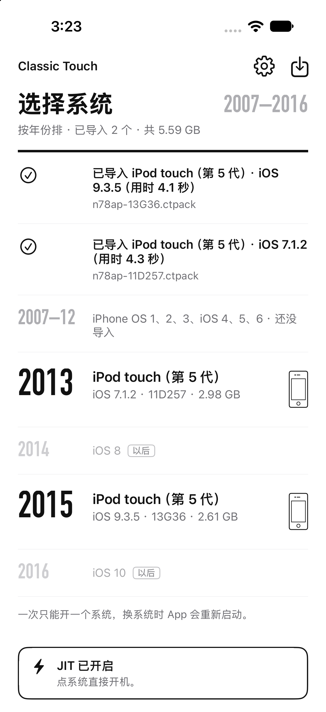
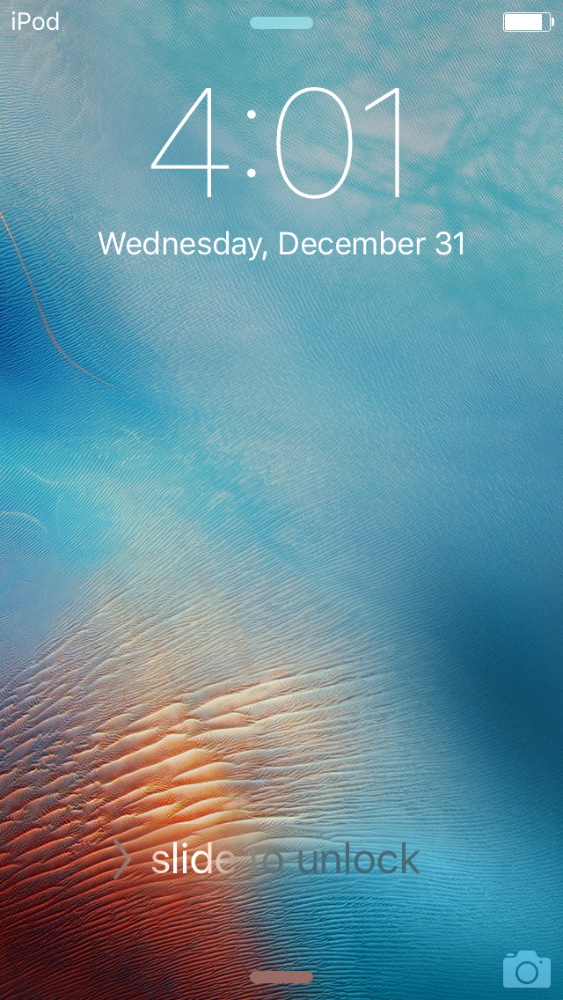
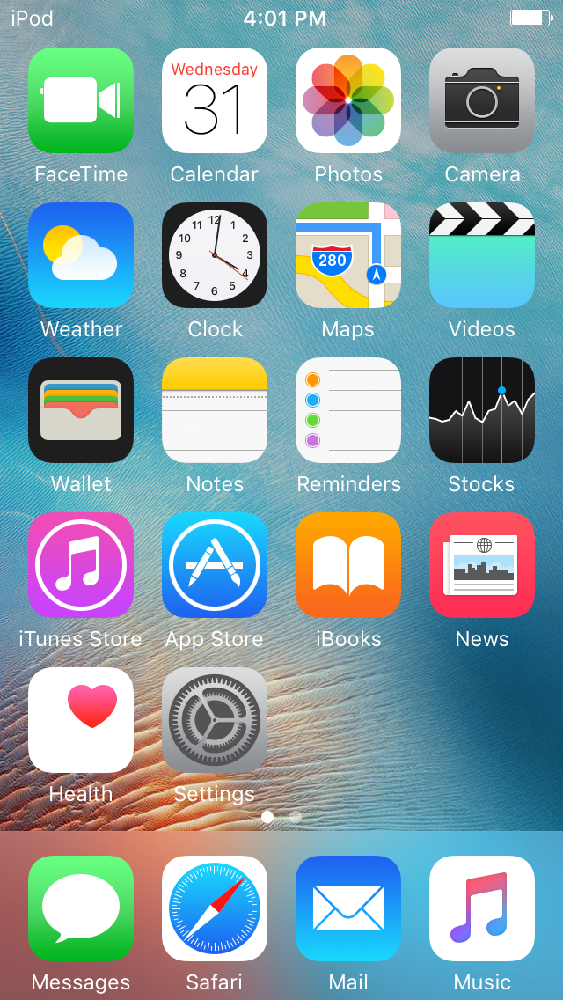
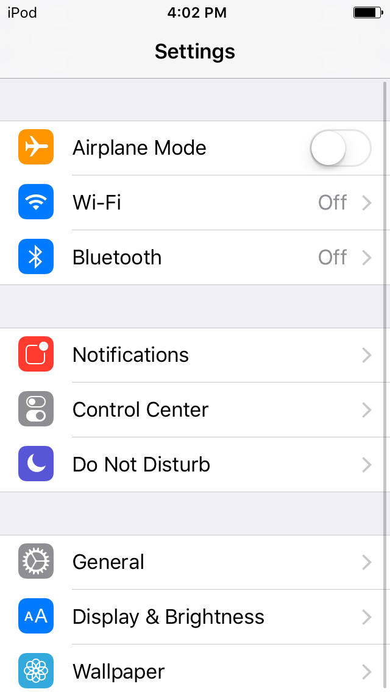
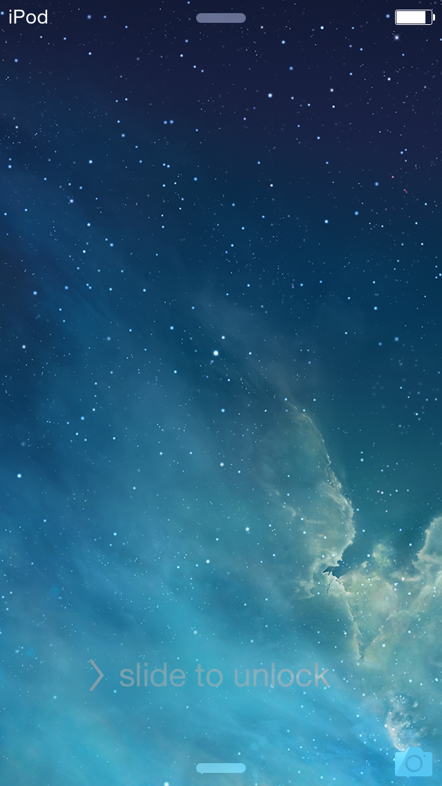
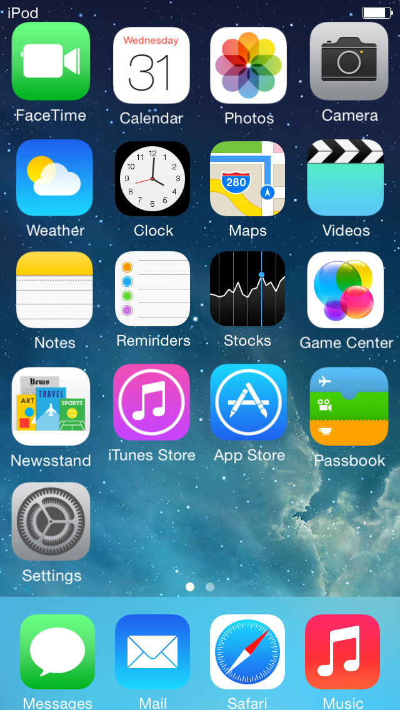
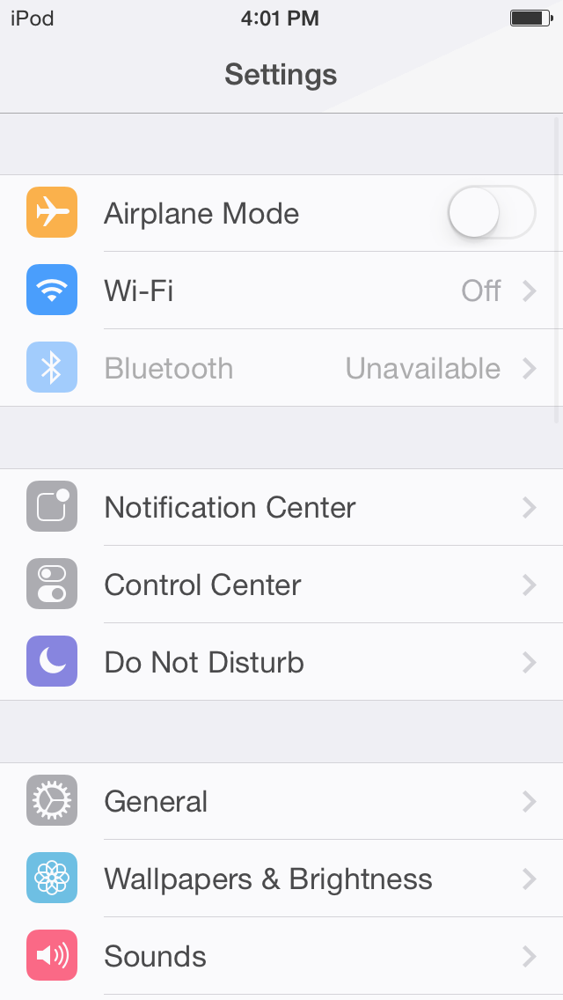
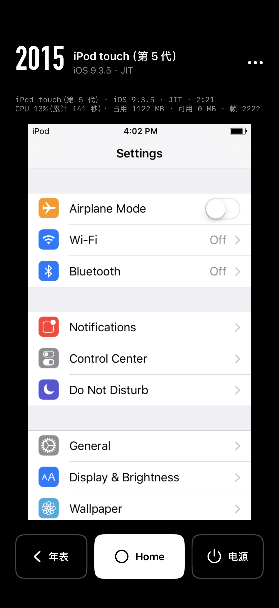

# A5 (iPod touch 5, n78) in the iPhone app

- Date: 2026-11-04
- Execution session: a5-nand (continuing from `docs/reports/a5-step1.md` section 3.17). Scope: stack the a5-n78 patch on the qemu-ios used for the iOS cross build and build the iOS Simulator version; add the n78 boot strategy to the app; make n78 `.ctpack` files; in the app in the iOS Simulator, boot 9.3.5 and 7.1.2 to the lock screen (ideally to the home screen and Settings).
- Not done: no real phone touched, no device symbols downloaded, no signing, no Apple ID used; no commit, no push.

## 0. Conclusions

1. **The iPod touch 5's 9.3.5 and 7.1.2 both boot to the lock screen and the home screen in the app in the iOS Simulator, and open Settings.** The simulator is an iPhone 18 Pro (iOS 27.2); the app uses JIT with a 256 MB code buffer, and the devices are imported from `.ctpack` files; all taps are done by the app itself (`control/unlock`, `control/tap`), not with the simulator's tap tool. **[verified: the run directories and screenshots in section 6]**

   | System | Lock screen | Home screen | Settings | Idle home screen CPU | Max footprint |
   |---|---:|---:|---:|---:|---:|
   | iOS 9.3.5 (13G36) | 66 to 104 s (four runs) | 84 s (`sim-boot.sh`) | 138 s | 96% (one core) | 1132 MB |
   | iOS 7.1.2 (11D257) | 37 s (two runs) | 45, 46 s | 65 s | 43% | 1029 MB |

2. **What wiring it into the app took:** the a5-n78 patch stacks on top of the four iOS patches without conflicts; the new patch `a5-n78-ios-ui.patch` makes the app's buttons and screen-off detection recognize n78; `build-qemu.sh` applies both patches along with the others; the app gains the `n78` boot strategy (USB root disk plus the IOP NAND directory), and the iPod touch 5 can be picked in both the 2013 and the 2015 rows of the Timeline.
3. **Two `.ctpack` files:** 9.3.5 2.6 GB, 7.1.2 2.9 GB; the app imports each in about 4 seconds. Only 8 MB of the NAND actually holds data, and that is all it takes in the pack, so no shrinking is needed; almost all of the size is the system volume.
4. **Downloads:** only the 8 approved dependency source tarballs (67 MB, all sha256 matched); pip installed only qemu.qmp and setuptools, and the logs show no downloads from the network.
5. **Problems:**
   - **Touch about 100 pixels too high vertically** (the old problem from section 3.16) is in the app too: the app's own "open Settings" test (`-opensettings`) missed because of it. Trying to fix it by changing the machine's `frame_y0` made touch stop working entirely, for reasons not found; reverted (section 2.1).
   - **The home screen occasionally shows "Trust This Computer?"** (modal, blocks taps); because of the offset above, a user tapping the middle of a button lands above it and has to tap lower.
   - The 9.3.5 idle home screen uses a full core; 7.1.2 less than half.
   - While making the 9.3.5 base image on the Mac, there was one kernel panic "compressed PTE … corrupted?"; redoing it worked, and the cause was not investigated (section 3).
6. **What is still missing for a real phone** is in section 7; a few things need the user's decision: which phone, which Apple ID to sign with, whether to download device symbols.

## 1. Stacking the patches

**This Mac has no iOS cross-build setup.** All of `work/ios/` is gone: the dependency source tarballs, `sysroot-iphonesimulator-arm64`, the qemu-ios working tree for iOS, the app's DerivedData, and the M1/M2 devices and packs are all missing; under `work/` only A5, the Mac build and the firmware remain. The iOS Simulator runtime (iOS 27.2) and three iPhone 18 Pro simulators are still there, and so are `meson`, `ninja` and `xcodegen`. **[verified: `ls work/`, `xcrun simctl list`]**

**iOS working tree:** `git clone --shared` from the local `upstream/qemu-ios` (b225694505, the same commit as the A5 working tree) to `work/ios/qemu-ios`, without network access.

**Conflict check:**

- `ios-gles-perf.patch` fails when checked on its own because it depends on `ios-eagl-es2.patch` (both change `hw/arm/gles-host.c`); applied one after another in `build-qemu.sh`'s order (file name order), all four apply. **[verified]**
- The a5-n78 patch (11 files, including the 9.x additions to the GL front end from section 3.17) applies directly on top of the four iOS patches. The only file both sides change is `hw/arm/s5l8930_display.c` (iOS gles-perf changes the read-back timing, A5 adds the H4P pipeline), and the changes do not overlap. **[verified: `git apply` without conflicts]**
- One semantic addition was needed: the app bridge (`contrib/ios-app/qemu-ios-ui.c`) does not send buttons through the QEMU keyboard but calls each machine's `*_press_button()` in turn, and n78 had only the keyboard wired up (H, L and so on). Added:
  - `hw/arm/ipod_touch_5g.c` gains `ipod_touch_5g_press_button()` (Home, power, volume up and down → GPIO 0 to 3, active low), declared in `include/hw/arm/ipod_touch_buttons.h`. It is in the a5-n78 patch, and the Mac A5 build compiles. **[verified]**
  - New patch `patches/a5-n78-ios-ui.patch` (only changes `qemu-ios-ui.c`): `ios_press` calls it; n78's panel is powered over MIPI-DSI, so it is added to the `ios_dsi_panel` check (only then does `display_sleeping` recognize screen-off); the machine table gains a row `iPod-Touch-5G n78ap 640×1136`.
  - Touch needs no change: the app bridge uses the old-style absolute pointer (`qemu_input_queue_abs` plus the left button), which is exactly the path n78's `n78_mouse_event` handles (qinput over QMP on the Mac uses it too).
- The patch list in `scripts/ios/build-qemu.sh` changed from `patches/ios-*.patch` to "`ios-*.patch` plus `a5-n78-skeleton.patch` plus `a5-n78-ios-ui.patch`", applied in that order; the logic that decides "already applied, pristine, or neither" is unchanged. Following its logic, the full patch set was applied to pristine upstream in a temporary directory and compared file by file with the working tree: all 21 files are identical. **[verified]**

## 2. Adding n78 to the app

- **`DeviceProfile.swift`:** the machine table gains `n78ap` (`iPod-Touch-5G`, 640×1136, no baseband; the USB host port carries the root disk, not usb-kbd, so `hasUSBHost` is false), list name "iPod touch (5th generation)". New boot strategy `n78` (`boot_strategy` in the lock file):
  - Base image: `device.lock.json`, `kboot.bin`, `disk.img` (two-partition USB disk), `nand/` (`ce0.pages`, `ce0.boot`);
  - On first launch, `disk.img` and `nand/` are each cloned into `state/` (first under a temporary name, then renamed; on APFS this is a clone and sparse files are not expanded), after which QEMU writes to them in place;
  - Arguments follow `tools/a5/n78_run.sh`: `-M iPod-Touch-5G,kboot=<base>/kboot.bin`, `-drive if=none,id=root,file=<state>/disk.img,format=raw -device usb-storage,bus=ehci.0,drive=root`, `-global driver=s5l8940.iop,property=nand,value=<state>/nand`; no `-netdev` (n78 has no network card), and memory is the machine's default 512 MB.
- **`Theme.swift`:** the Timeline's runnable versions change from `1...7` to `[1…7, 9]` (iOS 9 is listed under 2015), and n78's device outline uses `.flat` (straight edges, front camera). The n78 7.1.2 shares the 2013 row with the iPhone 4's 7.1.2.
- **Buttons:** the app's Home, power and volume buttons go `qemu_ios_ui_button` → `ios_press` → `ipod_touch_5g_press_button` (section 1).

### 2.1 Vertical touch offset: tried, not fixed

The problem left over from section 3.16 is that taps land about 100 pixels above the aimed point, and the same happens when a user taps the screen in the app, so I tried to fix it in the machine.

- Known points: aiming at 785 landed at about 685 (the "Don't Trust" button, 645 to 725), aiming at 930 landed at about 830 (the Settings icon, 770 to 880), and in t2 aiming at 810 dismissed the same button and aiming at 1080 opened Mail in the Dock (the icon starts at about 975). All consistent with "everything about 100 pixels too high", and the scale derived from the current parameters (0.1304 pixels per sensor unit) also matches 1136/8709, so only the origin was changed: `frame_y0` moved from -254 to -1021. **[inferred]**
- Result: in two boots, t1 and t3 (`work/a5/runs/s317/t1`, `t3`), touch did not work at all; even a horizontal swipe across the middle of the screen did not unlock; a clone of the same disk with -254 (t2) could be tapped as usual. In the multi-touch model `frame_y0` is only used to compute each contact's coordinates (`ipod_touch_multitouch.c` line 905), and the swipe in the middle converts to normal positive values, so why touch fails entirely was not found. **[verified: the behavior; cause unknown]**
- What was done: the parameter was restored to -254, and the app keeps this offset for now; when tapping in the simulator, aim about 100 pixels lower, as on the Mac. A real fix needs a look at the guest's touch conversion (the sensor area parameters in mtprops); left for later.

## 3. The n78 `.ctpack`

**Device directory** (`work/ios/devices/<id>/`, cloned with `cp -c` before packing): `device.lock.json` (`board n78ap`, `boot_strategy n78`, version and build number, `machine` empty), `kboot.bin` (`work/a5/kboot/n78-<build>-fmi.bin`, with the scalers hidden by default), `disk.img`, `nand/`. The disk and NAND are both in the state "format boot done, `n78_diskfix.sh` run, then booted once more to the lock screen", so the user's first boot does not have to wait for 9.3.5's roughly 100 seconds of data migration.

- 7.1.2: `n78ap-11D257`; disk and NAND taken from the 7.1.2 regression copy in a5-step1 3.17.4 (`nandfmt/disk-712-r.img`, `nand-712-r`).
- 9.3.5: `n78ap-13G36`; a clone of `nandfmt/disk-935-formatted.img` with diskfix run on it, booted once (`work/a5/runs/app/gold935b`: 150 seconds of migration, a Home press at 263 seconds shows the lock screen, no panic); disk `disk-935-gold2.img`, NAND `nand-935-gold2`.

**Size: the NAND needs no shrinking.** The two NAND files are 4.4 GB nominal and take 2.3 GB on disk, but only 8 MB is non-zero data (`ce0.pages` 7 MB, `ce0.boot` 1 MB); the rest is all-zero blocks that were written out: the page store keeps bits inverted, so the erased state (0xff) is written as 0. `pack-device.py` already skips all-zero 64 KiB blocks, and the app writes only the extents with data when unpacking, so the NAND is only about 8 MB both in the pack and on the phone. The 1.3 GB wasted by boot pages mentioned in 3.13.6 item 2 is only the all-zero blocks allocated in this copy of the file on the Mac; it does not affect the pack or the phone. **[verified: counted on `nand-935-formatted` with `pack-device.py`'s `extents()`]** The issue that boot page numbers carry the SLC bit and land 0.8 GB or more into the file remains; changing it requires reformatting, and it was not touched this time.

| Pack | Data | Pack size | Packing time |
|---|---:|---:|---:|
| `work/ios/packs/n78ap-11D257.ctpack` | 2785 MB | 2.9 GB | 2.5 s |
| `work/ios/packs/n78ap-13G36.ctpack` | 2449 MB | 2.6 GB | 2.8 s |

The disk takes almost all of it: the system volume is the IPSW's rootfs unchanged (7.1.2 about 1.8 GB, 9.3.5 about 2 GB), plus the data volume.

**The first attempt at the 9.3.5 base image failed (`work/a5/runs/app/gold935`):** on the first boot of the formatted disk after diskfix, a data migration progress bar at 150 seconds, a gray Apple logo at 200 seconds, then at about 220 seconds a kernel panic: `compressed PTE 0xc0c53ecc 0xfff8f8f8 has extra bits 0xfff8f878: corrupted?`. The memory compressor found a page table entry written as 0xfff8f8f8, which byte by byte is a near-white BGRA pixel, as if the host had written image data into guest memory that was reclaimed and reused as a page table (the GL read-back or IOSurface write-back used a stale address). Never seen in the dozen or so boots before. **[verified: the behavior, `gold935/serial.log` line 658; the cause is inferred]** Redone with a new clone.

## 4. Building the app (simulator version)

- Built once first, before the dylib existed: all 64 Swift compile steps passed, with no errors or warnings; only the final `embed-qemu.sh` reported "no qemu-ios dylib has been built".
- After the dylib was built: `xcodebuild -project app/ClassicTouch.xcodeproj -scheme ClassicTouch -sdk iphonesimulator -configuration Debug -derivedDataPath work/ios/DerivedData-a5 -destination id=<simulator> build`, "Embedded 1 qemu-ios dylib(s) (iphonesimulator)", BUILD SUCCEEDED. **[verified: `work/ios/xcodebuild-a5.log`]** Only the JIT dylib was built; the interpreter version is not used in the simulator and was not built.
- The test entry point gained a control command `tap` (`EmulatorViewController.pollControl`): write "x,y" to `Documents/control/tap` (normalized guest screen coordinates, origin at top left), and the app presses there for 0.3 seconds. The new script `scripts/ios/sim-settings.sh` uses it in the simulator to unlock, dismiss the pairing prompt and open Settings.

## 5. iOS Simulator version: dependencies and QEMU

- **Downloads:** `scripts/ios/fetch-sources.sh` downloaded 8 tarballs from the official URLs in its table; every sha256 check passed, 67 MB in total (openssl alone is 52 MB, more than the 30 MB I estimated when asking). **[verified: `work/ios/src/`]**
- **Dependency sysroot:** `scripts/ios/build-deps.sh iphonesimulator` built 7 static libraries in 59 seconds (libffi, pcre2, proxy-libintl, glib, pixman, slirp, openssl, nettle), installed into `work/ios/sysroot-iphonesimulator-arm64`, `minos 16.0`, `platform IOSSIMULATOR`. **[verified: `work/ios/build-deps-sim.log`]**
- **meson subprojects:** the iOS working tree comes from `git clone --shared` and has no subproject sources; following the note at the top of `build-qemu.sh`, berkeley-softfloat-3, berkeley-testfloat-3, dtc and keycodemapdb were copied with `cp -c` from the local `upstream/qemu-ios/subprojects/`, so meson needs no network access.
- **Simulator:** created "ClassicTouch iPhone 18 Pro" (iPhone 18 Pro, iOS 27.2, the runtime was already on this Mac), UDID saved in `work/ios/sim-udid`. The OCR tool was rebuilt locally from `tools/m0/ocr.swift` to `work/tools/ocr/ocr` (`sim-boot.sh` needs it). The "slide to unlock" on the 9.3.5 lock screen has a shimmer, which OCR reads as "crae to unlotk", so `sim-boot.sh`'s lock screen check was loosened to also accept "to unl".

- **iOS QEMU:** `TCG=jit scripts/ios/build-qemu.sh iphonesimulator` built in 36 seconds (the working tree already had the full patch set, and the script judged it "already applied"); configure's mkvenv installed meson and pycotap from QEMU's bundled wheels, then qemu.qmp 0.0.5 and setuptools, with no Downloading in the log. `TCG=jit scripts/ios/make-dylib.sh iphonesimulator` produced `libqemu-arm-jit.dylib` (36 MB, exporting 58 `qemu_ios_*` symbols), which contains the `iPod-Touch-5G` machine. **[verified: `work/ios/build-qemu-sim-jit.log`, `make-dylib-sim-jit.log`]**

## 6. The app in the iOS Simulator

Simulator "ClassicTouch iPhone 18 Pro", with the app from section 4. Both packs were put in the app's `Documents/import/`, the app was opened without arguments, and the home page imported them: 9.3.5 unpacked in 4.1 seconds, 7.1.2 in 4.3 seconds; in the Timeline the 2013 row shows "iPod touch (5th generation) · iOS 7.1.2 · 11D257 · 2.98 GB", the 2015 row shows "iPod touch (5th generation) · iOS 9.3.5 · 13G36 · 2.61 GB", and 2014 (iOS 8) and 2016 (iOS 10) are marked "later" (`以后`). **[verified: `logs/import.log`, `img/a5-app-library.png`]**

GL: the app uses the EAGL backend, front-end handshake protocol 1, `host GL up: OpenGL ES 3.0 APPLE-24.0.2 / Apple Software Renderer` (the simulator's GLES is a software renderer, slower than a real phone's GPU).

Each run (run directories were copied to `work/ios/runs/<name>/`, with `events.log`, `stats.csv`, and guest and window screenshots; times are counted from when the app calls `qemu_ios_main`):

| Run | System | How | Lock screen | Home screen | Settings | Notes |
|---|---|---|---:|---:|---:|---|
| `20261104-032344-n78ap-13G36-jit` | 9.3.5 | `sim-boot.sh` | 73 | 84 | | Idle home screen 96% (16 seconds), footprint 1132 MB |
| `20261104-032558-n78ap-13G36-jit` | 9.3.5 | `-autodrive -opensettings` | 104.6 | 114.6 | Failed | The app recognized the "Settings" label and tapped above it three times; with the touch offset the taps landed between two rows of icons; timed out after 5 minutes |
| `20261104-033342-n78ap-13G36-jit` | 9.3.5 | `sim-settings.sh` first version | 85 | 94 | Failed | "Trust This Computer?" was up on the home screen and blocked the tap on Settings |
| `20261104-034101-n78ap-13G36-jit` | 9.3.5 | `sim-settings.sh` | 66 | 116 | 138 | Unlock took three tries (67, 87, 108 seconds); the pairing prompt was dismissed at 117 seconds, Settings tapped at 133 seconds |
| `20261104-033121-n78ap-11D257-jit` | 7.1.2 | `sim-boot.sh` | 37 | 45 | | Idle home screen 43% (16 seconds), max footprint 1029 MB |
| `20261104-034354-n78ap-11D257-jit` | 7.1.2 | `sim-settings.sh` | 37 | 46 | 65 | Opened with one tap |

The lock screen time is the second of the first guest frame in which OCR recognized "slide to unlock"; the 9.3.5 lock screen turns off about 20 seconds after it appears, and unlocking after screen-off needs a Home press first, so the gap between the home screen time and the lock screen time is not all boot time. The four 9.3.5 lock screen times range from 66 to 104 seconds, a wide spread, not looked into (the second run was autodrive, which recognizes the lock screen differently). **[verified: each run's `events.log`]**

| 9.3.5 lock screen | 9.3.5 home screen | 9.3.5 Settings |
|---|---|---|
|  |  |  |

| 7.1.2 lock screen | 7.1.2 home screen | 7.1.2 Settings |
|---|---|---|
|  |  |  |

The app's running screen ("Timeline" look, with "2015 · iPod touch (5th generation) · iOS 9.3.5 · JIT" at the top):

Finally: the app was terminated, the simulator was shut down, and no QEMU process was left on the Mac.

## 7. What is still missing for a real phone

**For the user to decide:**

1. **Which phone.**
   - iPhone 18 Pro (iOS 27.2): M1 and M2 already booted iOS 3, 6 and 7 on it with StikDebug's JIT; StikDebug, the pairing file and app signing are all in place. **[verified: M1 and M2 reports]**
   - iPhone 14 Pro (iOS 27.0.1, the test phone the user named): there is no report yet of StikDebug successfully granting JIT on iOS 27.0.1; the first Xcode connection downloads about 6 to 7 GB of device symbols (needs approval); StikDebug and the app both need reinstalling and the pairing file regenerating. Without JIT only the interpreter is left; iOS 7 is already barely usable under the interpreter (M1 step 4) and 9.3.5 is heavier, so JIT is a prerequisite. **[inferred]**
2. **The Apple ID for signing** (currently the paid personal team; the team ID stays out of the repository).

**What we need to do (about half an hour, not counting waiting for the user):**

1. Device dependencies and QEMU: `scripts/ios/build-deps.sh iphoneos`, and run `build-qemu.sh iphoneos` and `make-dylib.sh iphoneos` once each with `TCG=jit` and with `TCG=interp` (the source tarballs are already downloaded; nothing more to download).
2. Device app: build Debug-iphoneos at the default `APP` path of `device-install.sh`, signed with the team decided above.
3. Copy the packs: `scripts/ios/device-install.sh work/ios/packs/n78ap-13G36.ctpack work/ios/packs/n78ap-11D257.ctpack` (transferred over USB AFC into the app's `Documents/import/`; the app imports them itself, then each one is booted once with StikDebug for timing). The two packs are 5.5 GB; at the roughly 34 MB/s AFC measured in M2, the transfer takes about 3 minutes; Finder file sharing or the Files app also works. **[inferred: speed extrapolated from M2's 473 MB in 14 seconds]**
4. Phone storage: packs 5.5 GB, unpacked 2.4 GB plus 2.8 GB, and each pack is deleted once unpacked; `device-install.sh` requires free space of at least the total pack size plus 2 GB. After that, every block the guest writes makes the clone in `state/` take one more block.
5. Memory: in the simulator, 9.3.5's maximum footprint is 1132 MB (guest 512 MB, code buffer 256 MB, GL and so on); the iPhone 14 Pro and 18 Pro both have 6 GB or more, and an app's limit is usually around 3 GB, so it should be enough. **[inferred]**

**Best fixed before the user tries it:** the vertical touch offset (otherwise every button has to be tapped low); the occasional pairing prompt on the home screen (consider preinstalling a pairing record or using a configuration profile to forbid pairing); the 9.3.5 idle home screen using a full core (drains the battery and heats the phone on a real device).

