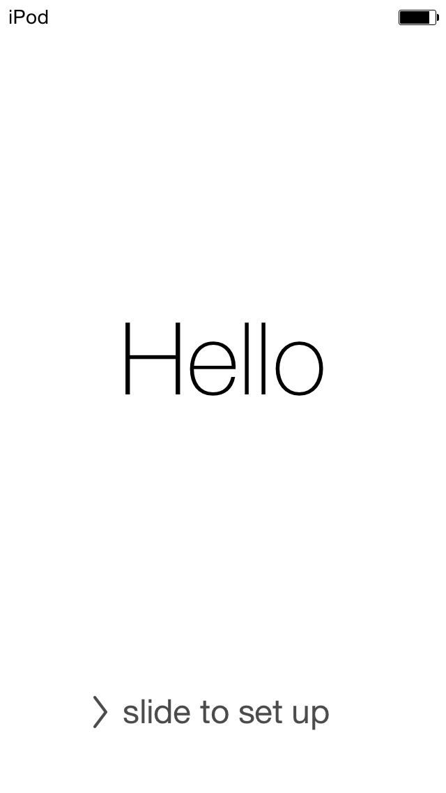
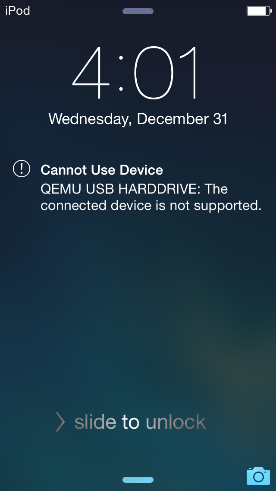
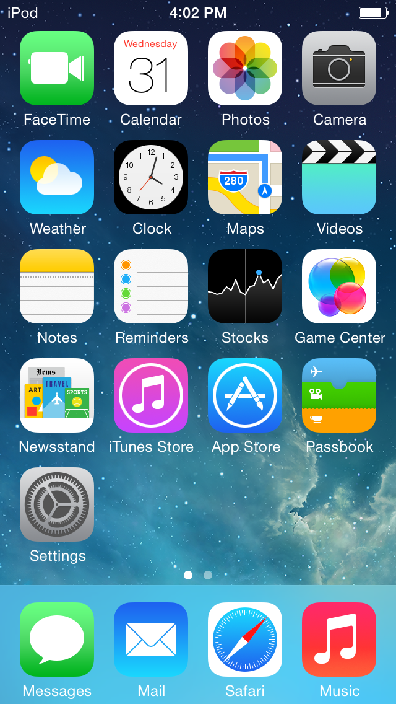
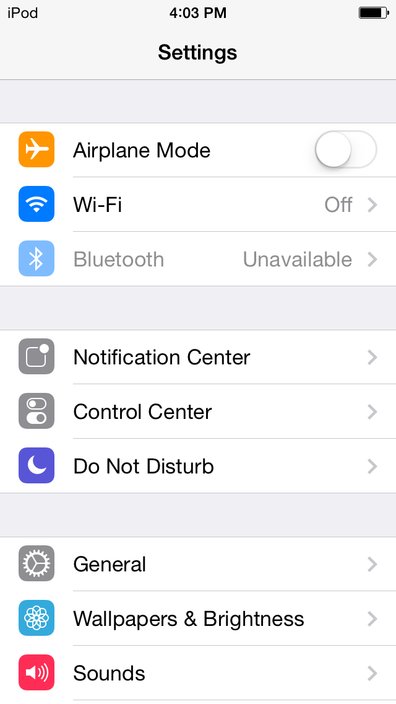
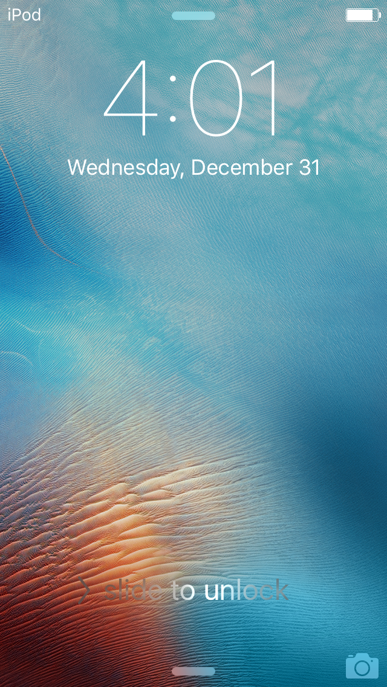
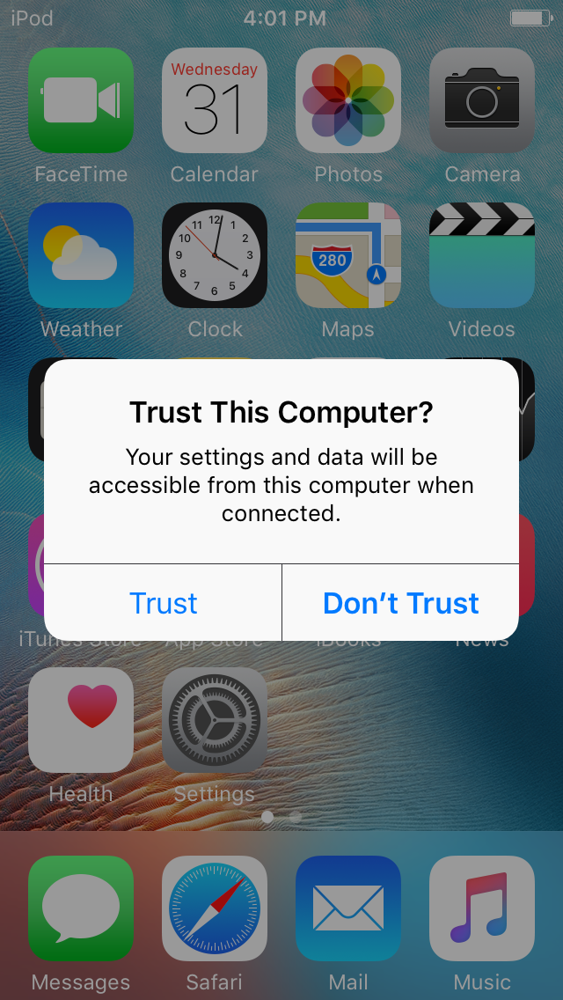
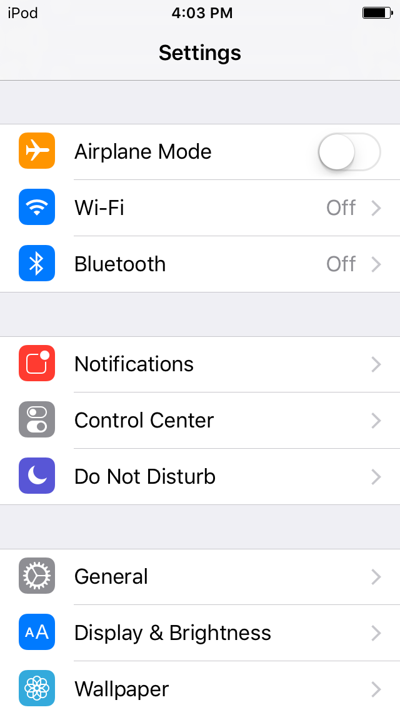

# iOS 8 to 10, step 1: iPod touch 5 (n78) machine skeleton

- Date: 2026-11-03
- What was done: on the Mac, added the A5 machine `iPod-Touch-5G` and an AIC interrupt controller model to qemu-ios, and booted straight into the kernel with a KBoot bundle. The goal was for the kernel to print on uart1 and stop at Waiting for root device. No real device was touched; nothing was committed or pushed.
- Outputs: `patches/a5-n78-skeleton.patch` (against qemu-ios b225694505; as of section 3.16, 9 files, +2547/-61 lines, including changes to upstream `s5l8930_cdma.c` and `s5l8930_display.c`), the scripts under `tools/a5/`, and `README.md` (reproduction steps). Large files are all in `work/a5/` and stay out of the repository.
- Tags: **[verified]** means seen directly in this round's run logs or binaries; **[inferred]** means my inference.

---

## 0. Summary of conclusions

> **Latest (section 3.17, handoff):** the 9.3.5 NAND layer works unchanged on the same IOP model; formatting and FTL open both succeed. The two-partition disk, the dyld override, the launchd daemon list and the GL front end are not done yet.
>
> **Section 3.16:** with touch (the Zephyr2 sensor on spi1) and GPIO buttons wired up, and input injected by script over QMP, 7.1.2 went from the lock screen via slide to unlock to the home screen, opened Settings, and returned to the home screen on Home.
>
> **Section 3.15:** 7.1.2 boots straight to the lock screen. Four things were done: patched lockdownd for local activation; added the step markers for the extra Setup Assistant steps the iPod touch 5 has over the iPhone 4 (Siri and others); moved away the two compass HID plug-ins that often crashed backboardd; and wired up the guest package service on n78, which made the GL protocol warning go away.
>
> **Section 3.14:** with the GL bridge wired up, 7.1.2 draws its UI: at 120 seconds an Apple logo drawn by the UI, at 180 seconds Setup Assistant's "Hello / slide to set up". The process that kept crashing was backboardd (the first crash was a SIGILL from an unhandled GL trap, the rest were in CompassPlugIn; the latter still happen intermittently after GL was wired up).
>
> **Section 3.13:** built the NAND layer (high-level IOP emulation plus a PPN page store). After one format boot, effaceable storage and NVRAM both come up on a normal boot, and the keybag is passed.
>
> **Section 3.12:** the full 7.1.2 system booted from a USB disk (two partitions, system and data). launchd started more than fifty daemons, then keybagd reported `FATAL KEYBAG ERROR: kb_load` and asked to enter recovery mode. The blocker is the effaceable storage the keybag needs (on the A5 it lives in NAND). USB is in section 3.11, display in section 3.10, launchd in section 3.9. Items 1 to 4 below describe round 1.

1. **Both kernels speak in the emulator.** 7.1.2 (xnu-2423.10.71) and 9.3.5 (xnu-3248.61.1, RELEASE_ARM_S5L8942X) both print a full boot log on uart1: the corecrypto self-test passes, AMFI accepts the boot arguments that relax signing, and `AppleS5L8940XIO`, the backlight, AppleKeyStore, the GPIO interrupt controller and the performance controller start in turn. **[verified]**
2. **The kernel recognizes our AIC.** The log shows `AppleInterruptController::start: _aicVersion = 0 ... _aicNumExtInts = 0x000000c0 _aicNumIPIs = 0x00000002`. **[verified]**
3. **Both versions now stop at the same place:** after the performance controller starts, panic `handleSwapCleanup - can't free 1 channels of dimension 0` (7.1.2 caller 0x8041648f, 9.3.5 caller 0x80376575). The cause is that the A5's PMGR slot temporarily holds the A4 PMGR model. **The next step is to write the s5l8940x PMGR model.** **[Stop point verified; the cause is inferred, but in both versions it comes right after `AppleS5L8940XPerformanceController::start`]**
4. **Not reached yet:** Waiting for root device, mounting root from a USB disk. Step 1 is about half done.

## 1. What was added

### 1.1 QEMU machine `iPod-Touch-5G` (`hw/arm/ipod_touch_5g.c`)

- Single-core Cortex-A9, 512 MiB of RAM at 0x80000000, PA 0 aliased to the first page of RAM (copied from the A4; not verified whether the A5 needs it).
- The whole arm-io window 0x30000000 to 0x40000000 is backed by a catch-all unimplemented device; accesses are logged under `-d unimp`.
- uart1 at 0x32600000 (the A4 uart offset plus the A5 window base), connected to serial0; its AIC interrupt line is not wired yet, so the console polls.
- AIC at 0x3F200000; the PMGR slot at 0x3F100000 temporarily holds the A4 `s5l8930.pmgr`.
- The boot bundle format is the same as the A4 (K48KBOOT trailer); the loader code is copied from `ipad1_cpu_reset`.

### 1.2 AIC (`hw/arm/s5l8940_aic.c`)

The register table comes from xnu-4570.1.46 `pexpert/pexpert/arm/AIC.h` (the first open-source xnu with 32-bit ARM). Timer usage follows the T8002 code in the same version: write a countdown to `kAICTmrCnt`; when it counts down to 0 it raises an **FIQ**, and the FIQ handler writes `kAICTmrIntStat` to clear it. Peripheral interrupts go via IRQ: reading `kAICIack` acknowledges, and the line is automatically masked until the driver writes `kAICIntMaskClr`.

- 192 external interrupts: the 9.3.5 AppleInterruptController checks the length of the device tree `ipid-mask` (24 bytes, exactly 6 words of 32 bits) against the count AicCap0 reports; reporting 256 panics with `ipid-mask property length is 24 but should be 32`. The 0xc0 to 0xc3 used by the CPU nodes in the device tree sit right after 192; those are the IPI numbers. **[verified]**
- The auto-masking and the set/clear encoding of IPIs are inferred and not yet checked against the 9.3.5 AppleInterruptController. Whether the timer actually runs was not specifically verified this time either.

## 2. Three things the boot bundle must do beyond the A4 (`tools/a5/n78_kboot.py`)

1. **RAM base 0x80000000, V=P**: both the 7.x and 9.x kernels are linked at 0x80001000. **[verified]**
2. **Clear the top bit of property lengths**: Apple device trees use bit 31 of the length field to mark "to be filled in by iBoot from syscfg", and iBoot clears it after filling. The parser masks this bit when reading; the kernel does not. 9.3.5's `/chosen` has two such properties (`marketing-hardware-behavior`, `marketing-software-behavior`). When the kernel walks the properties it counts this bit as part of the length, jumps 2 GiB past the device tree, and takes a data abort on the first instruction (PC 0x8038783c, DFAR 0x0124dbbc). 7.1.2 has no such properties. **[verified]**
3. **Fill `/chosen/random-seed` with 64 bytes**: iBoot fills in random data; in the IPSW it is all zeros. 9.3.5 panics on all zeros with `EntropyData needed 64 bytes, but got 0`. It is now derived from the machine's ECID, so runs are reproducible. **[verified]**

The rest follows the A4: `platform-name` becomes `s5l8942x`, `chip-id` becomes 0x8942; the `compatible` of cpu1, IOP, the flash controller, AE2, SGX, ISP and VXD becomes `none`; the AIC's `#main-cpus` becomes 1, and `cpus=1` is added to the boot arguments.

## 3. Next steps

1. **s5l8940x PMGR model.** First remove the A4 PMGR model so `-d unimp` shows which registers the performance controller actually reads and writes, then fill in the model against the kernel's `AppleS5L8940XPerformanceController` code. The pmgr `reg` in the device tree has 7 ranges (0xF100000, length 0x7000, plus 6 more between 0x8C00000 and 0xA600000).
2. **GPIO:** 7.1.2 makes unimplemented accesses around 0xFA00000. The A5 GPIO is still claimed by `AppleS5L8930XGPIOIC`, so the A4 GPIO model at a new base address should work.
3. **Wire up the uart1 interrupt (device tree `interrupts` 0x16),** then continue toward Waiting for root device, then try mounting root from USB mass storage.

## 3.5 Round 2 (same day): past the performance controller, stopped at the PMU on i2c0

**Conclusion:** both versions got past the `handleSwapCleanup` panic, and the SPI, I2C, PWM, MIPI-DSI, I2S, PL310, serial, watchdog, DWI and other drivers came up. They now stop at i2c0 reading the PMU (address 0xE8, D1881): 7.1.2 panics with `i2c0::_checkBusStatus SDA is stuck low ... for device pmu`, 9.3.5 panics with `i2c0::_checkBusStatus Bus is still in a bad state ... for device pmu`. **[verified]**

The earlier stop point had two causes, neither in the PMGR registers:

1. **The CPU performance state table is empty.** With the A4 PMGR model removed the panic is unchanged, so it is not a register problem. The panic comes from the open-source xnu `IOReporter::handleSwapCleanup`: allocating an array for an IOStateReporter whose "dimension" is 0. The performance controller counts performance states from `voltage-states1` (24 bytes) and `cpu-clk-cfgs` (12 bytes) in the device tree's `arm-io/pmgr`. Both properties are 0 in the IPSW and are filled in by iBoot's `pmgr_update_device_tree` (n78 iBoot-1940, 0x9ff1f82c). The rule from the disassembly: 3 states, each state's clock source and divider taken from two iBoot tables (0x9ff41b0c `[1,2,1]`, 0x9ff41b18 `[2,1,1]`); `voltage-states1[i]` = {CPU clock period (ns, 16.16 fixed point) = divider × 1e9 × 65536 ÷ clock source Hz, 0}; `cpu-clk-cfgs[i]` = the value of PMGR+0x38, with the clock source in bits 28 and 29 and the divider in the low 5 bits. Checked against an ioreg dump from an iPad 2 (1 GHz A5): periods 2.0, 1.25, 1.0 ns, a match. N78's `nominal-performance1` is 1.25 ns (800 MHz), so clock source 1 is taken as 800 MHz; 600 MHz for clock source 2 is inferred. With these filled in, 7.1.2 reads the three states as `*0.800`, `*0.600`, `*0.400`. The `/cpus/cpu0` frequencies were also changed to A5 values (CPU 800 MHz, bus 250 MHz, memory 400 MHz, peripheral 102.6 MHz, timebase 24 MHz). **[Rule verified; the clock source 2 frequency is inferred]**
2. **AIC IPIs must be acknowledged by reading Iack.** After the performance controller starts, the kernel sends itself an IPI (writes 0x2008 = 0x80000000), then reads Iack repeatedly in the IRQ handler, reading only WhoAmI in between and never writing IPIClr. The model used to leave the IPI pending, so the kernel looped forever in the interrupt handler. Changed so that reading an IPI from Iack also clears it. The `AIC_TRACE=1` environment variable turns on a per-access AIC log. **[verified]**

Also: up to this point the kernel only reads the PMGR and never writes it (0x38 to 0x104, 0x1010 to 0x115c, 0x220 to 0x254), and it keeps going when it reads 0. A real PMGR model can wait until the kernel starts switching performance states and writing to the PMGR.

**Next:** the A5 I2C controller (`i2c,s5l8940x`, AppleS5L8940XI2CController) and the PMU on i2c0 (Dialog D1881). The A4 `s5l8930_i2c.c` and PMU model can serve as references, but the A5 uses a different controller, so the registers must be re-verified against the kernel.

## 3.6 Round 3 (same day): I2C, PMU, PMGR gating; 9.3.5 reaches bsd_init

**Conclusion:** I2C and the PMU work, and PMGR clock gating is filled in. 9.3.5 reaches BSD network initialization (`L2TP domain init`, `PPTP domain init`), 7.1.2 reaches the LCD panel driver. Neither version panics now; both stop with some unmodeled device waiting for an interrupt in `start()`. **[verified]**

Added (the patch is now 6 files, +1253 lines):

1. **`hw/arm/s5l8940_i2c.c`: the A5 I2C controller.** Not the Samsung-style controller of the A4, but the PA Semi SMBus block that the Linux `i2c-pasemi` driver handles. The encoding comes from disassembling the 7.1.2 driver (init 0x80976c40, transfer 0x80976e80, receive 0x809776f8, `_checkBusStatus` 0x80977034); status bit names come from Linux `i2c-pasemi-core.c`: 0x00 transmit FIFO (0x100 start, 0x200 stop, 0x400 read; for reads the low 8 bits are the byte count), 0x04 receive FIFO (0x100 means empty), 0x14 SMSTA (bit 28 XIP, bit 27 XEN, bit 21 MTN, write 1 to clear), 0x18 interrupt mask, 0x1c control (low 8 bits are the divider). In interrupt mode the A5 driver first writes 0x2c = 0x100, then sets the mask to 0x00b00040 (MTO, MTN, bit 20, TOM), which does not include XEN. So bit 20 is treated as an Apple-added "transfer complete" interrupt and is set together with XEN (inferred). `I2C_TRACE=1` turns on a per-access log. **[Encoding verified; the meaning of bit 20 is inferred]**
2. **GPIO:** "SDA is stuck low" is not reported by the controller. Before each transfer the driver reads the pin levels from GPIO through `function-iic_sda/scl`; with no GPIO model it read 0 and concluded the bus was stuck. The A5 kernel still has `AppleS5L8930XGPIOIC` claim the GPIO, so the A4 model is reused directly (28 ports, 8 interrupt groups, AIC 0x77), with the idle level of the four i2c0 and i2c2 pins (0x0604, 0x0605, 0x1800, 0x1801) set high. **[verified]**
3. **D1881 PMU:** for now a 256-byte register file at 0x74 on i2c0. `AppleD1881PMU` has already made more than a hundred reads and writes: masking interrupts 0x0e to 0x14, reading events 0x08 to 0x0d, and around 0x55, 0x61, 0x8a and 0xa0. 9.3.5 also printed `AppleD1881PMUPowerSource: Setting battery threshold ... 4000 mV`. Reading all zeros gets through for now; battery, buttons and RTC need more work later. **[verified]**
4. **`hw/arm/s5l8940_pmgr.c`:** after I2C was added, it got truly stuck on the PMGR for the first time: `_enableDevicePowerGated: Power gate 0x6c enabled before clock was enabled`. The clock gates are at 0x1010 + 4n (on this chip they run up to 0x117c), with the same convention as the A4: bits 0 to 3 request, bits 4 to 7 report the actual state. The model makes the actual state follow the request immediately; bit 30 of the clock config (switch in progress) is cleared right after a write; other registers are stored and read back as is. **[verified]**
5. ~~Also hid jpeg, scaler and vxe in the device tree~~: later shown to be unnecessary and reverted; see section 3.7.

**Correction (section 3.7):** at the end of this round I thought both versions were stuck waiting for interrupts on DART, USB, CLCD and RGBOUT. That was wrong. They were already waiting for the root device; the regex I used to check (`[Ww]aiting (for|on) root`) just did not match the kernel's actual wording `Waiting on <dict ...>`. Those peripheral accesses were just background activity of other drivers while the kernel waited for the root device.

## 3.7 Step 1 goal reached: both versions wait for the root device

**Conclusion:** 7.1.2 and 9.3.5 both print `Waiting on <dict ID="0"><key>IOProviderClass</key><string ID="1">IOMedia</string><key>IOPropertyMatch</key><dict ID="2"><key>Partition ID</key><integer size="64" ID="3">0x1</integer></dict></dict>`, that is, partition 1 as asked for by the kboot `root-matching`. Drivers keep loading during the wait (`AppleFSCompressionTypeZlib`, `IOSurfaceRoot`). The last lines from 9.3.5 before waiting for the root device are `AppleD1881PMU::start: pmu ...`, `using DWI for BUCK changes`. **[verified, each version booted for 60 to 75 seconds]**

- After un-hiding jpeg, scaler and vxe and booting again, both versions still reach this point, so the hide list is back to what it was before section 3.6: cpu1, iop, flash-controller0, ae2, sgx, isp, vxd. **[verified]**
- `tools/a5/auto_hide.py` is a boot debugging loop: boot, and when the kernel stalls, hide the last device accessed and boot again, until it waits for the root device or panics. `n78_kboot.py` gained an `N78_HIDE` environment variable for temporarily hiding extra nodes.

**What remains of step 1:** give the kernel a root device. There are two routes:
1. **USB mass storage** (the step 0 plan): first build the EHCI host controller (under `usb-complex`), then attach QEMU's `usb-storage`. 9.3.5 switched its USB host stack to the new IOUSBHostFamily; the A4 EHCI model has only been verified on the old stack.
2. **Try a RAM disk first (faster):** `ipad1_kboot.build()` already supports `ramdisk=` (adds `rd=md0` and places the disk after the kernel). Using the firmware's restore RAM disk (RestoreRamdisk; ipsw.me has the keys) as root is the fastest way to see launchd and other user-space programs run on the A5. It fits in 512 MiB of RAM.

## 3.8 RAM disk as root: root is mounted, launchd not up yet

**Conclusion:** with the restore RAM disk (RestoreRamDisk, HFS+, about 20 MB for 9.3.5 and about 9 MB for 7.1.2) as md0, both versions print `BSD root: md0`; the root file system is mounted. The kernel then keeps loading drivers (`AppleFSCompressionTypeZlib`, L2TP/PPTP, display pipe, scaler, JPEG, LCD) and goes quiet: no panic, and not a single exception from EL0 in 60 seconds (counted with `-d int`), meaning `/sbin/launchd` has not started executing. **[verified]**

- `tools/a5/n78_unpack.py` now also extracts `RestoreRamDisk.dmg`; `n78_kboot.py` gained an `N78_RAMDISK=path` environment variable, passed to `ipad1_kboot.build(ramdisk=...)`, which adds `rd=md0` and clears root-matching.
- **The 9.3.5 timer fires only once:** the kernel sets `TmrCnt = 0x394f8` (about 9.8 ms), the first FIQ arrives on time, and the FIQ handler clears `TmrIntStat`, but `TmrCnt` is never written again, so the timer stops. After that the kernel repeatedly reads the main counter as "high, low, high" (0x28, 0x20, 0x28). 7.1.2 does not have this problem (117 FIQs in 60 seconds). Cause not found. **[Symptom verified]**
- **7.1.2's timer works, and it still does not start launchd:** so the blocker is not just the 9.3.5 timer; bsd_init is waiting on something before load_init_program. PC sampling only lands in scheduler functions (`thread_block_parameter`, `current_thread`), which does not show who is waiting on what.

**Next:** get the call stacks of all threads. The plan is to attach lldb to QEMU's gdb stub (`-s -S`), load the symbolicated kernelcache, take each thread's saved registers from xnu's thread list and backtrace them one by one; or find a way to trigger a panic so the kernel itself prints "Dumping thread state and stacks". Also need to come back to why the 9.3.5 FIQ handler does not rearm the timer.

## 3.9 launchd is up: both versions reach restored_external

**Conclusion:** 7.1.2 and 9.3.5 both executed `/sbin/launchd`, which started the restore environment's `restored_external`. This is the first time user-space programs ran on the emulated A5. Two blockers:

1. **(Both versions) bsd_init is waiting for the AES engine.** It needs CDMA (crypto DMA) and its AES filter. Reusing the upstream A4 `s5l8930_cdma.c` and wiring it to n78 made it work.
2. **(9.3.5) The timer fires only once.** The cause is in the AIC IPI semantics, not the timer itself: when reading Iack takes an IPI, it should only mask it, not clear it. With the AIC model changed, 9.3.5 gets 1388 timer FIQs in 60 seconds (previously just 1).

**[All of the above verified]**

| | Before (60 s) | CDMA only | Plus AIC change |
|---|---|---|---|
| 7.1.2 EL0 exceptions / FIQs | 0 / 117 | 7262 / not counted | 7681 / 2740 |
| 9.3.5 EL0 exceptions / FIQs | 0 / 1 | 10025 / 1 | 17454 / 1388 |

Both versions now reach the same place: `restored_external` reports `unable to find a usable display`, `unable to get framebuffer`, `enable_usb_connections failed`, then `restored exited normally with status 1 - rebooting`. It panics during the reboot: 7.1.2 with `IOUSBController::HandleHardwareException: Type: 0x00000004 could not halt controller in 100 ms`, 9.3.5 with the same wording from `AppleUSBHostController::hardwareException: ...`. In other words, the next batch to fill in is display, the USB host and device controllers, and NVRAM. 9.3.5 printed `Darwin Bootstrapper Version 3.4.0`, `Restore environment starting`; 7.1.2 printed `*** launchd[1] has started up. ***`, and before restored exited it was still waiting for `IONVRAM`. **[verified]**

### 3.9.1 How it was found: a breakpoint on thread_block

QEMU's gdb stub does not know about xnu threads, and walking the thread table requires knowing struct offsets first. So a different approach: from boot, set a breakpoint on `thread_block_reason` (7.1.2 0x800bf190, 9.3.5 0x8002d5c4, both found via the tail jump of the exported function `thread_block`); on each hit, backtrace along the r7 frame chain, group by kernel stack, and keep only each stack's call chain from the last time it went to sleep. If a thread sleeps forever, its last call chain is the blocker. The tool is `tools/a5/gdbtrace.py` (its own implementation of the gdb remote protocol, with no dependency on gdb/lldb).

- It takes only about 2 seconds from boot to the stall; in the following 198 seconds no thread calls `thread_block` again and the CPU stays in the idle loop. 77 kernel stacks in total. **[verified]**
- The boot thread's (bsd_init's) call chain is `bsd_init` 0x802494d4 → `AppleARMPlatform`+0x66d8 → `thread_block`. At 0x802494d2 is `pe->callPlatformFunction("SecureRootName", false, rootdevice, …)`, i.e. the inlined `IOSecureBSDRoot`. **[verified]**
- Disassembling AppleARMPE's `callPlatformFunction` reveals a two-party handshake:
  - `SecureRootName` (called by bsd_init): compares the root device name, stores the result at object +0x98, sets +0x96 to 1 and issues a wakeup, then waits until +0x97 is set.
  - `SecureRoot` (called by the AES driver, passing itself): first waits for +0x96, then calls back the driver's `SecureRootCallBack`; only after the callback returns does it set +0x97 to 1 and wake bsd_init.
- The caller of `SecureRoot` is IOCryptoAcceleratorFamily (the kext contains both strings `SecureRoot` and `SecureRootCallBack`). Another stack is stuck exactly on this path: `AppleCDMA`+0x215c (start) → IOCryptoAcceleratorFamily+0x1868 → `callPlatformFunction("SecureRoot")` → AppleARMPlatform+0x675e → `SecureRootCallBack` → IOCryptoAcceleratorFamily+0x221a, waiting in `IOCommandGate::commandSleep` for an AES operation to complete. `-d unimp` shows it wrote the setup and IV of AES context 1 (arm-io +0x7801000 to +0x780101c), configured CDMA channels 1 and 2 and pressed go, exactly as 7.x does on the A4 (channel 1 feeds data into AES, channel 2 takes out the result). Without a CDMA model the completion interrupt never comes. **[verified]**
- At the same moment a batch of drivers is waiting in `IODMAController::getController` for the DMA controller to register: AppleSamsungSPI, AppleSamsungSerial, AppleSamsungI2S, AppleAE2Audio. AppleCDMA is stuck in its own start() and never reaches registerService. With CDMA added, these were released too. **[verified]**

### 3.9.2 CDMA: reusing the A4 model

The A5 device tree's `arm-io/cdma`: `cdma-version` 3, the channel region at +0x7000000 (length 0x2d000), the AES context region at +0x7800000 (length 0x9000, 9 contexts, same as the A4), and `interrupts` 0x33 to 0x5c, 42 in all, for channels 1 to 0x2a. Upstream `s5l8930_cdma.c` hard-codes the A4 in three places; the patch turns them into properties, and the A4 and 3GS keep the original values by not setting them:

- `dram-base`: decides whether a descriptor address is RAM or a device FIFO; previously fixed at 0x40000000, on the A5 it is 0x80000000.
- `channels`: the number of channel slots (including global block 0); previously fixed at 0x26, the A5 uses 0x2b. The channel region's memory region is now sized from it in realize; the array is sized 0x30. Migration state still saves only the first 0x26 channels (now using `VMSTATE_*_SUB_ARRAY`); comparing `-dump-vmstate` between the old and new binaries, the `s5l8930.cdma` description is identical, so the A4 snapshot format is unchanged. After instantiating the A4 machines (`iPhone-4`, `ipad1`), CDMA in `info mtree` is still 0x87000000 to 0x87025fff. **[verified; an actual A4 boot was not tested, this machine no longer has A4 devices or firmware]**
- On n78 `paced-ports` is set to 0: the A4's I2S FIFO window is not the A5's, so audio DMA does not run at playback rate for now.

### 3.9.3 The 9.3.5 timer: the lost IPI

The two kernels have the same FIQ fast path; 9.3.5 registers T8002-style timer functions (AIC +0x2014 countdown, +0x2018 interrupt clear; the table is at 0x803f5790: FIQ handler 0x800c8bcc, get timebase 0x800c8be0, read countdown 0x800c8c0c, set countdown 0x800c8c20). After clearing the interrupt, the FIQ handler always enters `fleh_dec` (0x800c6c4c). The problem is in one branch of `fleh_dec`:

1. If IRQs are masked when the FIQ arrives (spsr bit 7), `fleh_dec` does not handle it on the spot; it calls `cpu_signal(cpu0, SIGPdec=1)` (0x800bd7b4) to defer it until IRQs are enabled. Breakpoint log: this is exactly what happens at 0.041 seconds. **[verified]**
2. When `cpu_signal` signals itself, it first records the signal bit in cpu_data+0x30; if bit 31 of that word (equivalent to xnu's `SIGPdisabled`) is still set, it returns without sending an IPI. Early in boot it is set. The bit is only cleared on receiving an IPI and entering `cpu_signal_handler` (0x800bd86c), which at the same time handles the pending SIGPdec and calls `rtclock_intr` (0x800cb74c) to reset the countdown. **[verified]**
3. At 1.72 seconds AppleARMCPU starts the CPU (via the kernel's `processor_start`) and calls AppleInterruptController's causeVector to send cpu0 a self-IPI (vector 0xc0, writing IPISet = 0x80000000). But vector 0xc0 is not registered yet, so the driver's interrupt handler reads the IPI and simply skips it: it neither writes IPIClr nor calls a handler. **[verified]**
4. The old model cleared the IPI on the Iack read (the stopgap made for 7.1.2 in section 3.5), so this IPI was lost. SIGPdisabled is never cleared, SIGPdec is never handled, and nobody ever resets the timer again. 7.1.2 is not affected, probably because its first timer FIQ did not land while IRQs were masked. **[inferred]**

For IPI vectors, the driver's disableVectorHard / enableVector write the per-CPU registers +0x24 and +0x28 (alias region 0x5024 / 0x5028 + 0x80 × CPU number), with 0x80000000 meaning the self-IPI and 1 meaning the normal IPI. At boot both kernels write `0x2024 = 0x80000001`, which earlier logs treated as an unimplemented register. Inference from this: +0x24 sets the IPI mask, +0x28 clears it; when reading Iack takes an IPI it only masks it, and the IPI stays pending until IPIClr is written. That way the early IPI is delivered again when the vector is registered and enableVector unmasks it. The model was changed accordingly, and 7.1.2's old "Iack read infinite loop" still does not occur (on the second read the IPI is already masked). **[Register usage verified; Iack auto-masking the IPI is inferred, but the behavior of both versions matches]**

### 3.9.4 New tools (`tools/a5/`)

- `gdbtrace.py`: connects to QEMU's `-gdb tcp::PORT`. Three modes: break at addresses and keep the last call chain of each kernel stack; `--log` prints r0 to r3 and a short backtrace for each hit in order; `--sample` interrupts periodically to sample. Symbols come from the kernelcache's exported symbols.
- `kexts.py`: reads `__PRELINK_INFO` and lists each kext's load address and size, or tells you which kext an address is in.
- `mkelf.py`: wraps the kernelcache's `__TEXT` and `__PRELINK_TEXT` in an ELF so that `llvm-objdump --start-address/--stop-address` can disassemble any range, kexts included (these two options have no effect when using `--macho` directly on the Mach-O).
- Like `xref.py`, `kexts.py` and `mkelf.py` must be in the same directory as `imgtools/` (put them in `work/a5/` when reproducing).

### 3.9.5 Next steps

1. **Display:** restored_external cannot find a framebuffer (7.1.2 goes through CLCD/RGBOUT/AppleDisplayPipe, 9.3.5 through IOMFB). Showing the Apple logo and progress bar needs a minimal model of the display pipe.
2. **USB:** the USB host controller panics on reboot (`could not halt controller in 100 ms`); `enable_usb_connections failed` is the device side. The EHCI model is needed for mounting root from a USB disk anyway, so both can be done together.
3. **NVRAM:** 7.1.2's restored is waiting for `IONVRAM` and also reports `No IOFlashController instance found`.
4. **Root file system:** a RAM disk can only run the restore environment; the full system still mounts USB mass storage as planned.
5. **Loose ends:** rate-paced I2S data feeding by CDMA on the A5 is not wired (`paced-ports` 0); the check in the CDMA model that keeps the UART receive chain from spinning uses the A4 UART address and has no effect on the A5; fix it later if BlueTool-style spinning shows up.

## 3.10 Display: Apple logo and restore screen

**Conclusion:** restored_external in both versions gets a 640×1136 display and no longer reports `unable to find a usable display` or `unable to get framebuffer`. QEMU's `screendump` captured the picture: boot starts with an iBoot-style white Apple logo; 9.3.5 then switches to the restore screen restored draws itself (Apple logo plus an empty progress bar track), and 7.1.2 switches to a spinning activity indicator in the center of the screen. After restored exits and the reboot panics in USB (section 3.9), the screen goes black. **[verified]**


(Left to right: 7.1.2 at 1.5 and 3 seconds, 9.3.5 at 2 and 6 seconds. Screenshots taken by `tools/a5/qmon.py` over QMP; originals in `work/a5/runs/s39/7n`, `9n`.)

| | Display driver | restored_external |
|---|---|---|
| 7.1.2 | AppleH4PDisplayPipe, AppleH4PCLCD (called AppleMobileCLCD in the log) | `found display: primary`, `display: 640 x 1136`, then exits on USB failure |
| 9.3.5 | IOMFB: `IOMFBSoCH4PProfile`, `AppleH4DisplayPipe`, `AppleMobileCLCD DisplayPipe ... physical = 0x3a100000` | Same as above, plus `powering on display`; draws the logo and progress bar |

### 3.10.1 Reusing the A4 display model, wired at A5 addresses

Upstream `s5l8930_display.c` (pipe, CLCD, RGBOUT, TV-out) and `ipod_touch_mipi_dsi.c` are instantiated unchanged, with addresses from the A5 device tree:

- Pipe 0: clcd `reg[0]` = arm-io +0xa100000 (on the A4 it is +0x9000000; it moved); CLCD: +0x9200000; RGBOUT's own pipe: rgbout `reg[0]` = +0xa200000; RGBOUT control block: rgbout `reg[1]` = +0x9600000; TV-out: +0x9400000; MIPI-DSIM: +0x9500000. clcd `reg[2]` (+0x9300000) and displayport are not wired and are still logged as unimplemented.
- Interrupts: clcd's `interrupts` is {0x2b, 0x2a}, i.e. pipe 0 is 0x2b and CLCD 0x2a; rgbout's first entry 0x2c is its pipe; DSIM is 0x29.
- The A5 clcd node has no DART mapper, so the model's dart2 does not map; layer addresses are treated as physical addresses or go through the page table described below.
- On reset the model presets the state iBoot leaves behind: CLCD +0x60 holds the panel size, ENVID is set to 1, UI0 points at vram (0x9f700000, the vram in the boot bundle and boot_args).

**"CLCD not initied by iBoot":** before this, both versions read the display block only once, CLCD +0x60 (panel size, `(width-1)<<16 | (height-1)`); on reading 0 they print this line and do not load the driver. With the model presetting this value, the line is gone. **[verified]**

### 3.10.2 The H4P pipe's layer registers differ from the A4 (the model gained an `h4p` switch)

Even on 7.1.2 the A5 uses the H4P generation of display drivers (kexts: AppleH4PDisplayPipe, AppleH4PCLCD, AppleH4PRGBOUT). When first wired up, the kernel reported `input width(-640) or height(-1136)`, restored got a size of `4294966784 x 4294966272`, and could not create a display buffer. Disassembling AppleH4PDisplayPipe (11D257) shows:

1. **Source rectangle:** when taking over iBoot's picture (0x80a2fc4a), width = the high 13 bits of 0x4070 − the high 13 bits of 0x4060, and height = the difference of their low 13 bits; so 0x60 is the source start and 0x70 the source end. The A4 model put the A4 "source end" in 0x60 and 0 in 0x70, which gives −640. On swap, the destination position is written to 0x54 and the destination size to 0x58 (11 bits, 0x80a337ee, 0x80a3381a). **[verified]**
2. **Each layer has its own page table:** after a swap, the layer's address register 0x44 becomes 0 and 0x98 holds a physical address (the table is built at 0x80a32ace). Read out, it is a page table with one entry per 4 KiB, the physical address ORed with 1 (valid bit); 0x44 is the layer's virtual address in this table. 7.1.2's layer 0 table maps exactly the vram (0x9f700001, 0x9f701001 …); layer 1 is scattered pages allocated by restored. **[verified]**
3. **0x4c is not the A4 UNSCALED bit:** H4P writes other values to it, and interpreting them the A4 way zeroes the destination rectangle. **[verified]**

`s5l8930_display.c` gained an `h4p` property (off by default, A4 unchanged): on reset it presets iBoot's layer as source 0x60→0x70; scanout takes the source rectangle from 0x60/0x70 and the destination from 0x54/0x58, and when 0x98 is nonzero it fetches pixels through the page table (`layer_read`). It is only turned on for n78. After the change, restored in both versions gets `display: 640 x 1136`. `-dump-vmstate` comparison: the migration formats of `s5l8930.display`, `s5l8930.cdma` and `ipodtouch.mipidsi` are identical to the original; on the iPhone 4 machine, pipe 0 and CLCD are still at 0x89000000 and 0x89200000. **[verified; an actual A4 boot is still untested, this machine has no A4 device]**

### 3.10.3 The boot bundle draws the Apple logo

`n78_unpack.py` now also extracts `applelogo@2x~iphone.s5l8942x.img3` from the local IPSW (the key is in the ipsw.me key table fetched earlier; nothing new was downloaded) and saves it as `AppleLogo.bin` (iBootIm, grey, 130×158). `n78_kboot.py` uses ipad1_kboot's `logo_segments` to draw it centered into vram, as a K48SEG segment appended to the boot bundle, which the machine copies into RAM on every reset.

### 3.10.4 Not yet understood

- **Who draws the 7.1.2 spinner:** it is in layer 0 (page table maps vram); 7.1.2 has only layer 0 enabled (0x1038 = 0x100), and restored's layer 1 stride is still 0. It might be a waiting pattern restored_external draws while waiting for a USB host, or the kernel's progress graphic. **[inferred]**
- **9.3.5 has both layers enabled (0x1038 = 0x300);** the model composites the two layers, using the A4 stacking order (UI1 on top), and the picture looks fine.
- The meaning of the other H4P layer registers (0x50, 0x5c, 0x88, 0x8c, 0x90) has not been looked into: after a swap 0x88/0x8c are 0x100000, which looks like a scale factor of 1.0; 0x90 is written with 1. Revisit when the picture needs scaling or an offset.

### 3.10.5 New tools

- `tools/a5/qmon.py`: over QMP (`-qmp unix:SOCK,server,nowait`), takes screenshots at given times (saved as PNG) and reads out pipe 0's global block, both layers' registers, and the H4P page tables.
- `tools/a5/pcrefs.py`: finds references to a string in llvm-objdump's Thumb disassembly (ldr, or movw/movt followed by add pc); used to locate error strings in kexts.

### 3.10.6 Next steps

1. **USB:** both versions exit after `enable_usb_connections failed`, and the USB host controller panics on reboot. EHCI is also what mounting root from a USB disk needs.
2. **NVRAM:** 7.1.2's restored waits for `IONVRAM`.
3. Display is good enough for now; when the full system needs animation later, verify H4P scaling, rotation and layer order.

## 3.11 USB: the host enumerates a USB disk, both versions mount root from it

**Conclusion:** all three goals were met:
1. **No more USB panic during reboot.** Previously there was no EHCI model, so `StopUSBBus` never saw the HCHalted bit on reboot.
2. **EHCI enumerates QEMU's `usb-storage`, and both versions mount root from the USB disk.** The disk holds the IPSW system partition; the kernel prints `BSD root: disk0s1`, launchd comes up and fscks the root partition, then goes through shutdown because it cannot find the data partition `/dev/disk0s2`.
3. **`enable_usb_connections failed` is gone in the restore RAM disk.** restored_external no longer exits; it sits in restore mode waiting for a host to connect (9.3.5 keeps showing the restore screen).

**[All of the above verified]**


(Left to right: 7.1.2 at 30 seconds after mounting root from the USB disk, the 9.3.5 restore RAM disk at 40 seconds (restored stays up), 9.3.5 at 60 seconds after mounting root from the USB disk.)

| | 7.1.2 | 9.3.5 |
|---|---|---|
| USB panic during reboot | Gone | Gone |
| `usb-storage` enumeration | Succeeds from the start: set address, read descriptors, then SCSI INQUIRY, MODE SENSE, READ CAPACITY, READ(10) in turn | Failed at first (`persistent enumeration failures`), succeeds after fixing PA 0 |
| Root from USB disk | `Got boot device = .../usb-ehci-port1`, `BSD root: disk0s1`, launchd, `fsck_hfs` | Same as left; the full path goes down to `IOGUIDPartitionScheme/System@1`; `Darwin Bootstrapper` |
| Stops after mounting root at | `Can't stat /dev/disk0s2`, `BAD DISK NAME /dev/disk0s2`, then `Userspace shutdown begun` | Same as left |
| restored in the restore RAM disk | Registers PTP, AppleUSBMux, USB Ethernet, starts the USB stack, does not exit | Same as left; the restore screen stays up |

### 3.11.1 Models wired up (all reused from the A4)

The A5 USB layout is the same as the A4's, just at a different base. Both versions' device trees are identical here:
- otgphyctrl at arm-io +0x6000000.
- usb-complex's `ranges` maps the child nodes starting at +0x6100000: usb-device (Synopsys OTG) +0, usb-ehci +0x300000, usb-ohci0 +0x400000, usb-ohci1 +0x500000.
- Their interrupts are 0x0b, 0x0c, 0x0d, 0x0e respectively.

On n78, four things were wired up following `ipad1.c`:
- The iPod USB PHY model and the Synopsys OTG model. When the usbmux bridge (`IT_USB_TCP`) is not connected, the OTG's built-in host configures the device.
- QEMU's `exynos4210-ehci-usb` (capability registers at +0) and a single-port sysbus OHCI.
- Both were given ids, so the bus names are fixed as `ehci.0` and `ohci.0`. To attach a disk: `-drive if=none,id=root,file=...,format=raw -device usb-storage,bus=ehci.0,drive=root`.
- usb-ohci1 is not wired (publish-criteria 0x10, not published).

### 3.11.2 9.3.5 enumeration failure: the "exception vectors" at PA 0 were taken as a transfer

9.3.5's new USB stack (IOUSBHostFamily) resets and enables the port, then never sends a SETUP packet. Turning on QEMU's EHCI trace made the sequence clear:

1. **Placeholder QHs point at PA 0.** The driver puts a batch of placeholder QHs (device 0, endpoint 15) in the periodic schedule; their next qTD pointer is 0 with the T bit clear. Per the EHCI spec, the controller fetches a qTD from physical address 0.
2. **n78's PA 0 maps RAM.** Following the A4 kboot approach, PA 0 was an alias of DRAM page 0, and the kernel copied the exception vectors (`b .` and so on) there at boot. The token read back happens to have the Active bit set, so QEMU starts executing a "transfer" and reports `guest requested more bytes than allowed`.
3. **After the error QEMU resets the whole EHCI.** The just-enabled port drops with it, the kernel resets the port again, and so on round and round, finally reporting `persistent enumeration failures`.

On real hardware PA 0 is the SecureROM window: when the A4 machines boot with `bootrom=` they also map the ROM at 0, and the kernel's vector copy there does not stick. So n78's PA 0 became a 64 KiB read-only placeholder ROM starting with 8 `ldr pc, [pc, #0x18]` instructions, the rest 0. After the change: 9.3.5 enumerates successfully, with no guest_bug throughout and EHCI reset only the normal 3 times during initialization; both versions boot as before, and 7.1.2's enumeration is unchanged. **[verified]**

### 3.11.3 Two device tree changes in the boot bundle (`tools/a5/n78_kboot.py`)

1. **Set `port-type` of `usb-ehci-port1` to 0.** The same change the A4 machines make to 6.x/7.x device trees (`ipad1.c`): the original 2 means a dock port, powered only when a host-side cable is connected.
2. **Add `no-pmu` to usb-complex.** When the USB arbiter sees this property it acts as "connected to a computer" (cable type USBHost, device mode) and publishes the OTG device node at boot. Otherwise it waits for the PMU to report a cable, and the D1881 model reports `Detached` (`AppleUSBCableDetect 0`), so:
   - restored_external first reports `unable to find valid configuration for this device`, then `enable_usb_connections failed`, and exits;
   - the OTG device side only comes up during the reboot.
   
   With it, restored prints `found PTP interface` and registers four configurations (PTP, iPod USB Interface, AppleUSBMux, USB Ethernet); `AppleUSBDeviceMux::start` and `startUSBStack` both come up, and QEMU's built-in host reports `device configured`.
   
   This has the same effect as on the A4 machines ("like an iPad connected to a Mac"). The cost is that the PMU's own cable detection still reports Detached; for charging state and the like, the D1881 charger and ADC registers need filling in later (the log has `_readADCGated ... ADC read bad state`). **[verified]**

### 3.11.4 USB root disk (`tools/a5/n78_usbroot.py`)

1. **Decrypt the rootfs.** Take the rootfs from the local IPSW (7.1.2 `058-4385-009.dmg` 1.26 GB, 9.3.5 `058-49388-036.dmg` 1.55 GB) and decrypt it with `imgtools/vfdecrypt.py` using the RootFS key from the ipsw.me key table (fetched earlier; nothing new downloaded), giving a UDZO-compressed UDIF image.
2. **Cut out the HFS volume.** `hdiutil convert -format UDTO` converts it to a raw disk, then the Apple_HFS partition is cut out per the APM: 7.1.2 is a 1620 MiB HFSX, 9.3.5 is 2012 MiB.
3. **Wrap it in a GPT disk.** Partition 1 holds this volume, with the Apple HFS type GUID, starting at 1 MiB. The kernel's IOGUIDPartitionScheme publishes it as `Partition ID` 1 (called `System@1` in the 9.3.5 path), which matches the kboot default root-matching.
4. **Usage.** The boot bundle without a RAM disk (`n78-<build>.bin`) plus this disk mounts root. The images are in `work/a5/disks/` and the decrypted dmgs in `work/a5/rootfs/`, neither in the repository. Attach with `snapshot=on` at boot so the image is not written.

This iPod kernel also has LightweightVolumeManager; it tried this disk and gave up (`LwVM: media block size too small`), which does not affect GPT.

### 3.11.5 Next steps

1. **Data partition (disk0s2, mounted at /private/var):** both versions' `/etc/fstab` require it. Populate it with the rootfs's /private/var contents the way a restore does, preserving ownership; imgtools' `ipad1_rootfs.py` has the A4 approach (`build_nand`, `var_owners`), which can be adapted. Once done, there is a chance of moving on toward SpringBoard.
2. **PMU charger and ADC:** cable detection is currently bypassed with `no-pmu`.
3. **Wi-Fi on HSIC:** the kernel waits for BCM Wi-Fi on EHCI's HSIC port (port 3) (`Bus enumeration failure`). Harmless for now; later either hide the DT wlan node or attach a device.
4. **NVRAM:** 7.1.2 and 9.3.5 were both waiting for `IONVRAM` after restored exited. Now restored does not exit, so this is not hit for the moment, but it may come up again when booting the real system.

## 3.12 Pushing for the home screen (7.1.2): the full system gets as far as the keybag, stuck on effaceable storage

**Conclusion:** not at the lock screen or home screen yet. The progress is that the full 7.1.2 system booted from a two-partition USB disk:
1. The system partition is mounted as the read-only root, the data partition at /private/var.
2. launchd starts syslogd, sandboxd, powerd, keybagd, wifid, ptpd, timed, sharingd, passd and others in turn, more than fifty jobs (pids go above 60).
3. The keybag daemon keybagd (pid 25) fails on every AppleKeyStore call (`AppleKeyStore: operation failed (pid: 25 sel: 24 ret: e00002f0)`), then reports `FATAL KEYBAG ERROR: kb_load`, `REBOOTING INTO RECOVERY MODE.`.
4. launchd goes through shutdown (`Userspace shutdown begun`), and finally the kernel panics on the reboot path. Our machine has no reset support yet.

SpringBoard did not get a chance to start; the screen went from the Apple logo to black. **[verified]**

**Blocker:** in start, AppleKeyStore calls `IOService::waitForService` for `AppleEffaceableStorage` (effaceable storage, where the keybag keys live) with no timeout, and it never arrives. The only effaceable storage driver in the A5 kernel is `AppleEffaceableNANDNOR`, which sits on IOFlashStorage (NAND), and so does NVRAM (`IOFlashNVRAM`). The A4 trick of grafting an effaceable partition onto SPI NOR does not work here: the A5 kernel has no NOR driver, and `ipad1_kboot.graft_nor` is skipped too because n78 has no spi0. **[verified]**

### 3.12.1 The two-partition USB disk: borrowing FirmwareKit to build only the volumes

FirmwareKit's `SystemEdits.buildK48` does exactly what we need:
- System volume: grows the IPSW rootfs to the partition size, changes fstab to two partitions, adds GL environment variables to the SpringBoard job and connects stdout/stderr to /dev/console, installs the GL front end (OpenGLES), AppSync and the guest tools, activates lockdownd, and with `--skip-setup` writes "setup completed".
- Data volume: creates a new journaled HFSX, puts in the /private/var skeleton, and writes ownership offline into the catalog records.

Steps:

1. **Rebuild the guest tools.** Per section 4 of the M0 report, `tools/m0/make-substitute-sdk.py` plus upstream's `contrib/export-guest-artifacts.sh` produce `work/guest-artifacts/ipad-guest-tools/`, 29 files.
2. **Two changes to FirmwareKit (patch `patches/a5-firmwarekit-n78-volumes.patch`, against LightTouchMac b06012fa4c).** Its recipes only know a few A4 boards: one change makes `n78ap` use n90's iOS 7 recipe (`Preparer.swift`), the other lets n78ap borrow n90ap's hardware description (`K48Recipe.swift`), used only for `--stop-after volumes`. The changes are in a copy at `work/a5/LightTouchMac`, built into `work/a5/fk/build`, with dependencies from the local SwiftPM cache and no network access.
3. **`tools/a5/n78_fkprep.py`.** Builds an n78 entry modeled on the n90ap-11D257 entry (iPod5,1 keys from the earlier ipsw.me key table), and puts in a copy of M0's helper stand-in (`tools/m0/helper-shim`), with paths changed to the current project directory and an n78ap line added to the machine table. FirmwareKit checks both before starting work, even though `--stop-after volumes` never reaches the boot step.
4. **`firmwarekit create ... --stop-after volumes --skip-setup` takes only 10 seconds,** producing `system.img` (1792 MiB) and `data.img` (14 GB sparse).
5. **Package with `tools/a5/n78_usbroot.py`.** It now also accepts "system.img + data.img", packs them as two GPT partitions with a sparse copy, giving `work/a5/disks/11D257-full.img` (15 GB, about 2 GB actually used).

### 3.12.2 Two boots

1. **Data volume with content protection (FirmwareKit always turns it on for 5.0 and later):** after /private/var is mounted (`journaled, noatime, protect`), user space prints nothing more. A breakpoint on thread_block from boot shows two call chains:
   - AppleKeyStore +0x2856 waiting for effaceable storage in `waitForService`;
   - kernel file system code (0x80238f4a), via AppleKeyStore +0x1bb0, stuck on its lock, i.e. creating a protected file needs the keybag.
   
   The whole system stalls there, with the screen on the Apple logo.
2. **Clear the content protection bit in the data volume header** (HFS+ attributes bit 30, 0x40000000; changed on an APFS clone of the disk image, `11D257-full-noprot.img`): the file system no longer looks for the keybag, and user space runs until the keybagd fatal error above.
   - The first attempt cleared bit 13 by mistake (that is "journaled"); corrected.

Also, to see user-space logs, `/etc/asl.conf` on the system volume was changed (added `? [<= Level info] file /dev/console`) and `/etc/syslog.conf` was created (`*.* /dev/console`). This was done by hand by mounting the disk image with hdiutil and diskutil, not scripted. The launchd and keybagd messages seen on the serial port might have gone to the console anyway; whether this change had any effect was not verified.

### 3.12.3 Handoff notes (for the session taking over)

- **Reproduce:** `python3 -I tools/a5/n78_fkprep.py 11D257 work/a5/fk`; apply the FirmwareKit patch, build, then run `firmwarekit create` and `n78_usbroot.py` per the notes at the top of the script; the Python snippet for clearing the content protection bit is in this section. Boot with `n78-11D257.bin` (no RAM disk), adding `-drive ...,snapshot=on -device usb-storage,bus=ehci.0,drive=root`.
- **Key evidence:** `work/a5/runs/s39/7h/block.txt` (the blocked call chains with content protection on), `work/a5/runs/s39/7i3/serial.log` (the full serial log with content protection removed, including the keybag error and shutdown).
- **Preferred next step: build the A5 NAND (PPN) and IOFlashStorage.** Section 1 of the step 0 report has the PPN analysis. This step provides both `AppleEffaceableNANDNOR` (keybag) and `IOFlashNVRAM` (NVRAM; 7.1.2's restored and the later system both wait for `IONVRAM`). Once done:
  - On first boot, keybagd or FirmwareKit's it_keybag formats the effaceable area and creates the system keybag. On the A4, FirmwareKit does this with a "keybag boot"; see `Preparer.keybagDone`.
  - Content protection on the data volume can be restored.
- **Alternative (faster but dirtier):** patch AppleKeyStore in the kernel so it does not wait for effaceable storage and uses an in-memory keybag; or make keybagd skip the kb_load failure in user space. Neither tried; feasibility unknown.
- **What will still come up before SpringBoard:**
  1. GL bridge: the GL front end is already installed on the system volume, but the n78 machine has no `QEMU_CALL`/`gles-host` yet, and iOS 7's SpringBoard crashes without host GL (M1 step 4). Wire it up following `ipad1.c`.
  2. Reset: when keybagd or the like requests a reboot, the kernel ends in a panic. n78 needs watchdog reset or a `PE_halt_restart` path.
  3. Touch (multi-touch on spi1), buttons, battery and real-time clock (the D1881 ADC currently reports `ADC read bad state`).
- **9.3.5:** not touched yet. The two new issues from the step 0 report (dyld-390 does not allow overriding the shared cache; launchd reads its daemon list from `xpcd_cache.dylib`) wait until 7.1.2 works end to end.

## 3.13 NAND: high-level IOP emulation; effaceable storage and NVRAM are up, past the keybag

**Conclusion:** 7.1.2 gets past the keybag. The NAND layer is provided by a newly written high-level IOP model: one "format boot" (restore RAM disk plus a helper program) partitions the blank NAND, sets up the FTL, formats effaceable storage, and creates the system keybag; after that, on a normal boot from the USB disk, AppleEffaceableNAND finds the current generation (`found current generation, 2, in group 1`), `IOFlashNVRAM::start: nand nvram started successfully`, and keybagd no longer reports FATAL. The screen stays on the spinner, and the display client disconnects and reconnects roughly every 10 seconds. **[verified]**

> **Correction (section 3.14):** this section originally said "launchd started SpringBoard (pid 76)" and "SpringBoard crashes and restarts every 10 seconds"; the evidence was insufficient. The pid 76 line appears only in the first normal boot (boot1) and is the `Stopping job` launchd printed when it_seal halted the machine; the serial log of the second boot (boot2) has no mention of SpringBoard. The crash-restart was inferred from the display client reconnecting 18 times. Section 3.14 read the crash logs on the data volume: the process crashing repeatedly is **backboardd**, not SpringBoard.


(Normal boot, 180 seconds.)

**Approach:** chose "high-level IOP emulation": the IOP firmware does not run; a new QEMU device `s5l8940.iop` (`hw/arm/s5l8940_iop.c`) directly answers the FMI commands the kernel sends through the IOP, backed by a page store organized by PPN geometry. Reasoning: the protocol between the AP and the IOP (control block, doorbell, EmbeddedIOP message rings, AppleIOPFMI's 512-byte commands) can all be read out of the kernel and the IOP firmware, and the kernel has many assertion strings, so wrong answers get called out directly; running the real firmware would additionally require emulating the ARMv7 IOP core, its memory map and interrupts, and the register-level H2FMI plus PPN protocol, none of which is documented. **[judgment]**

### 3.13.1 The protocol as read out (7.1.2, all verified)

Decompilation used REA (Ghidra backend): the relevant kexts in the kernelcache, along with the kernel's exported symbols, are wrapped as ELF (`tools/a5/kextelf.py`), the IOP firmware and iBoot are wrapped as ELF from raw images (`rawelf.py`), and string references in the pseudocode are then resolved (`pcfix.py`, `fwfix.py`).

1. **AppleA5IOP-14 (IOP control block, arm-io +0xf300000).** startCPU (0x80e2d93c): writes 0 to +0x0, the firmware's physical address to +0x4, 0x3ff01ff to +0x34 (iop-version 1), and 1 to +0x0; stopCPU writes +0x0 = 0. The doorbell and NMI are the device tree's `function-doorbell`/`function-nmi`, i.e. AIC IPID platform functions: they set the software interrupt bit of an IPID vector (device tree `ipid-mask` = 0xf, vectors 0 to 3) to 1; the doorbell is vector 3. The IOP signals the AP with vector 2 (device tree iop `interrupts`), and the AIC driver writes SW_CLR itself before dispatching such vectors (0x80ba1a32).
2. **Memory as the IOP sees it:** DRAM at 0xc0000000, i.e. the AP physical address plus 0x40000000 (same as the A4 firmware memory map).
3. **EmbeddedIOP-50 message rings.** The `cnfg` block in the firmware (7.1.2 firmware +0x13000) is filled in by the AP: +0x4 flags, +0x8 message buffer, +0xc debug flags; for endpoint h (< 10) the ring address is at +0x10 + 8h and the slot count at +0x14 + 8h (registerEndpoint 0x80cce9f8). Each slot is 64 bytes, and word 0 is "entry | ownership bit" (sendMessage 0x80ccf470, receiveMessage 0x80ccf39c). For command endpoints the AP posts `entry|0`, and the IOP writes back `entry|1` when done. Endpoint 0 is control (`nop ` and so on; writing 0 to buffer +4 means done), 1 is messages from the IOP to the AP, and AppleIOPFMI bus 0 uses endpoint 5 (3 slots).
4. **FMI commands (AppleIOPFMI-93, 512 bytes):** +0 opcode, +8 status (1 success, 2 blank, 0x8xxxxxxx error; `_fmiTranslateResult` 0x80b1af84), +0x10 bus, +0x18 CE. Dispatch in the IOP firmware's `fmi_message_process` (0x1088) on PPN devices:

| Opcode | Meaning (firmware function) | Fields |
|---|---|---|
| 0x01 | set_config | +0x88 whether PPN, +0x8c PPN spec version |
| 0x16 | Get controller info (0x861c) | +0x1c firmware version, +0x5c vendor ID, parameter page from +0x70 (CAU count, block count, page count, page size, timing, queue depth) |
| 0x17 | Get die info (0x8798) | +0x20 die unique ID, +0x30 die chip ID |
| 0x19 | Get temperature | +0x18 signed 16-bit |
| 0x0a / 0x0b | Write / read boot page (0x8468 / 0x83b4) | +0x1c page, +0x20 buffer, 0x600 bytes per page |
| 0x03 | Erase single block (0x7de0) | +0x1c block |
| 0x10 / 0x12 / 0x11 | Read / write / erase multi-page (0x7fbc / 0x822c / 0x7d5c) | +0x1c data segment table {address, length}, +0x20 segment table byte count, +0x24 metadata segment table, +0x28, +0x2c ppnCommand, +0x30 its length, +0x34 AES IV table |
| 0x0d | Read CAU factory bad block table (0x84d8) | +0x1c segment table; the result is one bit per block |

5. **ppnCommand (structure shared by IOFlashStorage and the IOP):** +0 operation (1 read, 2 write, 3 erase), +8 page count (u16), +0xe + 6k is the physical CE for CE index k; from +0x1c on, one 12-byte entry per page {length, row address, CE index, ?, status, ?} (`h2fmi_ppn_process_error_list` 0x6524). The status is the PPN operation status: 0x40 ready, 0x08 blank, 0x10 general error, 0x01 failure (read boot page 0x6220, SwissPPN's `_ppnvflProgramMultiple` 0x80d12674). SwissPPN's row address is {page, block << page bits, CAU << (page bits + block bits)}, and one bit above that indicates SLC mode (PPNMISC 0x80d110ac).
6. **NAND properties iBoot writes into the device tree** (n78 iBoot-1940 `nandid.c`, 0x9ff22338): `#ce`, `ce-bitmap`, `device-readid`, `#databus`, `#ce-blocks`, `#block-pages`, `#page-bytes`, `#spare-bytes` and so on; PPN devices also get `ppn-device`, `ppn-spec-version`, `blocks-cau`, `caus-ce`, `slc-pages`, `mlc-pages`, `cau-bits`, `page-bits`, `block-bits`, `ppn-features`. In the IPSW's device tree these are all empty.

### 3.13.2 The PPN device we provide

With no real device to read, the geometry is our own choice, with values all within the ranges checked by the IOP firmware's `_validate_device_parameters` (0x7374): 1 bus with 1 CE, 2 CAUs, 0x420 blocks per CAU, 128 pages per block (64 in SLC), 8 KiB pages plus 32 bytes of metadata, about 2.2 GB in all. The device tree is filled in by `fill_nand` in `tools/a5/n78_kboot.py`, and the controller info is answered by the IOP model; the two agree. The page store lives in the directory given by `-global driver=s5l8940.iop,property=nand,value=DIR` (two sparse files, `ce0.pages` and `ce0.boot`, stored bit-inverted so holes read back as the erased state; erasing punches holes with `F_PUNCHHOLE` on macOS). Without a directory it is kept in memory.

### 3.13.3 Blank NAND must first be formatted, as a restore does

On blank NAND the partition scheme reports `no partition table found` and publishes only one `Unformatted` partition, with neither effaceable storage nor NVRAM. The format entry point is IOFlashPartitionScheme's user client, selector `copy` (0x636f7079, `kIOFlashPartitionSchemeFormatCmd`, 0x806f730c), with no arguments; the kernel requires `/chosen/system-trusted` to be nonzero and the caller to be root (0x806f71e0), and formatting itself is always allowed (0x806f6540). Formatting effaceable storage (AppleEffaceableStorage selector 4), however, is allowed only under a trusted root, i.e. with the restore RAM disk as md0 (same as the A4's `it_keybag`).

So an A5 version of FirmwareKit's "keybag boot" was made: `tools/a5/it_nandfmt.c` (armv7, calls IOKit via dlsym, built with qemu-ios's armv6-toolchain and signed with ldid), placed in a copy of the restore RAM disk as `/usr/local/bin/restored_external` (the imgtools `ipad1_keybag.ramdisk_with_helper` method: grow by 1 MiB, delete the original file and put the new one in, change the owner to root offline). In order, it formats the NAND partitions, formats effaceable storage, runs `MKBKeyBagCreateSystem` on the USB disk's data volume, and then halts. The boot bundle adds `nand-enable-reformat=1` so the SwissPPN FTL formats the blank file system partition on its own.

### 3.13.4 Five pitfalls fixed in the format boot (in order of appearance)

1. **`-global s5l8940.iop.nand=...` has no effect:** the driver name contains a dot, so it must be written `-global driver=s5l8940.iop,property=nand,value=DIR`.
2. **SLC-mode row addresses:** SwissPPN reads and writes in SLC mode when testing special blocks, and the row address has an extra SLC flag bit (above the cau, block and page bits). The model used to reject it as out of range, so stale buffers were read back and all 2109 special blocks "failed verifying". Now the bit is dropped before addressing (the first 64 pages of the same block).
3. **Erasing by writing zeros is too slow:** the model wrote 1 MB of zeros into the sparse file per block erase, and FTL formatting erases all 2112 blocks, which amounts to writing 2 GB. Switched to `F_PUNCHHOLE`.
4. **`max-transaction-size` cannot be 0:** I had put 0 in the device tree. When SwissPPN adds pages to a PPN command it requires "pages per CE < this limit" (0x80d11640), so not a single page could be added, and `_ppnvflProgramMultiple` (0x80d12674) spun in place, with the CPU fully busy but the IOP receiving no commands. Changed to 32.
5. **Read status encoding:** ppnCommand +0xc is the overall status (bitwise OR of all page statuses); when it equals 0x40 the kernel does not look page by page. Page by page, it only accepts 0x40, 0x42 to 0x45, 0x49, 0x51, 0xc1 (`_analyzeSpansReadStatuses` 0x80d14e7c); blank pages must report 0x49, not 0x48, or it panics with "Read operation contained an unidentified status". Also, a read can cover just half a page: each page entry carries {length, column offset}, and one 8 KiB physical page is two logical pages of "4 KiB data + 16 bytes metadata"; the page store uses this column layout.

The format boot log after the fixes (`work/a5/runs/s313/fmt14/serial.log`): VFL, FPart and FTL are formatted in turn, `Writing final signature`, `VFL_Open [OK]`, `FTL_Open [OK]`, `AppleNANDFactoryBBT::start: ready`, the partition scheme publishes 8 partitions, `it_nandfmt: NAND partition format -> 0`, `[effaceable:INIT] format succeeded`, `MKBKeyBagCreateSystem -> 0, /mnt2/keybags/systembag.kb 1495 bytes`, then it halts. The IOP received about 17,000 commands over the whole run. The kernel panic at the end of the halt is because the machine has no reset support yet; it does not affect the result (the NAND store is already on disk).

### 3.13.5 Normal boot

- **The USB disk number changed:** the FTL on NAND also presents a disk, which becomes disk0, and the USB disk becomes disk1. So the system volume's `/etc/fstab` must change to `/dev/disk1s1`, `/dev/disk1s2` (edited by hand on a disk clone; LwVM cannot handle the NAND disk, `media block size too small`, so root-matching still lands on partition 1 of the USB disk).
- **FirmwareKit's `it_seal`:** the system volume has the A4 flow's `it_seal` installed, which halts the machine on its own 40 seconds into the first boot to "seal the NAND store". The first normal boot was shut down by it. With a `/private/var/.it_sealed` marker on the data volume it exits immediately.
- Later boots: effaceable storage, NVRAM and keybag are all fine; the display client reconnects 18 times in 200 seconds, and the screen shows the spinner (the process crashing repeatedly is backboardd; see section 3.14).

### 3.13.6 Not yet understood or not done

1. **`unable to efface group 0/1 after 3 attempts`:** effaceable storage fails when "effacing" old groups, but still finds the current generation, and the keybag works. Probably I have not matched the command or row address it uses for erasing (erase single block 0x03, or the SLC address for multi-block erase); not investigated. **[inferred]**
2. **Boot page storage wastes space:** the partition table is written to boot pages whose page numbers carry the SLC bit, so the `ce0.boot` sparse file actually occupies 1.3 GB. The SLC bit should be dropped for boot pages too, which needs a reformat; not done.
3. **The CAU factory bad block table** reports all blocks good (every per-block bit set to 1); the meaning of the bit was not verified, it is just that formatting and FBBT both accepted it.
4. **9.3.5** not tried (AppleIOPFMI and the IOP firmware are different versions; the protocol needs re-checking).
5. **The format boot needs manual steps:** the RAM disk copy, the fstab edit and the `.it_sealed` marker were all done by hand and are not scripted yet; see `tools/a5/README.md` to reproduce.

### 3.13.7 Next steps

1. **GL bridge:** wire `QEMU_CALL` and `gles-host` into n78 following `ipad1.c`; the GL front end is already installed on the system volume (done; see section 3.14).
2. **Reset:** both halt and reboot panic; the format boot and future reboots both need it.
3. Touch, battery, real-time clock.
4. Script the format boot (the A5 equivalent of FirmwareKit's keybag step), fixing items 1 and 2 of 3.13.6 along the way.

## 3.14 GL bridge: backboardd draws, reaching Setup Assistant's "Hello"

**Conclusion:** with the GL bridge wired into n78 (the `QEMU_CALL` trap plus `gles-host`), 7.1.2 boots from the USB disk plus the formatted NAND; at 120 seconds the screen shows an Apple logo drawn by the UI stack, and at 180 seconds Setup Assistant's "Hello / slide to set up", with "iPod" and a battery icon in the status bar. This is the first time the emulated A5 drew an iOS UI. **[verified: screenshots `work/a5/runs/s314/gl1/shot-120.png`, `shot-180.png`, the two below]**

 

### 3.14.1 First, find out who is crashing

The normal boots in the previous round (section 3.13) all used `snapshot=on`, so the crash logs were lost with the snapshot. This time the boot used a writable APFS clone of the disk (`work/a5/nandfmt/disk-c1.img`, with a clone of the formatted store for NAND), and after 150 seconds the data volume was mounted on the Mac to read `/private/var/mobile/Library/Logs/CrashReporter`:

1. **The crashing process is backboardd, not SpringBoard.** 11 `backboardd_*.ips` files in 150 seconds, roughly one every 10 seconds, and none from SpringBoard. **[verified]**
2. **The first one (about 17 seconds after boot) is GL:** `EXC_BAD_INSTRUCTION (SIGILL)`, exception code `0xee6f6f1f`, crashing in OpenGLES (called from QuartzCore via IOMobileFramebuffer). 0xee6f6f1f is `mcr p15,3,r6,c15,c15,0`, the `QEMU_CALL` trap the GL front end sends to the host; n78 has no such coprocessor register, hence an undefined instruction. **[verified: `backboardd_1969-12-31-160017_localhost.ips` on the data volume of `work/a5/nandfmt/disk-c1.img`]**
3. **The other ten are in CompassPlugIn:** `EXC_BAD_ACCESS`, address 0xc, main thread, call chain backboardd → IOKit → `/System/Library/HIDPlugins/CompassPlugIn.plugin` (a session filter plug-in of the HID event system with no matching dictionary, so every service goes through it). **[verified]** See 3.14.3.

### 3.14.2 What was wired up (`hw/arm/ipod_touch_5g.c`)

Following `hw/arm/ipad1.c`: after the CPU is instantiated, `define_arm_cp_regs` registers `QEMU_CALL` (cp15, opc1 3, c15, c15, 0, accessible from user mode); a write calls `qc_handle_gles` (`QC_GLES`) or answers a ping (`QC_GLES_PING`); on reset `gles_host_reset()`; on the machine class `gles_host_class_init()` (adds the `gl-renderer` property). The guest services (clipboard, guest package, guest agent) are not wired, and their calls get no answer. SGX in the device tree is still hidden (compatible is none), as on the A4 machines: the GL front end does not go through the kernel's SGX driver.

At boot QEMU prints (`work/a5/runs/s314/gl1/qemu.out`): `host GL up: 2.1 Metal ... Apple M4 Max, present by readback`, `OpenGLES front end (contrib/gles-public): 508 gl exports`, `dispatch layout ...: 1035 slots`, `CoreAnimation composites through the host`. **[verified]**

### 3.14.3 Not yet understood or not done

1. **The CompassPlugIn crash is still there, but intermittent:** with the GL bridge wired up, backboardd still crashed 7 times in CompassPlugIn in the first 75 seconds or so of boot (data volume of `work/a5/nandfmt/disk-c2.img`), then stopped crashing and the UI appeared. The PCs given by the crash reports (plug-in +0x1408, +0x1f88) are, in the file, a `mov.w` and a spot between `__stub_helper` and `__symbolstub1` respectively, neither of which accesses memory; register r0 = 0xc and lr points into a system library. So either the PC in the report cannot be trusted, or at run time the contents of this code page differ from the file. Cause not found; possibly related to the failed accelerometer and gyroscope probes (`AppleEmbeddedI2CNewAccelerometer::free`, `AppleAP3GDL::probe ... ID=0x0`), lazy binding, or the emulator itself. **[inferred]** It slows boot down (each time launchd restarts backboardd it waits about 10 seconds).
2. **GL wire protocol warning:** QEMU prints `the host speaks another wire protocol: GL calls may go astray` and `REFUSED shim:hello:protocol`. The UI draws, but check whether the GL front end on the system volume (from the guest tools FirmwareKit installed) and this QEMU speak the same protocol version. **[inferred: the front end and host are not from the same build]**
3. **Why "Hello" and not the lock screen:** on the data volume, `SetupDone` and `SetupFinishedAllSteps` in `com.apple.purplebuddy.plist` are both true and lockdown's `data_ark.plist` says `FactoryActivated`, yet Setup Assistant still appears. Possibly related to device identity (the serial number and ECID in the kboot differ from those FirmwareKit used for the activation record). **[inferred]** Without touch there is no sliding past it either.
4. 9.3.5 not tried.

### 3.14.4 Next steps

1. Investigate the intermittent CompassPlugIn crash (use gdb to see the real PC and instruction bytes when backboardd crashes).
2. Make Setup Assistant stop appearing and get to the lock screen: check device identity and the activation record.
3. Touch (multi-touch on spi1), reset, battery and clock.

## 3.15 Lock screen: past Setup Assistant

**Conclusion:** 7.1.2 on the emulated iPod touch 5 boots straight to the lock screen, with no touch needed: around 100 seconds "slide to unlock", the time, the date and the camera icon appear, and the screen turns off automatically about 20 seconds later. Two clones were made from the formatted disk in one step with `tools/a5/n78_diskfix.sh` and booted at the same time; both reached the lock screen, and neither data volume has a crash report. **[verified: `work/a5/runs/s315/fix3a/shot-100.png`, `fix3b/shot-120.png`; crash log directories on the data volumes of `work/a5/nandfmt/disk-fix-a.img` and `disk-fix-b.img`]**



The "Cannot Use Device: QEMU USB HARDDRIVE" on screen is a notification from MobileStorageMounter about the USB disk we mount root from (FirmwareKit's `it_msmquiet` does not apply to this firmware, as noted in fit.json); it does not affect boot. The time is the 1969-12-31 one because there is no real-time clock yet. (Correction, 2026-11-04: the notification comes from DeviceOMatic; its `UNSUPPORTED_FAILURE` text is exactly this message. It is launched when a removable IOUSBDevice is attached. `n78_diskfix.sh` now disables it for 7.1.2 in launchd's `overrides.plist`; see section 7 of `ios-device-14pro.md`.)

Four things were done in all: the first three change the disk, the fourth changes QEMU.

### 3.15.1 Activation: a local activation patch for lockdownd

- **FirmwareKit did not apply an activation patch for n78.** The lockdownd on the system volume has the same hash as the IPSW original (`261017f5…`). FirmwareKit's CActivation reports `no supported activation path` on this lockdownd and so falls back to "only write FactoryActivated into data_ark" (originally the iOS 6 route). **[verified: built a command-line tool from FirmwareKit's own `activation.c` and ran `--probe` on the original lockdownd]**
- **Patch location:** in lockdownd's `dealwith_activation` (VA 0xfecc), `bl 0x22180; cmp r0,#1; bne 0xfffc` decides whether to short-circuit the activation state to Activated (log `Short circuiting activation state to Activated.`). 0x22180 returns "whether to hactivate", decided by MobileGestalt's ShouldHactivate or by `hw.model` ending in DEV; on the iPod touch 5 it is false. Changing the `bne` at 0xff1a (file offset 0xef1a) to `nop` makes this branch always taken. FirmwareKit does the same thing on the A4 machines; its matcher just does not recognize the shape of this code. **[verified: decompiled `work/a5/dis/pc-lockdownd-n78/functions/0xfecc.c`, `0x221b4.c`]**
- **Tool:** `tools/a5/n78_activate.py` first checks the original hash and the 4 bytes at 0xef18, then patches in place, leaving ownership unchanged. The code signature is not redone; the boot arguments `amfi_allow_any_signature=1` and `cs_enforcement_disable=1` let it through. No connection to Apple servers at any point.
- **Result:** after boot, `com.apple.mobile.lockdown_cache-ActivationState` in data_ark changes from FactoryActivated to Activated. But with only this change, Setup Assistant still appears (`work/a5/runs/s315/act3/shot-110.png`, the Japanese "こんにちは"). So activation is not the deciding factor. **[verified]**

### 3.15.2 Setup Assistant: adding the steps the iPhone 4 does not have

FirmwareKit's `FinishedSetup` keys were derived on the iPhone 4 (n90) 11D257 by comparing "the data volume before and after going through Setup Assistant". The iPod touch 5's Setup Assistant has a few more steps than the iPhone 4's: the completion markers in Setup.app include `AssistantPresented` (Siri), `ActivationLockPresented`, `KeychainSyncPresented` and `PBEmailUpdatesPresented`, the first being Siri, which the iPhone 4 does not support. Setting these four to true in `mobile/Library/Preferences/com.apple.purplebuddy.plist` makes boot go straight to the lock screen (`work/a5/runs/s315/act4/shot-100.png`). **[verified: whether Setup Assistant appears differs only by these four keys. Whether it is the Siri one or several of them that actually matter was not tested one by one]**

### 3.15.3 backboardd crashes intermittently in the compass plug-ins: move the plug-ins away for now

- **Symptom:** backboardd crashes in CompassPlugIn, and occasionally in CompassBacklightCompensation: `EXC_BAD_ACCESS` at address 0xc, r0 = 0xc. Both are compass-related HID session filter plug-ins under `/System/Library/HIDPlugins`. About half of boots keep crashing with the screen stuck on the spinner: act1 crashed 20 times, fix2 crashed 11 times in a 300-second run. The other half survive after a few crashes or never crash at all. **[verified]**
- **HFS compression ruled out:** both crash points fall in the second page of the plug-in's __TEXT and neither is a memory access instruction, so my first guess was that the guest decompressed the HFS-compressed file wrongly. With the plug-ins stored uncompressed, act2, act4 and act6 did not crash, but fix1 and fix2 still crashed at the same point (+0x1408). So it has nothing to do with compression; the earlier runs were just luck. **[verified]**
- **Current approach:** the iPod touch 5 has no compass, so both plug-ins are moved to `/System/Library/HIDPlugins.disabled/` (`n78_diskfix.sh`). The two verification boots after that had no crashes. **[verified]**
- **Root cause not found.** Probably the plug-in reads our incompletely emulated sensor services (the accelerometer and gyroscope probes both failed) and then dereferences a null pointer; the PC in the crash report is not trustworthy either. Finding out requires gdb to see the real PC and instruction bytes at the moment of the crash. **[inferred]**

### 3.15.4 GL protocol warning: n78 did not have the guest package service wired

The cause of section 3.14's `the host speaks another wire protocol` / `REFUSED shim:hello:protocol` is not a build mismatch between the front end and QEMU: the GL front end's hello goes through the guest package service (`GLES_HELLO_PROTO` in `contrib/it-gles/gles_dispatch.c`), while n78's QEMU_CALL only handled the GL calls themselves. After wiring up `guest_pkg_init`, `guest_pkg_reset` and `guest_pkg_call` following `ipad1.c`, QEMU prints `shim hello: protocol 1, name table ad3b3412 (host: 1, ad3b3412)` and the warning is gone. it_boot on the system volume also starts getting answers (`it_boot: package 38 (read-only root)`). **[verified: `work/a5/runs/s315/act6/qemu.out`, `act6/serial.log`]**

### 3.15.5 Reproduction

Do the format boot per section 3.13; then run `tools/a5/n78_diskfix.sh` on a clone of the formatted disk. It changes fstab to disk1, places `.it_sealed`, applies the lockdownd patch, moves the compass plug-ins away, and adds the four Setup Assistant keys. Finally, boot normally (`tools/a5/README.md`).

### 3.15.6 Next steps

1. Root cause of the compass plug-in crash (gdb). The accelerometer and gyroscope should get models too (ap3dsh and ap3gdl on i2c2).
2. Touch (multi-touch on spi1), needed to unlock into the home screen.
3. Reset, battery, real-time clock. Once the screen turns off, waking it needs a button, so buttons are needed.
4. 9.3.5.

## 3.16 Touch and buttons: unlocked into the home screen, opened Settings

**Conclusion:** with the touch sensor on spi1 and the GPIO buttons wired into n78, and input injected by script over QMP, 7.1.2 went from the lock screen via slide to unlock to the home screen, opened Settings with a tap, and returned to the home screen on Home. No human clicks at any point. **[verified: `work/a5/runs/s316/t3/in-156.png` (home screen), `t5/in-190.png` (Settings), `t5/in-205.png` (back to the home screen on Home), the images below]**

 

### 3.16.1 The touch path (7.1.2 n78)

- **Device tree:** `arm-io/spi1/multi-touch`, compatible `multi-touch,n78`, interrupt on 0x15 of the GPIO controller (pin 0x205, same as the A4's Zephyr2 ATN). Power comes from a PMU LDO, reset and chip select from GPIO, clock from PWM. spi1 is at arm-io +0x2100000, AIC interrupt 0x1d. **[verified: `work/a5/dec/11D257/DeviceTree.txt`]**
- **Driver:** AppleMultitouchN1SPI, personality "C1,N78", `mt-merge-personality` is `C1F58,1`; the same driver class as the A4's n81 and n90. The firmware is not in the kernel: user-space mtmergeprops reads the `C1F58,1` entry from `/usr/share/firmware/multitouch/N78.mtprops` on the system volume (`Constructed Firmware` 61520 bytes, version 0x0264, Z2 boot package), merges it into the driver, and it is sent down in one go. **[verified]**
- **Buttons:** the device tree `buttons` node: Home (menu), power (hold), volume up and volume down are GPIO pins 0, 1, 2 and 3 respectively, active low; wake goes separately through the PMU (`function-wake_button_*`). **[verified]**

### 3.16.2 What was wired up (`hw/arm/ipod_touch_5g.c`)

All of it reuses existing A4 machine models (wired as in `hw/arm/ipad1.c`):

- spi1 uses the iPod SPI model, with multitouch as the peripheral. The transmit FIFO is set to 0x10000 so the 61520-byte firmware fits in one go; the firmware is written in via CDMA.
- Touch is the iPod Zephyr2 protocol model. ATN is on GPIO pin 0x205. n78 uses a new profile: family 0x58, version 0x264, row and column counts as on the A4 iPod; the area is computed for a 4-inch screen (5000 × 8860), and the coordinate box is n81's values scaled up to 1136 rows.
- QEMU's absolute pointer (abs plus left button via QMP `input-send-event`) is turned into one finger.
- Keyboard keys H, L, = and - map to Home, power, volume up and volume down; the four pins idle high.

PMU wake is not done: the D1881 is still just a set of registers. But pressing Home after the screen turns off lights the screen back up to the lock screen, because the AP never really goes to sleep. **[verified: `work/a5/runs/s316/t2/in-128.png`]**

### 3.16.3 Scripted input (`tools/a5/qinput.py`)

Runs actions over QMP on a timetable: `T:shot` takes a screenshot, `T:key:h` presses a key, `T:tap:X,Y[,MS]` taps (held 300 ms by default, with a same-position move every 50 ms in between), `T:swipe:X0,Y0,X1,Y1[,MS]` swipes. Coordinates are screen pixels (640×1136). To reproduce: at about 148 seconds after boot press Home to wake, at 152 seconds swipe from (140,975) to (620,975) to unlock, at 160 seconds tap (92,920) to open Settings; see `tools/a5/README.md`.

### 3.16.4 Not yet understood or not done

1. **Vertical calibration is off:** tapping (92,800) (the Settings icon) opened Newsstand in the row above (`work/a5/runs/s316/t4/in-172.png`); only tapping (92,920) opened Settings. That is, around y 800 to 900 the actual touch point lands about 100 pixels above the aim point. The cause is that the coordinate box and area parameters were derived by proportion, not measured. Needs a web page to record touch points and a per-axis fit, as on the A4. **[inferred]**
2. **Taps need to be held a while:** a 120 ms tap did not open the app (`t3`); holding 300 ms works. Possibly the sensor frame cadence; not looked into. **[Symptom verified, cause inferred]**
3. **Boot time varies:** with the same disk, the lock screen sometimes appears at 100 seconds and sometimes only shows after pressing Home (`t2`). The script presses Home before unlocking, so it is unaffected.
4. Auto-Lock was not changed; the lock screen turns off after about 20 seconds, and Home wakes it.
5. Multi-finger, rotation and volume buttons not tested; PMU wake, reset, real-time clock, the root cause of the compass plug-in crash, and 9.3.5 remain to do.

## 3.17 9.3.5 (13G36): lock screen, home screen, opening Settings

**Conclusion:** 9.3.5 on the emulated iPod touch 5 boots to the lock screen, slides to unlock to the home screen, and opens Settings. Booting from a disk that has already been through the first-boot data migration, it reaches the lock screen in about 80 seconds (the first boot adds a migration progress bar of about 100 seconds). **[verified: `work/a5/runs/s317/b4/in-83.png`, `in-90.png`, `in-25.png`]** 7.1.2, regression-tested with the same new scripts and new boot bundle, still reaches the lock screen at 90 to 110 seconds. **[verified: `work/a5/runs/s317/r712/in-100.png`]**

| Lock screen | Home screen | Settings |
|---|---|---|
|  |  |  |

The "Trust This Computer?" on the home screen is lockdownd's pairing prompt (USB device mode is up, so it thinks it is connected to a computer); tapping "Don't Trust" dismisses it. What had to be done beyond 7.1.2, in the order things got stuck:

1. Build the two-partition disk ourselves (FirmwareKit has no iOS 9 recipe): `tools/a5/n78_volumes.py`.
2. The format helper must carry `com.apple.private.security.disk-device-access` and other entitlements: the 9.x platform sandbox does not let it read raw disks.
3. Turn the shared cache into a development cache (set header +0x68 to 0 and recompute the signature's page 0 hash) so that dyld-390 uses the GL front end on disk: `tools/a5/n78_devcache.py`.
4. Add to the GL front end iOS 9's 4 color format exports (strongly bound by GLKit) and EAGLContext's `debugLabel` and `multiThreaded` (CoreImage sends `setDebugLabel:`; SpringBoard used to crash here).
5. Hide the two M2 scalers in the device tree (as soon as 9.3.5's SpringBoard uses them the kernel panics), changing `device_type` too when hiding.
6. The activation patch moves from lockdownd to mobileactivationd; Setup Assistant is handled with `ForceNoBuddy`.

The first part (3.17.1 to 3.17.3) is the handoff record from the previous stretch; 3.17.4 is this stretch's step-by-step record.

### 3.17.1 Verified

1. **The IOP model works unchanged for 9.3.5.** Booting with the 9.3.5 restore RAM disk as root and the IOP and flash controller un-hidden (`work/a5/kboot/n78-13G36-fmi-rd.bin`): AppleA5IOP comes up, the firmware is iBoot-2817.60.2; the IOP receives set_config, 0x16 (controller info), 0x17 and 0xb (read boot page) in turn; the partition scheme reads the boot page and reports `no partition table found`. As with 7.1.2, neither the cnfg block nor the message rings need changes. **[verified: `work/a5/runs/s317/p1/serial.log`, `q.log`]**
2. **Formatting works on 9.3.5 too.** A copy of the 9.3.5 restore RAM disk (`work/a5/nandfmt/rd-13G36.dmg`, made as in 3.13.3) with `it_nandfmt` and `nand-enable-reformat=1`, attaching `13G36-usbroot.img`: VFL, FPart and FTL are formatted in turn, `Writing final signature`, `VFL_Open [OK]`, `FTL_Open [OK]`, `AppleNANDFactoryBBT::start: ready`, effaceable storage `started`, `it_nandfmt: NAND partition format -> 0`. About 16,000 IOP commands, all page statuses accepted. The PPN settings tuned on 7.1.2 (`max-transaction-size` 32, blank page 0x49, half-page reads by column) hold for 9.3.5's SwissPPN as well. **[verified: `work/a5/runs/s317/f1/serial.log`]**
3. **The helper's false report:** in that run the helper finally reported `FAILED: no AppleEffaceableStorage`, but effaceable storage had in fact come up. The helper waits for the data volume and the service in the same loop; `13G36-usbroot.img` has only one partition, and short-circuit evaluation meant the service was never fetched. To fix: wait for the two separately and give an accurate error. A two-partition disk will not hit this. **[verified: `tools/a5/it_nandfmt.c`]** **Correction (3.17.4):** the two-partition disk reports the same error; the root cause is that the 9.x platform sandbox does not let an unentitled helper read `/dev/disk0s2`. The loop has been split.

### 3.17.2 Next steps listed at handoff (all done in 3.17.4)

1. **Build the 9.3.5 two-partition disk.** FirmwareKit has no iOS 9 recipe: the A4 machines top out at 7.1.2, and `patches/a5-firmwarekit-n78-volumes.patch` makes n78 borrow n90's iOS 7 recipe, which does not apply to 13G36. So either add an iOS 9 recipe to FirmwareKit or do without it: grow the system volume from the decrypted rootfs with `n78_usbroot.py`, and create the data volume the FirmwareKit way, as a new journaled HFSX with the `/private/var` skeleton and ownership written. **[inferred: most of the work lies in the latter]**
2. **Two known 9.3.5 user-space issues** (step 0 report sections 4.3 and 5; 3.12.3):
   - dyld-390 only allows libraries on disk to override libraries in the shared cache if the cache is a development cache; the GL front end, AppSync and the guest tools all rely on such overrides.
   - The new launchd reads its daemon list from `xpcd_cache.dylib`, so plists placed in `/System/Library/LaunchDaemons` may not take effect, which affects how `it_boot`, `it_seal` and the like are installed.
   The a5-launchd session investigated part of this; read its notes first.
3. **On-disk changes must be split by version** (`n78_diskfix.sh`):
   - `n78_activate.py` only recognizes the 11D257 lockdownd (hash and offset hard-coded); for 9.3.5 the same check in `dealwith_activation` must be found again;
   - the Setup Assistant completion markers must follow the keys in 9.3.5's Setup.app (iOS 8 and 9 added steps);
   - fstab is still disk1 (the NAND FTL disk takes disk0);
   - whether the compass plug-ins must be moved away likewise;
   - `.it_sealed` is only needed if it_seal is installed.
4. **GL front end:** the front end on the system volume (contrib/gles-public) must be verified on 9.3.5. Step 0 checked that the GL dispatch table is byte-for-byte identical across three generations, but the trampoline shape was not checked; plus the override issue in item 2 above.
5. Then, in order: normal boot, lock screen, unlock, Settings. The n78 machine side (touch, buttons, GL bridge, guest package service) needs no changes for 9.3.5. **[inferred]**

### 3.17.3 Artifacts

- Kernel, device tree, restore RAM disk: `work/a5/dec/13G36/`.
- RAM disk used for the 9.3.5 format: `work/a5/nandfmt/rd-13G36.dmg`.
- NAND store produced by this format: `work/a5/nandfmt/nand-935/`. It has no system keybag and effaceable storage was not formatted; the format boot must be redone for the real two-partition disk.

### 3.17.4 Second stretch (continued in the same session, in the order of 3.17.2)

**Step 1: two-partition disk (done).**

- New script `tools/a5/n78_volumes.py ROOTFS.dmg OUTDIR [SYSTEM_GROW_MiB] [DATA_MiB]`: the system volume is cut out of the decrypted rootfs with imgtools' `extract_rootfs`, then grown by 512 MiB with `grow_to_partition` (room for the GL front end and the helper); the data volume follows FirmwareKit's `SystemEdits`: a 14 GiB sparse, journaled, case-sensitive HFSX; the system volume's `/private/var` skeleton is copied in through a noowners mount, then ownership is restored offline from the system volume's catalog (entries with no record follow a rule: `mobile` and `ea` go to 501, the rest to root); finally the content protection bit is turned on (volume header attribute 0x40000000; restores have formatted this way since 5.0). No other changes; fstab, activation and Setup Assistant are left to `n78_diskfix.sh`. **[verified: `work/a5/vol-13G36/build.log`]**
- Result: `system.img` 2524 MiB, HFSX, 4 KiB blocks, 131835 free blocks (about 515 MiB); `data.img` owners 0:0×27, 0:1×1, 0:3×1, 24:24×1, 25:25×2, 33:33×1, 64:0×1, 501:501×29, 63 catalog records changed in all. The whole run takes 8 seconds. **[verified: same as above]**
- Assemble the disk: `python3 -I -B tools/a5/n78_usbroot.py work/a5/vol-13G36/system.img work/a5/disks/13G36-full.img work/a5/vol-13G36/data.img`; partition 1 System at LBA 2048, partition 2 Data at LBA 5173248, whole disk 16863 MiB (sparse, about 2 GB actually used). **[verified]**
- The original 9.3.5 fstab is `/dev/disk0s1 / hfs ro` plus `/dev/disk0s2 /private/var`; as with 7.1.2 it must change to disk1. The system volume has `dyld_shared_cache_armv7` but no `System/Library/Caches/com.apple.xpcd/`. **[verified: inspected by mounting `vol-13G36/system.img` read-only]**

**Step 2: dyld override and the launchd daemon list (static findings; boot verification below).** Files copied from `vol-13G36/system.img` to `work/a5/vol-13G36/x/` (dyld, launchd, shared cache), decompiled with REA (Ghidra); launchd's large function is saved in `work/a5/dis/launchd-935-17d84.c`.

- **Which cache dyld-390 opens** (`dyld::openSharedCacheFile`, 0x1fe03226): if `enable-dylibs-to-override-cache` exists and is smaller than 1 KiB, and `dyld_shared_cache_armv7.development` exists, it opens `.development`; otherwise, if the production cache does not exist, it also opens `.development`; in all other cases it opens the production cache. **[verified]**
- **When on-disk libraries may override the cache** (`dyld::loadPhase5`, 0x1fe077c4): only when bit 0 of comm page 0xFFFF4084 is 1 and the 64-bit `cacheType` at cache header +0x68 is 0 does it first stat the library on disk (`loadPhase5stat`), using the on-disk version if found; otherwise it uses the cache directly. Under the same conditions `dyld::mapSharedCache` (0x1fe06390) also skips building the `ImageLoaderMegaDylib` (a development cache does not use the accelerator tables). **[verified]**
- **Cache signature:** the 13G36 cache has a signature blob at 0x1f58c000; it is ad hoc (CodeDirectory flags 0x2, the CMS slot only 8 bytes), SHA-1, 4 KiB pages, 128396 pages in all, and the page 0 hash matches the file. Before mapping, dyld registers the signature with `fcntl(0x61)` and throws on failure; then it mmaps the first 0x2000 bytes as executable and compares them with what it read. So changing only +0x68 without changing the page 0 hash makes page validation fail. Approach: set +0x68 to 0 and replace CodeDirectory slot 0 with the SHA-1 of the new page. The CDHash changes as a result and is not in the kernel trust cache, so whether it passes depends on `amfi_allow_any_signature=1 cs_enforcement_disable=1` (our own ad hoc helper runs under these arguments). **[First half verified; whether it is let through awaits a boot]**
- **Development bit:** kboot forces the device tree's `debug-enabled` = 1 (`imgtools/ipad1_kboot.py` line 395), so `PE_i_can_has_debugger` is true and the comm page development bit should be 1. **[inferred; confirm by reading 0xffff4084 at boot]**
- **launchd 765.50.8's rules for reading the daemon list:** at boot it dlopens the copy in the cache only when `xpcd_cache.dylib` does **not** exist on disk (`FUN_0000513c`: if `lstat` succeeds it does not read it), so putting a modified `xpcd_cache.dylib` on disk leaves launchd with no daemon list, and it exits after "No service cache". Plists under `/System/Library/LaunchDaemons` are looked up one by one in the cache and dropped as errors if not found (`FUN_000055cc`, type set to 4, error 0x94); only paths outside `/System/Library` are read from disk. The switch that decides all this is whether `kern.bootargs` contains the substring `rd=md0` (`FUN_0002675c`, result written to 0x3684d): true when booting from the restore RAM disk, "disk will be searched for uncached services"; false on a normal boot, "system services must be in cache". **[verified]**
- **Impact on this round:** reaching the lock screen and Settings needs no new daemons (to reach the home screen, 7.1.2 also only changed fstab, lockdownd, the Setup Assistant markers, the compass plug-ins and the GL front end), so xpcd_cache is left alone for now. To add daemons later, two routes could be tried: put in a boot argument that contains the substring `rd=md0` but that the kernel does not recognize (such as `it_rd=md0`; the kernel matches the argument name `rd` as a whole word) **[inferred; side effects not checked: the switch also controls ASL logging and a few other things]**; or wrap a non-critical daemon that already exists in the cache. **[inferred]**

**First format boot failed (`work/a5/runs/s317/fmt2`):** the NAND partitions, VFL and FTL were all formatted (`it_nandfmt: NAND partition format -> 0`), then the helper was denied once a second: `Sandbox: restored_externa(5) System Policy: deny(1) file-read-data /dev/disk0s2`, finally reporting `FAILED: no AppleEffaceableStorage`. The 9.x platform sandbox does not let processes without entitlements read raw disks; the original restored_external carries 9 entitlements, including `com.apple.private.security.disk-device-access`. The claim in item 3 of 3.17.1 that "a two-partition disk will not hit this" was wrong; the single-partition run probably had the same cause. **[verified]** Fix: the helper is signed with `ldid -Stools/a5/it_nandfmt.ent` using `tools/a5/it_nandfmt.ent` (the 4 relevant entitlements from the original); inside the helper, waiting for the service and waiting for the data volume are split into two loops, each with its own error. `nandfmt/rd-13G36.dmg` and `kboot/n78-13G36-nandfmt.bin` were rebuilt.

**Step 3: 9.3.5 format boot (done, `work/a5/runs/s317/fmt3`).** This time the entitled helper ran all the way through: `effaceable open 0 isFormatted 0 -> 0`, `format 0`, data volume `/dev/disk1s2`, `MKBKeyBagCreateSystem -> 0, /mnt2/keybags/systembag.kb 1495 bytes`, `system keybag created; halting`. Along the way the kernel printed two lines of `[effaceable:ERR ] unable to efface group 0/1 after 3 attempts`, which did not affect keybag creation; whether effaceable storage recognizes it will be checked on a normal boot. **[verified: `work/a5/runs/s317/fmt3/serial.log` lines 218 to 240]** Outputs: disk `work/a5/nandfmt/disk-935-formatted.img`, NAND directory `work/a5/nandfmt/nand-935-formatted/` (2.3 GB actually used). All later boots use `cp -c` clones. Commands:

```bash
cp -c work/a5/disks/13G36-full.img work/a5/nandfmt/disk-935.img && mkdir -p work/a5/nandfmt/nand-935f
IOP_TRACE=1 DISK=work/a5/nandfmt/disk-935.img SNAP=off tools/a5/n78_run.sh work/a5/runs/s317/fmt3 work/a5/kboot/n78-13G36-nandfmt.bin 420 \
  -global driver=s5l8940.iop,property=nand,value=work/a5/nandfmt/nand-935f -D work/a5/runs/s317/fmt3/q.log
# about 15 seconds after the helper prints "system keybag created; halting", kill QEMU by PID
```

**Step 4: on-disk changes split by version (done); 9.x exports added to the GL front end.**

- **Activation moved.** 9.3.5's lockdownd no longer has the "Short circuiting" part; it asks mobileactivationd for the activation state (`MAEGate_GetActivationState`). The same logic is in `dealwith_activation` of `/usr/libexec/mobileactivationd` (0xb428, MobileActivation-96.60.1): `bl 0x1a6bc; cmp r0,#1; bne` followed by `bl 0x1a670; cmp r0,#0; beq short-circuit`, log `Hactivation is enabled, short circuiting activation state to Activated.`. Removing the `bne` at 0xb448 (file offset 0x7448, `03 d1` becomes `00 bf`) is the same patch as on 7.1.2. `tools/a5/n78_activate.py` now recognizes two originals by SHA-1 (11D257 lockdownd `261017f5…`, 13G36 mobileactivationd `b2f628f3…`) and is safe to run repeatedly. **[verified: decompilation and bytes; runtime effect awaits a boot]**
- **Setup Assistant:** the 9.3.5 disk has no FirmwareKit seed, so a new script `tools/a5/n78_setupdone.py` writes a superset: all `…Presented` keys that appear in the 13G36 Setup.app and the shared cache (34 keys, including `AppleIDPB9Presented`, `Passcode4Presented`, `LocationServices5Presented`, `Payment2Presented`, `TrueTonePresented`), plus `SetupDone`, `SetupFinishedAllSteps` and the 7.x cloud configuration record. `SetupVersion` = 7 is a guess (6.x is 3, 7.x is 5). **[inferred; awaits a boot]**
- **The GL front end lacks 4 exports.** Decoding the 489 exports of the original 9.3.5 OpenGLES from the cache's export trie (`work/a5/vol-13G36/x/opengles-13G36.exports`) and comparing with the front end, only `kEAGLColorFormatRGBA_XR10_64BPP`, `kEAGLColorFormatSRGBA_XR10_64BPP`, `kEAGLColorFormatSRGB_XR10` and `kEAGLColorFormatSRGB_XR10_A8_2P` are missing. Scanning the bind tables of all 971 images in the cache, only GLKit strongly binds these 4; without them, every process that loads GLKit fails to bind after the override. The front end's `contrib/gles-public/opengles.c` added these 4 constants using the original string values, `opengles.exports` gained 4 lines, and it was rebuilt into `work/a5/guest/OpenGLES` (`build.sh`, substitute SDK); after that the 9.3.5 exports are fully covered. The changes are in `work/a5/qemu-ios` and are exported with the patch. **[verified: nm comparison shows 0 missing]**
- **Cache made a development cache:** `tools/a5/n78_devcache.py` sets +0x68 to 0 and recomputes signature slot 0 (touches only 20 bytes; safe to run repeatedly).
- **`tools/a5/n78_diskfix.sh` now branches on `ProductBuildVersion` in `SystemVersion.plist`:** for both versions it changes fstab, applies the activation patch, and moves the compass plug-ins away (9.3.5 has both plug-ins too, so do the same for now); 11D257 still gets `.it_sealed` and the 4 setup keys; 13G36 gets the development cache, the front end installed (overridable with `GLES=`, default `work/a5/guest/OpenGLES`; ownership set back to root offline after install), and the Setup Assistant seed. Ran through on a clone of `disk-935-formatted.img` on the first try. **[verified]**

**Step 5: the GL front end loads on 9.3.5 (`work/a5/runs/s317/b1`).** Normal boot bundle `kboot/n78-13G36-fmi.bin` (`N78_SHOW=arm-io/iop,arm-io/flash-controller0`, no RAM disk), disk `nandfmt/disk-935-a.img` (a clone of the formatted disk with diskfix applied), NAND `nandfmt/nand-935a` (a clone of the formatted store), 330 seconds.

- comm page 0xffff4084 reads 1 every time; the development bit holds. **[verified: `b1/mem.txt`]**
- The modified cache maps successfully with no dyld errors; AMFI lets the modified programs through as usual (`AMFI: Invalid signature but permitting execution`). **[verified: `b1/serial.log`]**
- Effaceable storage recognizes generation 3, `MKB_INIT: System Keybag loaded`, and data protection is up. **[verified]**
- **dyld uses the front end on disk:** QEMU prints `shim hello: protocol 1`, `OpenGLES front end (contrib/gles-public): 508 gl exports … ES 1.1 + 2.0 (GLEngine.bundle); IOSurface`, `dispatch layout from the @encode's count … 1035 slots`, `CoreAnimation composites through the host`. So the "set the cache header to 0 plus recompute the page 0 hash" route works on 9.3.5. **[verified: `b1/qemu.out`]**
- Screen: at 120 seconds an Apple logo plus an empty progress bar (iOS 9's first-boot data migration screen, drawn by backboardd with GL); from 210 seconds only the Apple logo, unchanged through 300 seconds. **[verified: `b1/shot-120.png`, `shot-210.png`, `shot-300.png`]**
- **Blocker: SpringBoard crashes every few seconds** (10 `SpringBoard-*.ips` on the data volume): SIGABRT on the main thread, with the stack SpringBoardFoundation → UIKit → CoreImage → CoreFoundation's `___forwarding___` → `doesNotRecognizeSelector:` → exception thrown. Decoding the method lists of the original 9.3.5 EAGLContext and EAGLSharegroup from the cache's ObjC metadata (`work/a5/vol-13G36/x/eagl-13G36.methods`) and comparing with the front end, it lacks `debugLabel`, `setDebugLabel:`, `isMultiThreaded`, `setMultiThreaded:`, `setBlockFence:onQueue:` and others; scanning `__objc_selrefs` across the whole cache, the senders of `setDebugLabel:` are exactly CoreImage and GLKit, of `isMultiThreaded` CoreMotion, and of `setBlockFence:onQueue:` MediaToolbox. **[verified]** The front end added the first four (stored in a private struct for EAGLContext, and an instance variable added to EAGLSharegroup); `setBlockFence:onQueue:` is only used by video and was not added.
- Separately, mediaserverd crashed 11 times in the first few minutes: the camera's `HDR.videoprocessor` throws a C++ exception during initialization (no emulated camera); unrelated to reaching the lock screen. **[verified]**

**Second boot (`work/a5/runs/s317/b2`, front end with the EAGL methods added; disk `disk-935-b.img` is a clone of disk a after one boot, past the data migration):** from 90 seconds the screen shows the status bar ("iPod", battery) plus a grey Apple logo, meaning SpringBoard is up and drawing; it then stays unchanged. Kernel panic on the serial port: `AppleM2ScalerCSCHalSamsung::resetScaler(): cannot reset the scaler 0`; the panicking task is SpringBoard (pid 48), preceded by a run of `Scaler waiting for device reset step 2 to complete.`. The scaler driver already reads `SOC 0x0, Scaler HW Version 0x0` at boot (we do not emulate this block; its registers are all zero); as soon as 9.3.5's SpringBoard uses the hardware scaler, the reset never completes and it panics. 7.1.2 never took this path. **[verified: `b2/serial.log` line 440, `b2/shot-150.png`]** Next: first try hiding `arm-io/scaler0` in the boot bundle (`N78_HIDE`) and see whether SpringBoard falls back to the software path.

**Third boot (`work/a5/runs/s317/b3`, boot bundle hides `arm-io/scaler0` and `arm-io/scaler1`):** changing only `compatible` the first time did not help; the scaler driver still loaded and still panicked, because IOKit's IONameMatch also matches `device_type` ("scaler"). Hiding in `n78_kboot.py` was changed so that nodes under arm-io also get `device_type` changed to `-` (cpus/cpu1 is left alone, since the kernel counts CPUs by it; `-` is so it fits in ae2's `device_type`, which is only 4 bytes). After that the scaler no longer loads, there is no panic, SpringBoard does not fail on the fallback, and the screen is normal. The screen was already off before 90 seconds; after waking with Home it shows Setup Assistant's welcome page "Hola / Deslizar para configurar" (a multilingual carousel). **[verified: `b3/in-6.png`, saved as `img/a5-935-hello.png`]** Both scalers were then added to the default `HIDDEN` list.

**The Setup Assistant switch:** SpringBoard imports `BYSetupAssistantNeedsToRun` from SetupAssistant.framework. Cutting this image out of the cache as an ELF with the new tool `tools/a5/cache2elf.py` and decompiling it (0x2a5e3b10): if com.apple.purplebuddy's `ForceNoBuddy` is true it answers "no need to run"; otherwise it only checks whether `/tmp/com.apple.purplebuddy.sentinel` exists (written only after Setup Assistant finishes). The `…Presented` and `SetupVersion` keys written earlier are not decisive on 9.x. `n78_setupdone.py` now adds `ForceNoBuddy = YES`. **[verified: decompilation and the CFStrings in the cache]**

**Fourth boot (`work/a5/runs/s317/b4`, disk `disk-935-d.img` is a clone of disk c with diskfix run again, NAND `nand-935d`, boot bundle as in the third boot):** qinput presses Home at about 108 seconds of QEMU time, and the screen shows the lock screen (time, date, "slide to unlock", camera); `swipe:140,975,620,975,500` unlocks into the home screen (four rows including FaceTime, Calendar, Photos and Camera, plus the Dock, and a dot for the second page); tapping "Don't Trust" (455,785) dismisses the pairing prompt, and tapping Settings (244,930) opens Settings, with the list down to "Wallpaper". The vertical offset of about 100 pixels still needs compensating (the old problem from 3.16). **[verified: `b4/in-83.png`, `in-90.png`, `in-25.png`, `qinput.log`]**

**7.1.2 regression (`work/a5/runs/s317/r712`):** the new `n78_kboot.py` (scalers hidden by default, with `device_type` changed too) rebuilt `kboot/n78-11D257-fmi.bin`, and the new `n78_diskfix.sh` fixed up a clone of `nandfmt/disk-formatted.img` (`disk-712-r.img`, still with the lockdownd patch); at 90, 100 and 110 seconds it shows the lock screen, and at 120 seconds the screen turns off, consistent with 3.15; no scaler logs, no panic. **[verified: `r712/in-100.png`, `serial.log`]**

### 3.17.5 Reproduction (9.3.5; all of it is in the "9.3.5" section of `tools/a5/README.md`)

```bash
# 1. Volumes and disk (for the decrypted rootfs, see section 3.11)
cd work/a5 && python3 -B ../../tools/a5/n78_volumes.py rootfs/13G36-rootfs.dmg vol-13G36 && cd ../..
python3 -I -B tools/a5/n78_usbroot.py work/a5/vol-13G36/system.img work/a5/disks/13G36-full.img work/a5/vol-13G36/data.img
# 2. Format boot (the helper must be signed with it_nandfmt.ent; make the RAM disk copy as in 3.13)
cp -c work/a5/disks/13G36-full.img work/a5/nandfmt/disk-935-formatted.img && mkdir -p work/a5/nandfmt/nand-935-formatted
IOP_TRACE=1 DISK=work/a5/nandfmt/disk-935-formatted.img SNAP=off tools/a5/n78_run.sh work/a5/runs/fmt935 \
  work/a5/kboot/n78-13G36-nandfmt.bin 420 -global driver=s5l8940.iop,property=nand,value=work/a5/nandfmt/nand-935-formatted
# 3. GL front end (work/a5/qemu-ios has the patch applied) and on-disk changes
ARMV6_SDK=$PWD/work/sdk-substitute/iPhoneOS-substitute.sdk bash work/a5/qemu-ios/contrib/gles-public/build.sh $PWD/work/a5/guest/OpenGLES
cp -c work/a5/nandfmt/disk-935-formatted.img work/a5/nandfmt/disk-935.img && tools/a5/n78_diskfix.sh work/a5/nandfmt/disk-935.img
# 4. Normal boot (the first one adds about 100 seconds of data migration); at the lock screen press Home, swipe, tap Settings
N78_SHOW=arm-io/iop,arm-io/flash-controller0 python3 -I -B tools/a5/n78_kboot.py work/a5/dec/13G36 work/a5/kboot/n78-13G36-fmi.bin
mkdir -p work/a5/nandfmt/nand-935 && cp -c work/a5/nandfmt/nand-935-formatted/* work/a5/nandfmt/nand-935/
(DISK=work/a5/nandfmt/disk-935.img SNAP=off tools/a5/n78_run.sh work/a5/runs/ui935 work/a5/kboot/n78-13G36-fmi.bin 330 \
  -global driver=s5l8940.iop,property=nand,value=work/a5/nandfmt/nand-935 &)
```

### 3.17.6 Not done, and next steps

1. **The scalers are only hidden.** 9.3.5's SpringBoard runs without them, but places that use IOSurfaceAccelerator, such as photo thumbnails and video, may have problems later; real use would need an emulated M2 Scaler. **[inferred]**
2. **The front end does not implement `setBlockFence:onQueue:`** (used by MediaToolbox; only hit during video playback). The additions for `setDebugLabel:` and the others, and the 4 exports, are all in the patch; whether to submit them upstream is the user's call.
3. **mediaserverd crashes repeatedly in the camera HDR plug-in** (no emulated camera); it does not affect the UI.
4. **launchd only accepts daemons in the cache** (3.17.4 step 2); installing helpers like it_boot later needs another approach; the `it_rd=md0` route was not tried.
5. **Setup Assistant is skipped with `ForceNoBuddy`,** not actually completed; the `…Presented` keys are not decisive on 9.x and are harmless to leave.
6. The 100-pixel vertical touch offset, the compass plug-ins, the real-time clock and reset are all old problems left over from 7.1.2 and exist on 9.3.5 as well (whether the compass plug-ins also crash on 9.3.5 was not verified; they were moved away anyway).

## 4. Test device

On 2026-11-03 the user changed the test device to an iPhone 14 Pro (iOS 27.0.1). `xcrun devicectl list devices` already sees it (available, paired). Step 1 was done only on the Mac; it was not used this time.
