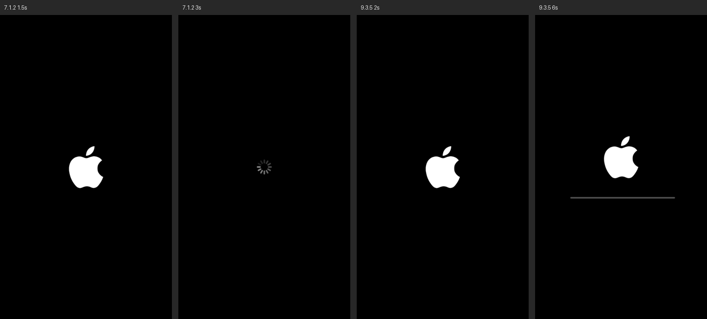
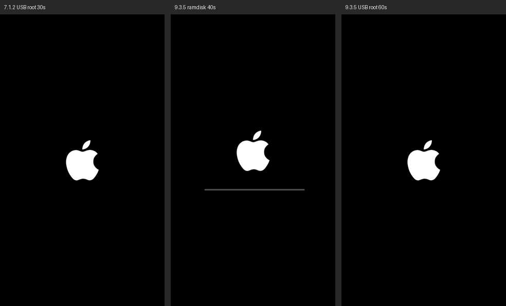

# iOS 8 到 10 第 1 步：iPod touch 5（n78）机型骨架

- 日期：2026-11-03
- 做的事：在 Mac 上给 qemu-ios 加 A5 机型 `iPod-Touch-5G` 和 AIC 中断控制器模型，用 KBoot 包直接进内核，目标是内核在 uart1 打印、停在 Waiting for root device。没碰真机，没 commit、没 push。
- 产物：`patches/a5-n78-skeleton.patch`（对 qemu-ios b225694505，到 3.11 节为止 8 个文件 +1564/-61 行，含对上游 `s5l8930_cdma.c`、`s5l8930_display.c` 的改动），`tools/a5/` 下的脚本和 `README.md`（复现步骤）。大文件都在 `work/a5/`，不进仓库。
- 标注：【已核实】在这次的运行日志或二进制里直接看到；【推测】我的推断。

---

## 0. 结论摘要

> **最新（3.11 节）：** USB 主机和设备端都通了：两版都能从 USB 盘（IPSW 的系统分区）挂根并起 launchd，停在缺数据分区 /dev/disk0s2；恢复内存盘里 restored 不再退出，停在恢复模式等主机。显示见 3.10 节，launchd 见 3.9 节。下面 1 到 4 条是第 1 轮的情况。

1. **两个内核都在模拟器里开口说话了。** 7.1.2（xnu-2423.10.71）和 9.3.5（xnu-3248.61.1，RELEASE_ARM_S5L8942X）都在 uart1 打出完整的开机日志：corecrypto 自检通过，AMFI 认了放宽签名的启动参数，`AppleS5L8940XIO`、背光、AppleKeyStore、GPIO 中断控制器、性能控制器依次启动。【已核实】
2. **内核认出了我们写的 AIC。** 日志里 `AppleInterruptController::start: _aicVersion = 0 ... _aicNumExtInts = 0x000000c0 _aicNumIPIs = 0x00000002`。【已核实】
3. **现在两个版本停在同一个地方：** 性能控制器启动后 panic `handleSwapCleanup - can't free 1 channels of dimension 0`（7.1.2 caller 0x8041648f，9.3.5 caller 0x80376575）。原因是 A5 的 PMGR 位置上暂时放的是 A4 的 PMGR 模型。**下一步就是写 s5l8940x 的 PMGR 模型。**【停止点已核实；原因是推测，但两个版本都紧跟在 `AppleS5L8940XPerformanceController::start` 之后】
4. **还没到的：** Waiting for root device、USB 盘挂根。第 1 步完成了大约一半。

## 1. 新增的东西

### 1.1 QEMU 机型 `iPod-Touch-5G`（`hw/arm/ipod_touch_5g.c`）

- 单核 Cortex-A9，512 MiB 内存在 0x80000000，PA 0 别名到内存第一页（照 A4，未验证 A5 是否需要）。
- arm-io 窗口 0x30000000 到 0x40000000 整个兜底成未实现设备，访问会记进 `-d unimp`。
- uart1 在 0x32600000（A4 的 uart 偏移加 A5 窗口基址），接 serial0；它的 AIC 中断线还没接，控制台走轮询。
- AIC 在 0x3F200000，PMGR 位置 0x3F100000 暂时放 A4 的 `s5l8930.pmgr`。
- 开机包格式和 A4 一样（K48KBOOT 尾部），装载代码照抄 `ipad1_cpu_reset`。

### 1.2 AIC（`hw/arm/s5l8940_aic.c`）

寄存器表取自 xnu-4570.1.46 `pexpert/pexpert/arm/AIC.h`（第一个带 32 位 ARM 的开源 xnu）。定时器的用法照同一版本 T8002 的代码：往 `kAICTmrCnt` 写倒计时，倒数到 0 走 **FIQ**，FIQ 处理里写 `kAICTmrIntStat` 清掉。外设中断走 IRQ，读 `kAICIack` 应答，并把这条线自动屏蔽，等驱动写 `kAICIntMaskClr`。

- 192 条外部中断：9.3.5 的 AppleInterruptController 按 AicCap0 报告的数量核对设备树 `ipid-mask` 的长度（24 字节，正好 6 个 32 位字），报 256 时 panic `ipid-mask property length is 24 but should be 32`。设备树里 CPU 节点用的 0xc0 到 0xc3 正好在 192 之后，就是核间中断号。【已核实】
- 自动屏蔽和核间中断的置位、清除编码是推测，还没对照 9.3.5 的 AppleInterruptController 核实。定时器有没有真正走起来，这次也没专门验证。

## 2. 开机包要比 A4 多做的三件事（`tools/a5/n78_kboot.py`）

1. **内存基址 0x80000000，V=P**：7.x 和 9.x 内核都链接在 0x80001000。【已核实】
2. **清掉属性长度的最高位**：苹果设备树用长度字段的第 31 位标记「等 iBoot 从 syscfg 填写」，iBoot 填完会清掉。解析器读的时候屏蔽了这一位，内核没有。9.3.5 的 `/chosen` 里有两个（`marketing-hardware-behavior`、`marketing-software-behavior`），内核遍历属性时把这一位算进长度，一下跳到设备树外 2 GiB，第一条指令就数据中止（PC 0x8038783c，DFAR 0x0124dbbc）。7.1.2 没有这样的属性。【已核实】
3. **`/chosen/random-seed` 填 64 字节**：iBoot 会填随机数，IPSW 里是全 0。9.3.5 见到全 0 就 panic `EntropyData needed 64 bytes, but got 0`。现在由机器的 ECID 算出来，方便复现。【已核实】

其余照 A4：`platform-name` 改 `s5l8942x`、`chip-id` 改 0x8942；cpu1、IOP、闪存控制器、AE2、SGX、ISP、VXD 的 `compatible` 改成 `none`；AIC 的 `#main-cpus` 改 1，启动参数加 `cpus=1`。

## 3. 下一步

1. **s5l8940x PMGR 模型。** 先把 A4 的 PMGR 模型撤掉，让 `-d unimp` 显示性能控制器到底读写了哪些寄存器，再对照内核里 `AppleS5L8940XPerformanceController` 的代码补模型。设备树里 pmgr 的 `reg` 有 7 段（0xF100000 长 0x7000，另外 6 段在 0x8C00000 到 0xA600000）。
2. **GPIO：** 7.1.2 在 0xFA00000 一带有未实现访问，A5 的 GPIO 仍由 `AppleS5L8930XGPIOIC` 认领，A4 的 GPIO 模型换基址应该能用。
3. **接上 uart1 的中断（设备树 `interrupts` 0x16），** 然后继续往 Waiting for root device 走，再试 USB 大容量存储挂根。

## 3.5 第 2 轮（同日）：越过性能控制器，停在 i2c0 上的 PMU

**结论：** 两个版本都越过了 `handleSwapCleanup` panic，SPI、I2C、PWM、MIPI-DSI、I2S、PL310、串口、看门狗、DWI 等驱动都起来了。现在停在 i2c0 读 PMU（地址 0xE8，D1881）：7.1.2 panic `i2c0::_checkBusStatus SDA is stuck low ... for device pmu`，9.3.5 panic `i2c0::_checkBusStatus Bus is still in a bad state ... for device pmu`。【已核实】

原来的停止点有两个原因，都不在 PMGR 寄存器上：

1. **CPU 性能状态表是空的。** 撤掉 A4 的 PMGR 模型后 panic 照旧，说明不是寄存器的问题。panic 出自 xnu 开源的 `IOReporter::handleSwapCleanup`：给「维度」为 0 的 IOStateReporter 分配数组。性能控制器从设备树 `arm-io/pmgr` 的 `voltage-states1`（24 字节）和 `cpu-clk-cfgs`（12 字节）数性能状态，这两个属性 IPSW 里是 0，由 iBoot 的 `pmgr_update_device_tree` 填（n78 iBoot-1940，0x9ff1f82c）。反汇编出来的规则：3 个状态，每个状态的时钟源和分频取自 iBoot 的两张表（0x9ff41b0c `[1,2,1]`、0x9ff41b18 `[2,1,1]`）；`voltage-states1[i]` = {CPU 时钟周期（ns，16.16 定点）= 分频 × 1e9 × 65536 ÷ 时钟源 Hz, 0}；`cpu-clk-cfgs[i]` = PMGR+0x38 的值，第 28、29 位放时钟源，低 5 位放分频。拿 iPad 2（1 GHz A5）的 ioreg 导出核对：周期 2.0、1.25、1.0 ns，吻合。N78 的 `nominal-performance1` 是 1.25 ns（800 MHz），所以时钟源 1 取 800 MHz；时钟源 2 取 600 MHz 是推测。填上之后，7.1.2 把三个状态读成 `*0.800`、`*0.600`、`*0.400`。`/cpus/cpu0` 的频率也改成 A5 的值（CPU 800 MHz，总线 250 MHz，内存 400 MHz，外设 102.6 MHz，计时 24 MHz）。【规则已核实；时钟源 2 的频率为推测】
2. **AIC 的核间中断要靠读 Iack 应答。** 性能控制器启动后内核给自己发了一个核间中断（写 0x2008 = 0x80000000），然后在 IRQ 处理里反复读 Iack，中间只读 WhoAmI，不写 IPIClr。模型原来让核间中断一直挂着，内核就在中断处理里死循环。改成读 Iack 读到核间中断时顺手清掉。用 `AIC_TRACE=1` 环境变量可以打开 AIC 的逐次访问日志。【已核实】

另外：到这一步为止，内核对 PMGR 只读不写（0x38 到 0x104、0x1010 到 0x115c、0x220 到 0x254），读到 0 也能往下走。真正的 PMGR 模型等内核开始切换性能状态、往 PMGR 写的时候再做。

**下一步：** A5 的 I2C 控制器（`i2c,s5l8940x`，AppleS5L8940XI2CController）和挂在 i2c0 上的 PMU（Dialog D1881）。A4 的 `s5l8930_i2c.c` 和 PMU 模型可以参考，但 A5 换了控制器型号，寄存器要对照内核重新核实。

## 3.6 第 3 轮（同日）：I2C、PMU、PMGR 门控，9.3.5 进到 bsd_init

**结论：** I2C 和 PMU 通了，PMGR 的时钟门控也补上了。9.3.5 走到了 BSD 网络初始化（`L2TP domain init`、`PPTP domain init`），7.1.2 走到 LCD 面板驱动。两个版本现在都不再 panic，而是停在某个没有模型的设备在 `start()` 里等中断。【已核实】

新增（补丁现在 6 个文件、+1253 行）：

1. **`hw/arm/s5l8940_i2c.c`：A5 的 I2C 控制器。** 不是 A4 那种三星式控制器，而是 Linux `i2c-pasemi` 驱动的那种 PA Semi SMBus 块。编码从 7.1.2 驱动反汇编得出（init 0x80976c40、传输 0x80976e80、收数据 0x809776f8、`_checkBusStatus` 0x80977034），状态位名取自 Linux `i2c-pasemi-core.c`：0x00 发送 FIFO（0x100 起始、0x200 停止、0x400 读，读时低 8 位是字节数）、0x04 接收 FIFO（0x100 为空）、0x14 SMSTA（第 28 位 XIP、第 27 位 XEN、第 21 位 MTN，写 1 清）、0x18 中断屏蔽、0x1c 控制（低 8 位分频）。A5 驱动的中断模式会先写 0x2c = 0x100，再把屏蔽设成 0x00b00040（MTO、MTN、第 20 位、TOM），不包含 XEN。所以第 20 位被当作苹果加的「传输完成」中断，和 XEN 一起置位（推测）。`I2C_TRACE=1` 打开逐次访问日志。【编码已核实；第 20 位的含义为推测】
2. **GPIO：** 「SDA is stuck low」并不是控制器报的。驱动在每次传输前，通过 `function-iic_sda/scl` 从 GPIO 读引脚电平，GPIO 没有模型，读到 0，就判定总线卡死。A5 内核仍由 `AppleS5L8930XGPIOIC` 认领 GPIO，所以直接复用 A4 的模型（28 个端口、8 个中断组、AIC 0x77），并把 i2c0、i2c2 的四个脚（0x0604、0x0605、0x1800、0x1801）的静止电平设为高。【已核实】
3. **D1881 PMU：** 先做成 256 字节的寄存器文件，挂在 i2c0 的 0x74。`AppleD1881PMU` 已经读写了一百多次：屏蔽中断 0x0e 到 0x14，读事件 0x08 到 0x0d，以及 0x55、0x61、0x8a、0xa0 一带。9.3.5 还打出了 `AppleD1881PMUPowerSource: Setting battery threshold ... 4000 mV`。全读 0 暂时能过，以后电池、按键、RTC 要再补。【已核实】
4. **`hw/arm/s5l8940_pmgr.c`：** 加上 I2C 之后，第一次真正卡在 PMGR：`_enableDevicePowerGated: Power gate 0x6c enabled before clock was enabled`。时钟门控在 0x1010 + 4n（这块芯片一直排到 0x117c），约定和 A4 一样：第 0 到 3 位申请，第 4 到 7 位报告实际状态。模型让实际状态立即跟上申请；时钟配置的第 30 位（正在切换）写入后立即清掉；其余寄存器按原样存取。【已核实】
5. ~~设备树里又隐藏了 jpeg、scaler、vxe~~：后来证实不需要，已撤回，见 3.7 节。

**更正（3.7 节）：** 这一轮结束时我以为两个版本都卡在 DART、USB、CLCD、RGBOUT 上等中断，其实不对。它们当时已经在等根设备了，只是我用来判断的正则（`[Ww]aiting (for|on) root`）没匹配上内核的原话 `Waiting on <dict ...>`。那几次外设访问只是内核等根设备时，其他驱动的后台活动。

## 3.7 第 1 步目标达成：两个版本都在等根设备

**结论：** 7.1.2 和 9.3.5 都打出了 `Waiting on <dict ID="0"><key>IOProviderClass</key><string ID="1">IOMedia</string><key>IOPropertyMatch</key><dict ID="2"><key>Partition ID</key><integer size="64" ID="3">0x1</integer></dict></dict>`，即 kboot 的 `root-matching` 要的第 1 分区。等的同时还有驱动在加载（`AppleFSCompressionTypeZlib`、`IOSurfaceRoot`）。9.3.5 等根设备前的最后几行是 `AppleD1881PMU::start: pmu ...`、`using DWI for BUCK changes`。【已核实，两个版本各开机 60 到 75 秒】

- 撤掉 jpeg、scaler、vxe 的隐藏之后再开，两个版本照样走到这一步，所以隐藏列表回到 3.6 节之前的样子：cpu1、iop、flash-controller0、ae2、sgx、isp、vxd。【已核实】
- `tools/a5/auto_hide.py` 是一个启动调试的循环：开机，内核停住时就把最后访问的设备藏掉，再开，直到出现等根设备或 panic。`n78_kboot.py` 新增了 `N78_HIDE` 环境变量，用来临时多藏几个节点。

**第 1 步剩下的部分：** 给内核一个根设备。有两条路：
1. **USB 大容量存储**（第 0 步的方案）：要先做 EHCI 主机控制器（`usb-complex` 下面），再挂 QEMU 的 `usb-storage`。9.3.5 的 USB 主机栈换成了新的 IOUSBHostFamily，A4 的 EHCI 模型只在老栈上验证过。
2. **内存盘先试一下（更快）：** `ipad1_kboot.build()` 本来就支持 `ramdisk=`（加 `rd=md0`，把盘放在内核后面）。拿固件里的恢复内存盘（RestoreRamdisk，ipsw.me 有密钥）当根，能最快看到 launchd 等用户态程序在 A5 上跑起来。512 MiB 内存放得下。

## 3.8 内存盘当根：根挂上了，launchd 还没起来

**结论：** 用恢复内存盘（RestoreRamDisk，HFS+，9.3.5 约 20 MB、7.1.2 约 9 MB）当 md0，两个版本都打出了 `BSD root: md0`，根文件系统挂上了。之后内核继续加载驱动（`AppleFSCompressionTypeZlib`、L2TP/PPTP、显示管线、缩放器、JPEG、LCD），然后安静下来：没有 panic，60 秒内也没有一次来自 EL0 的异常（`-d int` 统计），也就是 `/sbin/launchd` 还没开始执行。【已核实】

- `tools/a5/n78_unpack.py` 现在也解出 `RestoreRamDisk.dmg`；`n78_kboot.py` 新增 `N78_RAMDISK=路径` 环境变量，交给 `ipad1_kboot.build(ramdisk=...)`，会加上 `rd=md0` 并清空 root-matching。
- **9.3.5 的定时器只响一次：** 内核设了 `TmrCnt = 0x394f8`（约 9.8 ms），第一次 FIQ 按时到来，FIQ 处理程序清了 `TmrIntStat`，但之后再没写过 `TmrCnt`，定时器就停了。之后内核反复按「高位、低位、高位」读主计时器（0x28、0x20、0x28）。7.1.2 没有这个问题（60 秒 117 次 FIQ）。原因未查明。【现象已核实】
- **7.1.2 定时器正常，也没起 launchd：** 所以卡点不只是 9.3.5 的定时器，而是 bsd_init 在 load_init_program 之前等着某样东西。PC 采样只落在调度器函数里（`thread_block_parameter`、`current_thread`），看不出是谁在等什么。

**下一步：** 拿到各线程的调用栈。打算用 QEMU 的 gdb 调试口（`-s -S`）接 lldb，加载带符号的 kernelcache，从 xnu 的线程列表取出每个线程保存的寄存器，逐个回溯；或者想办法触发一次 panic，让内核自己打印「Dumping thread state and stacks」。另外要回头查 9.3.5 的 FIQ 处理为什么不重新设定定时器。

## 3.9 launchd 起来了：两个版本都跑到 restored_external

**结论：** 7.1.2 和 9.3.5 都执行了 `/sbin/launchd`，并由它拉起恢复环境的 `restored_external`，这是模拟的 A5 上第一次跑起用户态程序。两个卡点：

1. **（两版共同）bsd_init 在等 AES 引擎。** 需要 CDMA（加密 DMA）和它的 AES 过滤器。复用上游 A4 的 `s5l8930_cdma.c`，接到 n78 上就通了。
2. **（9.3.5）定时器只响一次。** 原因在 AIC 的核间中断语义，不在定时器本身：读 Iack 取走 IPI 时应该只把它屏蔽、不清掉。改了 AIC 模型后，9.3.5 在 60 秒里收到 1388 次定时器 FIQ（原来只有 1 次）。

【以上都已核实】

| | 改之前（60 秒） | 只加 CDMA | 再改 AIC |
|---|---|---|---|
| 7.1.2 EL0 异常 / FIQ | 0 / 117 | 7262 / 未统计 | 7681 / 2740 |
| 9.3.5 EL0 异常 / FIQ | 0 / 1 | 10025 / 1 | 17454 / 1388 |

现在两个版本走到的地方一样：`restored_external` 报 `unable to find a usable display`、`unable to get framebuffer`、`enable_usb_connections failed`，然后 `restored exited normally with status 1 - rebooting`。重启途中 panic：7.1.2 `IOUSBController::HandleHardwareException: Type: 0x00000004 could not halt controller in 100 ms`，9.3.5 `AppleUSBHostController::hardwareException: ...` 同样的话。也就是说，下一批要补的是显示、USB 主机和设备控制器、NVRAM。9.3.5 打出了 `Darwin Bootstrapper Version 3.4.0`、`Restore environment starting`；7.1.2 打出了 `*** launchd[1] has started up. ***`，restored 退出前还在等 `IONVRAM`。【已核实】

### 3.9.1 怎么找到的：在 thread_block 上下断点

QEMU 的 gdb 调试口不认识 xnu 的线程，遍历线程表又要先知道结构体偏移。所以换了个办法：从开机起在 `thread_block_reason` 下断点（7.1.2 0x800bf190，9.3.5 0x8002d5c4，都是从导出函数 `thread_block` 的尾跳找到的），每次命中时沿 r7 帧链回溯，按内核栈分组，只留每个栈最后一次睡下时的调用链。一个线程永远睡下了，它最后那条调用链就是卡点。工具是 `tools/a5/gdbtrace.py`（自己实现的 gdb 远程协议，不依赖 gdb/lldb）。

- 开机到卡住只要约 2 秒；之后 198 秒里没有任何线程再调用 `thread_block`，CPU 一直在空闲循环。共 77 个内核栈。【已核实】
- 开机线程（bsd_init）的调用链是 `bsd_init` 0x802494d4 → `AppleARMPlatform`+0x66d8 → `thread_block`。0x802494d2 处是 `pe->callPlatformFunction("SecureRootName", false, rootdevice, …)`，也就是内联的 `IOSecureBSDRoot`。【已核实】
- 反汇编 AppleARMPE 的 `callPlatformFunction`，得到一个双方握手：
  - `SecureRootName`（bsd_init 来调）：比较根设备名，把结果记在对象 +0x98，把 +0x96 置 1 并唤醒，然后一直等 +0x97 被置位。
  - `SecureRoot`（AES 驱动来调，带上自己）：先等 +0x96，再回调这个驱动的 `SecureRootCallBack`，回调返回后才把 +0x97 置 1 并唤醒 bsd_init。
- 调 `SecureRoot` 的是 IOCryptoAcceleratorFamily（kext 里同时有 `SecureRoot` 和 `SecureRootCallBack` 两个字符串）。另一个栈正好卡在这条路上：`AppleCDMA`+0x215c（start）→ IOCryptoAcceleratorFamily+0x1868 → `callPlatformFunction("SecureRoot")` → AppleARMPlatform+0x675e → `SecureRootCallBack` → IOCryptoAcceleratorFamily+0x221a 在 `IOCommandGate::commandSleep` 里等一次 AES 运算完成。`-d unimp` 显示它写了 AES 上下文 1 的设置和 IV（arm-io +0x7801000 到 +0x780101c），配了 CDMA 通道 1、2 并按下 go，和 A4 上 7.x 的做法一模一样（通道 1 把数据喂进 AES，通道 2 取出结果）。没有 CDMA 模型，完成中断永远不来。【已核实】
- 同一时刻还有一批驱动在 `IODMAController::getController` 里等 DMA 控制器注册：AppleSamsungSPI、AppleSamsungSerial、AppleSamsungI2S、AppleAE2Audio。AppleCDMA 卡在自己的 start() 里，没走到 registerService。加上 CDMA 后这些也一起放行了。【已核实】

### 3.9.2 CDMA：复用 A4 模型

A5 设备树的 `arm-io/cdma`：`cdma-version` 3，通道区在 +0x7000000（长 0x2d000），AES 上下文区在 +0x7800000（长 0x9000，9 个上下文，和 A4 一样），`interrupts` 是 0x33 到 0x5c 共 42 条，对应通道 1 到 0x2a。上游 `s5l8930_cdma.c` 有三处写死了 A4，补丁里改成属性，A4、3GS 不传就保持原值：

- `dram-base`：判断描述符地址是内存还是设备 FIFO，原来固定 0x40000000，A5 是 0x80000000。
- `channels`：通道槽数（含 0 号全局块），原来固定 0x26，A5 用 0x2b。通道区内存区改在 realize 里按它定大小；数组开到 0x30。迁移状态仍只存前 0x26 个通道（改用 `VMSTATE_*_SUB_ARRAY`），`-dump-vmstate` 比对新旧二进制里 `s5l8930.cdma` 的描述完全一致，A4 的快照格式没变。A4 机型（`iPhone-4`、`ipad1`）实例化后 `info mtree` 里 CDMA 仍是 0x87000000 到 0x87025fff。【已核实；A4 实际开机没测，本机已没有 A4 的设备和固件】
- n78 上 `paced-ports` 设 0：A4 的 I2S FIFO 窗口不是 A5 的，音频 DMA 暂时不按播放速率走。

### 3.9.3 9.3.5 的定时器：丢掉的那个核间中断

两个内核的 FIQ 快路径一样，9.3.5 注册的是 T8002 式的定时器函数（AIC +0x2014 倒计时、+0x2018 清中断，表在 0x803f5790：FIQ 处理 0x800c8bcc、取时基 0x800c8be0、读倒计时 0x800c8c0c、设倒计时 0x800c8c20）。FIQ 处理清掉中断后总是进 `fleh_dec`（0x800c6c4c）。问题出在 `fleh_dec` 的一个分支：

1. 如果 FIQ 来时 IRQ 正被屏蔽（spsr 第 7 位），`fleh_dec` 不当场处理，而是调 `cpu_signal(cpu0, SIGPdec=1)`（0x800bd7b4），留到 IRQ 打开后再处理。断点记录：0.041 秒时正是这样。【已核实】
2. `cpu_signal` 给自己发信号时，先把信号位记进 cpu_data+0x30；如果这个字的第 31 位（相当于 xnu 的 `SIGPdisabled`）还在，就不发核间中断，直接返回。开机初期它就是置位的。这一位只有收到核间中断、进 `cpu_signal_handler`（0x800bd86c）时才清，清的同时处理积压的 SIGPdec，调 `rtclock_intr`（0x800cb74c）重设倒计时。【已核实】
3. 1.72 秒时 AppleARMCPU 启动 CPU（经内核 `processor_start`），调 AppleInterruptController 的 causeVector 给 cpu0 发自发 IPI（向量 0xc0，写 IPISet = 0x80000000）。但这时向量 0xc0 还没注册，驱动的中断处理读到 IPI 后直接跳过：不写 IPIClr，也不调处理函数。【已核实】
4. 旧模型在读 Iack 时就把 IPI 清了（3.5 节为 7.1.2 做的权宜之计），这个 IPI 就此丢失。SIGPdisabled 永远清不掉，SIGPdec 永远没人处理，定时器再也没人重设。7.1.2 不受影响，大概是它的第一次定时器 FIQ 没赶上 IRQ 屏蔽的时候。【推测】

驱动里的 disableVectorHard / enableVector 对 IPI 向量写的是每核寄存器 +0x24 和 +0x28（别名区 0x5024 / 0x5028 + 0x80 × 核号），值 0x80000000 表示自发 IPI，1 表示普通 IPI。开机时两个内核都会写 `0x2024 = 0x80000001`，之前日志里当成未实现寄存器。据此推断：+0x24 置 IPI 屏蔽、+0x28 清屏蔽；读 Iack 取走 IPI 时只把它屏蔽，IPI 仍挂着，直到写 IPIClr。这样那个早到的 IPI 会在向量注册、enableVector 解除屏蔽时重新送达。模型按此改了，7.1.2 原来那个「读 Iack 死循环」也照样不会出现（第二次读时 IPI 已屏蔽）。【寄存器用法已核实；Iack 自动屏蔽 IPI 是推测，但两版行为都对上了】

### 3.9.4 新工具（`tools/a5/`）

- `gdbtrace.py`：接 QEMU 的 `-gdb tcp::PORT`。三种用法：在地址上下断点并保留每个内核栈最后的调用链；`--log` 按顺序打印每次命中的 r0 到 r3 和短回溯；`--sample` 定时打断采样。符号取自 kernelcache 的导出符号。
- `kexts.py`：读 `__PRELINK_INFO`，列出各 kext 的装载地址和大小，或者告诉你某个地址在哪个 kext 里。
- `mkelf.py`：把 kernelcache 的 `__TEXT` 和 `__PRELINK_TEXT` 包成 ELF，这样 `llvm-objdump --start-address/--stop-address` 能反汇编任意范围，kext 也行（直接对 Mach-O 用 `--macho` 时这两个参数不生效）。
- `kexts.py`、`mkelf.py` 和 `xref.py` 一样，要和 `imgtools/` 放在同一目录（复现时放 `work/a5/`）。

### 3.9.5 下一步

1. **显示：** restored_external 找不到 framebuffer（7.1.2 走 CLCD/RGBOUT/AppleDisplayPipe，9.3.5 走 IOMFB）。要显示出苹果标志和进度条，需要显示管线的最小模型。
2. **USB：** 重启时 USB 主机控制器 panic（`could not halt controller in 100 ms`），`enable_usb_connections failed` 是设备端。EHCI 模型本来就是 USB 盘挂根要做的，可以一起做。
3. **NVRAM：** 7.1.2 的 restored 在等 `IONVRAM`，还报 `No IOFlashController instance found`。
4. **根文件系统：** 内存盘只能跑恢复环境；完整系统仍按原计划挂 USB 大容量存储。
5. **小尾巴：** A5 上 CDMA 的 I2S 按速率送数没接（`paced-ports` 0）；CDMA 模型里防 UART 接收链空转的判断用的是 A4 的 UART 地址，A5 上不生效，以后出现 BlueTool 那种空转时再补。

## 3.10 显示：苹果标志和恢复界面

**结论：** 两个版本的 restored_external 都拿到了 640×1136 的显示器，不再报 `unable to find a usable display`、`unable to get framebuffer`。QEMU 的 `screendump` 截到了画面：开机先是 iBoot 式的白色苹果标志；9.3.5 随后换成 restored 自己画的恢复界面（苹果标志加进度条底槽），7.1.2 换成屏幕中央一个转动的菊花图案。restored 退出、重启途中 panic 在 USB（3.9 节）之后，屏幕变黑。【已核实】

（从左到右：7.1.2 第 1.5 秒、第 3 秒，9.3.5 第 2 秒、第 6 秒。截图由 `tools/a5/qmon.py` 经 QMP 拍，原图在 `work/a5/runs/s39/7n`、`9n`。）

| | 显示驱动 | restored_external |
|---|---|---|
| 7.1.2 | AppleH4PDisplayPipe、AppleH4PCLCD（日志里叫 AppleMobileCLCD） | `found display: primary`、`display: 640 x 1136`，然后 USB 失败退出 |
| 9.3.5 | IOMFB：`IOMFBSoCH4PProfile`、`AppleH4DisplayPipe`，`AppleMobileCLCD DisplayPipe ... physical = 0x3a100000` | 同上，再加 `powering on display`，画出标志和进度条 |

### 3.10.1 复用 A4 的显示模型，按 A5 的地址接上

上游 `s5l8930_display.c`（管线、CLCD、RGBOUT、TV-out）和 `ipod_touch_mipi_dsi.c` 原样实例化，地址取自 A5 设备树：

- 管线 0：clcd `reg[0]` = arm-io +0xa100000（A4 是 +0x9000000，挪了位置）；CLCD：+0x9200000；RGBOUT 自己的管线：rgbout `reg[0]` = +0xa200000；RGBOUT 控制块：rgbout `reg[1]` = +0x9600000；TV-out：+0x9400000；MIPI-DSIM：+0x9500000。clcd `reg[2]`（+0x9300000）和 displayport 没有接，仍记未实现。
- 中断：clcd 的 `interrupts` 是 {0x2b, 0x2a}，即管线 0 0x2b、CLCD 0x2a；rgbout 的第一条 0x2c 是它的管线；DSIM 0x29。
- A5 的 clcd 节点没有 DART mapper，模型的 dart2 不映射，层地址按物理地址或下面的页表走。
- 模型复位时照 iBoot 留下的样子预置：CLCD +0x60 为面板尺寸、ENVID 置 1、UI0 指向 vram（0x9f700000，即开机包和 boot_args 里的 vram）。

**「CLCD not initied by iBoot」：** 两个版本在这之前对显示块只读过一次 CLCD +0x60（面板尺寸，`(宽-1)<<16 | (高-1)`），读到 0 就打这句、不加载驱动。模型预置了这个值，这句就没了。【已核实】

### 3.10.2 H4P 管线的层寄存器和 A4 不一样（模型加了 `h4p` 开关）

A5 即使在 7.1.2 上也用 H4P 那一代显示驱动（kext：AppleH4PDisplayPipe、AppleH4PCLCD、AppleH4PRGBOUT）。第一次接上时内核报 `input width(-640) or height(-1136)`，restored 拿到的尺寸是 `4294966784 x 4294966272`，建不了显示缓冲。反汇编 AppleH4PDisplayPipe（11D257）得出：

1. **源矩形：** 接管 iBoot 画面时（0x80a2fc4a），宽 = 0x4070 的高 13 位 − 0x4060 的高 13 位，高 = 两者低 13 位之差，即 0x60 是源起点、0x70 是源终点。A4 模型在 0x60 放的是 A4 的「源终点」、0x70 是 0，于是得出 −640。交换时目标位置写 0x54、目标尺寸写 0x58（11 位，0x80a337ee、0x80a3381a）。【已核实】
2. **每层自带页表：** 交换后层的地址寄存器 0x44 变成 0，0x98 里是一个物理地址（0x80a32ace 建表）。读出来是每 4 KiB 一项、物理地址或上 1（有效位）的页表；0x44 是层在这张表里的虚拟地址。7.1.2 的层 0 表映射的正是 vram（0x9f700001、0x9f701001 …），层 1 是 restored 分配的零散页。【已核实】
3. **0x4c 不是 A4 的 UNSCALED 位：** H4P 往里写别的值，按 A4 解释会把目标矩形清零。【已核实】

`s5l8930_display.c` 加了属性 `h4p`（默认关，A4 不变）：复位时把 iBoot 的层预置为源 0x60→0x70；扫描输出按 0x60/0x70 取源矩形、0x54/0x58 取目标，0x98 非零时经页表取像素（`layer_read`）。只在 n78 上打开。改完后两版的 restored 都拿到 `display: 640 x 1136`。`-dump-vmstate` 比对：`s5l8930.display`、`s5l8930.cdma`、`ipodtouch.mipidsi` 的迁移格式和原版完全一致；iPhone 4 机型的管线 0、CLCD 仍在 0x89000000、0x89200000。【已核实；A4 实际开机仍未测，本机没有 A4 设备】

### 3.10.3 开机包画苹果标志

`n78_unpack.py` 现在也从本地 IPSW 解出 `applelogo@2x~iphone.s5l8942x.img3`（密钥在之前取的 ipsw.me 密钥表里，没有新下载），存成 `AppleLogo.bin`（iBootIm、grey、130×158）。`n78_kboot.py` 用 ipad1_kboot 的 `logo_segments` 把它居中画进 vram，作为 K48SEG 段跟在开机包后面，机型每次复位时拷进内存。

### 3.10.4 还没弄清的

- **7.1.2 的菊花图案是谁画的：** 它在层 0（页表映射 vram）里，7.1.2 只开着层 0（0x1038 = 0x100），restored 的层 1 行跨度还是 0。可能是 restored_external 在等 USB 主机时画的等待图案，也可能是内核的进度图。【推测】
- **9.3.5 两层都开（0x1038 = 0x300），** 模型把两层叠在一起显示，叠放次序沿用 A4 的（UI1 在上），从画面看没问题。
- H4P 的其余层寄存器（0x50、0x5c、0x88、0x8c、0x90）意义未查：0x88/0x8c 交换后是 0x100000，像 1.0 的缩放系数；0x90 写 1。画面需要缩放或偏移时再看。

### 3.10.5 新工具

- `tools/a5/qmon.py`：经 QMP（`-qmp unix:SOCK,server,nowait`）在指定时刻截图（存 PNG）并读出管线 0 的全局块、两层寄存器和 H4P 页表。
- `tools/a5/pcrefs.py`：在 llvm-objdump 的 Thumb 反汇编里找某个字符串的引用（ldr 或 movw/movt 再 add pc），kext 里的报错字符串靠它定位。

### 3.10.6 下一步

1. **USB：** 两版都是 `enable_usb_connections failed` 后退出，重启时 USB 主机控制器 panic。EHCI 也是 USB 盘挂根要的。
2. **NVRAM：** 7.1.2 的 restored 等 `IONVRAM`。
3. 显示方面暂时够用；以后进系统要看动画时，再核实 H4P 的缩放、旋转和层叠次序。

## 3.11 USB：主机能枚举 USB 盘，两版都从 USB 盘挂根

**结论：** 三件事都做到了：
1. **重启途中不再因 USB panic。** 原来没有 EHCI 模型，重启时 `StopUSBBus` 等不到 HCHalted 位。
2. **EHCI 能枚举 QEMU 的 `usb-storage`，两版都能从 USB 盘挂根。** 盘里装的是 IPSW 的系统分区，内核打出 `BSD root: disk0s1`，launchd 起来、fsck 根分区，然后因为找不到数据分区 `/dev/disk0s2` 走关机流程。
3. **恢复内存盘里 `enable_usb_connections failed` 消掉了。** restored_external 不再退出，停在恢复模式等主机来连（9.3.5 屏幕上一直是恢复界面）。

【以上都已核实】

（从左到右：7.1.2 从 USB 盘挂根后第 30 秒，9.3.5 恢复内存盘第 40 秒（restored 一直在），9.3.5 从 USB 盘挂根后第 60 秒。）

| | 7.1.2 | 9.3.5 |
|---|---|---|
| 重启途中 USB panic | 没了 | 没了 |
| `usb-storage` 枚举 | 一开始就成功：设地址，读描述符，SCSI 依次 INQUIRY、MODE SENSE、READ CAPACITY、READ(10) | 先失败（`persistent enumeration failures`），修了 PA 0 后成功 |
| USB 盘挂根 | `Got boot device = .../usb-ehci-port1`，`BSD root: disk0s1`，launchd、`fsck_hfs` | 同左，完整路径到 `IOGUIDPartitionScheme/System@1`，`Darwin Bootstrapper` |
| 挂根后停在 | `Can't stat /dev/disk0s2`、`BAD DISK NAME /dev/disk0s2`，然后 `Userspace shutdown begun` | 同左 |
| 恢复内存盘里的 restored | 注册 PTP、AppleUSBMux、USB 以太网，启动 USB 栈，不退出 | 同左，恢复界面一直显示 |

### 3.11.1 接上的模型（都复用 A4 的）

A5 的 USB 布局和 A4 一样，只是换了基址。两版设备树相同：
- otgphyctrl 在 arm-io +0x6000000。
- usb-complex 的 `ranges` 把子节点映射到 +0x6100000 起：usb-device（Synopsys OTG）+0、usb-ehci +0x300000、usb-ohci0 +0x400000、usb-ohci1 +0x500000。
- 中断依次是 0x0b、0x0c、0x0d、0x0e。

n78 上照 `ipad1.c` 的做法接了四样：
- iPod 的 USB PHY 模型和 Synopsys OTG 模型。没接 usbmux 桥（`IT_USB_TCP`）时，由 OTG 内建的主机来配置设备。
- QEMU 的 `exynos4210-ehci-usb`（能力寄存器在 +0）和一个单口的 sysbus OHCI。
- 给两者设了 id，总线名固定为 `ehci.0`、`ohci.0`。挂盘的写法：`-drive if=none,id=root,file=...,format=raw -device usb-storage,bus=ehci.0,drive=root`。
- usb-ohci1 没接（publish-criteria 0x10，不发布）。

### 3.11.2 9.3.5 枚举失败：PA 0 上的「异常向量」被当成了传输

9.3.5 的新 USB 栈（IOUSBHostFamily）复位端口、使能端口之后，从来不发 SETUP 包。打开 QEMU 的 EHCI trace 后看清了过程：

1. **占位 QH 指向 PA 0。** 驱动在周期调度里放了一批占位 QH（设备 0、端点 15），它们的 next qTD 指针是 0，T 位没置。按 EHCI 规范，控制器会去物理地址 0 取一个 qTD。
2. **n78 的 PA 0 映射的是内存。** 原来照 A4 的 kboot 做法，PA 0 是 DRAM 第 0 页的别名，内核开机时把异常向量（`b .` 等）拷了进去。读出来的 token 正好带 Active 位，QEMU 就开始执行一个「传输」，报 `guest requested more bytes than allowed`。
3. **QEMU 出错后复位整个 EHCI。** 刚使能的端口跟着掉线，内核再复位端口，周而复始，最后报 `persistent enumeration failures`。

真机上 PA 0 是 SecureROM 的窗口：A4 机型用 `bootrom=` 启动时也是把 ROM 映射在 0，内核往那里拷向量也写不进去。所以 n78 的 PA 0 改成一块 64 KiB 的只读占位 ROM，开头是 8 条 `ldr pc, [pc, #0x18]`，其余为 0。改完以后：9.3.5 枚举成功，整个过程没有 guest_bug，EHCI 只在初始化时正常复位 3 次；两版照常开机，7.1.2 的枚举也没变。【已核实】

### 3.11.3 开机包里改的两处设备树（`tools/a5/n78_kboot.py`）

1. **`usb-ehci-port1` 的 `port-type` 改为 0。** 和 A4 机型对 6.x/7.x 设备树的改法相同（`ipad1.c`）：原来的 2 表示底座口，只有接上主机侧线缆才供电。
2. **usb-complex 加 `no-pmu`。** USB 仲裁器见到这个属性，就按「接在电脑上」（cable type USBHost，设备模式）处理，开机即发布 OTG 设备节点。否则它要等 PMU 报线缆，而 D1881 模型报的是 `Detached`（`AppleUSBCableDetect 0`），于是：
   - restored_external 先报 `unable to find valid configuration for this device`，再报 `enable_usb_connections failed`，然后退出；
   - OTG 设备端要到重启途中才起来。
   
   加上后，restored 打出 `found PTP interface`，注册了 PTP、iPod USB Interface、AppleUSBMux、USB 以太网四套配置，`AppleUSBDeviceMux::start`、`startUSBStack` 都起来了，QEMU 的内建主机报 `device configured`。
   
   这和 A4 机型的效果一样（「像接在 Mac 上的 iPad」）。代价是 PMU 自己的线缆检测仍报 Detached，充电状态之类以后要补 D1881 的充电器和 ADC 寄存器（日志里有 `_readADCGated ... ADC read bad state`）。【已核实】

### 3.11.4 USB 根盘（`tools/a5/n78_usbroot.py`）

1. **解密 rootfs。** 从本地 IPSW 取出 rootfs（7.1.2 `058-4385-009.dmg` 1.26 GB，9.3.5 `058-49388-036.dmg` 1.55 GB），用 ipsw.me 密钥表里的 RootFS 密钥（之前已取，没有新下载）经 `imgtools/vfdecrypt.py` 解密，得到 UDZO 压缩的 UDIF 镜像。
2. **切出 HFS 卷。** `hdiutil convert -format UDTO` 转成裸盘，按 APM 切出 Apple_HFS 分区：7.1.2 是 1620 MiB 的 HFSX，9.3.5 是 2012 MiB。
3. **包成 GPT 盘。** 第 1 分区放这个卷，类型为 Apple HFS 的 GUID，从 1 MiB 处开始。内核的 IOGUIDPartitionScheme 把它发布成 `Partition ID` 1（9.3.5 路径里叫 `System@1`），正好对上 kboot 默认的 root-matching。
4. **用法。** 不带内存盘的开机包（`n78-<build>.bin`）加上这块盘就能挂根。镜像在 `work/a5/disks/`，解密后的 dmg 在 `work/a5/rootfs/`，都不进仓库。开机时用 `snapshot=on` 挂，镜像不会被写。

这个 iPod 内核里也有 LightweightVolumeManager，它试过这块盘后放弃了（`LwVM: media block size too small`），不影响 GPT。

### 3.11.5 下一步

1. **数据分区（disk0s2，挂到 /private/var）：** 两版的 `/etc/fstab` 都要它。要按恢复的做法往里放 rootfs 的 /private/var 内容，并保留属主；imgtools 的 `ipad1_rootfs.py` 有 A4 上的做法（`build_nand`、`var_owners`）可以改用。做好后有望往 SpringBoard 走。
2. **PMU 的充电器和 ADC：** 现在靠 `no-pmu` 绕过线缆检测。
3. **HSIC 上的 Wi-Fi：** 内核在 EHCI 的 HSIC 口（端口 3）等 BCM Wi-Fi（`Bus enumeration failure`）。暂时无害，以后要么藏掉 DT 的 wlan 节点，要么接一个设备。
4. **NVRAM：** 7.1.2 和 9.3.5 的 restored 退出后都在等 `IONVRAM`。现在 restored 不退出，这条暂时碰不到，正式开系统时可能还会遇到。

## 4. 测试机

用户 2026-11-03 把测试机改成 iPhone 14 Pro（iOS 27.0.1）。`xcrun devicectl list devices` 已能看到它（available, paired）。第 1 步只在 Mac 上做，这次没有用它。
