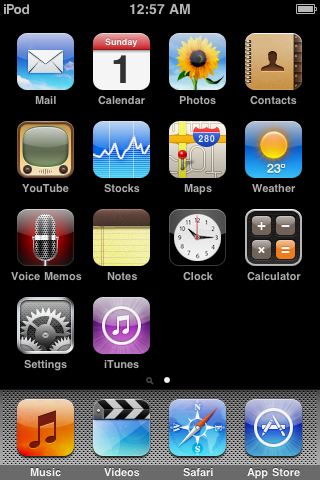
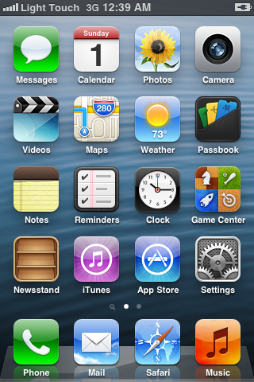
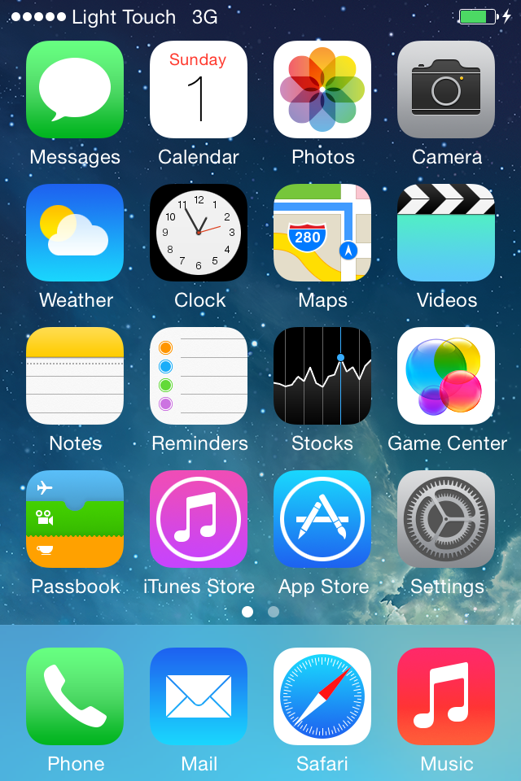
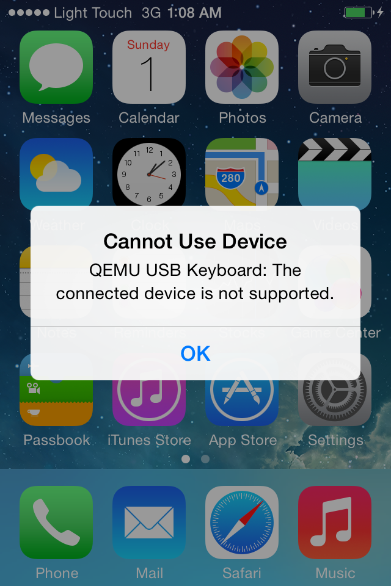

# M0：Mac 上的 JIT 与纯解释器（TCI）测速

- 日期：2026-11-01
- 执行会话：M0（接手中断的上一个后台代理）。范围：3GS 6.1.6 的 TCI；iPhone 4 7.1.2 和 iPod touch 2 代 3.1.3 的首次设置与 JIT、TCI 测速；每轮的系统负载；快照和宿主 GL 的关系；推算到两台测试机；本报告。
- 没做的：没下载任何东西；没碰 M1 的目录（只读了 `docs/reports/m1-stage1.md` 拿真机数字做校准）；上游两个仓库没改（`git status` 干净，所以 `patches/` 里没有 M0 的补丁）；没 commit，没对外发任何东西。
- 测试机：M4 Max（10 性能核 + 4 能效核，36 GB），macOS 27.0.1，Xcode 27.2。qemu-ios b225694505（QEMU 11），LightTouchMac b06012fa4c。

## 0. 结论

1. **JIT 和 TCI 差几倍：纯算力的活差 7 到 11 倍，日常交互的平均 CPU 差 2.5 到 5 倍，系统越新差得越多。** 开机到锁屏是最干净的对比（全程吃满一个核）：客体主核线程的 CPU 秒，iPhone OS 3.1.3 差 6.9 倍，iOS 6.1.6 差 7.0 倍，iOS 7.1.2 差 11.2 倍（墙钟 5.1、6.1、10.1 倍：9 秒对 46 秒，26 秒对 156 秒，40 秒对 407 秒）。交互时客体大部分时间在空等，平均 CPU 占比只差 2.5 到 5 倍；但 iOS 7 在 TCI 下连 M4 Max 都吃满了，它的交互倍数被「最多一个核」截断，实际差距接近开机的 11 倍。
2. **没有 JIT 时 iPhone 上大概什么体验**（iPhone 18 Pro 按 M1 真机开机数据校准，约 1.2 个 M4 Max 核；简报的粗算 0.7 更保守；iPhone 14 Pro 粗算 0.48，再慢一倍多。见第 4 节）：
   - **iPhone OS 3（iPod touch 2 代 3.1.3）：能用。** 开机 40 秒到 1 分钟（M1 真机实测 43 秒），主屏待机约三分之一到一半个核，翻页和开 App 约半个核到 0.8 个核，主屏拖动帧率在 Mac 上不受 CPU 限制（JIT 35 帧、TCI 44 帧）。14 Pro 上翻页和开 App 会短暂吃满。
   - **iOS 6（3GS 6.1.6）：勉强能用，卡和耗电是问题。** 开机 2 到 4 分钟（M1 实测 115 秒），待机约半个核到 0.7 个核（Mac 上 42% 到 60% 之间波动；M1 真机 91%，口径不同），翻页半个核到一个核，开 App 吃到 0.7 到 1.2 个核；主屏拖动从 JIT 的 52 帧掉到 20 多帧。14 Pro 上待机就吃满，拖动约 15 帧。
   - **iOS 7（iPhone 4 7.1.2）：不能用。** 在 M4 Max 上 TCI 就已吃满一个核：主屏什么都不做也要 94%（iOS 7 的主屏每秒重绘 30 次），开「设置」「时钟」要 4 到 11 秒才到前台（JIT 1.3 到 1.9 秒），主屏拖动 7 帧，按 Home 到亮屏 5.6 秒，开机 6 分 47 秒。按开机倍数估，18 Pro 上日常交互约要 2 到 3 个核（粗算 4 到 6 个），客体只能跑到实速的二分之一到五分之一，开机 6 到 14 分钟。
3. **有 JIT 时三个年代在两台手机上都宽裕。** 按粗算，14 Pro 上 iOS 7 主屏待机约半个核、翻页约 0.7 个核、开 App 约 0.6 个核，开机约 1.5 分钟；18 Pro 上都在半个核左右以内。前提是 JIT 的代码缓冲够大：M1 在手机上为了缩短调试器「准备」的时间把缓冲降到 32 MB，开机提速明显变小。（决策会话更正：M1 那次 3GS 待机的 79% 不能当证据，测量期间有人在手机上点开了设置，见 `m1-stage1.md` 第 4.2 节的补注；32 MB 对待机 CPU 的影响要等 M1 第二阶段重测。）
4. **快照：Mac 上宿主 GL 一直开着，GL 状态跟着快照走，没问题；iPhone 上目前存不了。** Mac 的 CGL 后端把活着的 GL 状态读回来存成快照里的「gles-host」段（iOS 3 和 6 约 4 MB，iOS 7 约 18 MB，占快照 1.5% 到 4%）。快照大小约等于客体内存：iPod 115 MB、3GS 259 MB、iPhone 4 445 MB；存 0.67、1.8、3.3 秒；恢复都在 0.1 到 0.2 秒，恢复后点图标能正常开 App。但手机用的 EAGL 后端（还有 Mac 上实验性的 ANGLE）只要有一个活着的 GL 上下文就挂迁移阻断器，SpringBoard 起来以后就一直有，所以**手机上现在存不了快照**。M2 的「快照秒切」要先把 CGL 的读回和重建移植到 EAGL；在那之前手机上每次都得冷启动，而没有 JIT 时 iOS 6、7 的冷启动是分钟级的。
5. **iPod touch 2 代的 SecureROM 有一半解了。** 4 字节占位文件就能冷启动；但实测深度睡眠后唤醒会复位进 ROM、卡死在地址 0。3GS 的机型代码对同样的唤醒做了高层模拟（`s5l8920_resume`），照着给 iPod 2 代补一段，就可以彻底不需要苹果的 SecureROM。`docs/plan.md` 记着用户已决定先不做长待机测试、等正式支持 iPod 2 代时再处理；这里的两分钟睡眠测试是在看到那条决定之前顺手做的，正好回答了那条路线的第一步「会不会卡」：会卡，下一步就是这个补丁。
6. **测试中的干扰都有记录。** M1 同时编译加 Spotlight 建索引，负载几次冲到 20 到 63；受影响的轮次在表里标了 ⚠、不计入均值，并补测了 3GS TCI 第三轮、iPhone 4 全部四轮。另外 iOS 7 会弹「Cannot Use Device / QEMU USB Keyboard」挡住所有触摸，iPhone 4 前三轮因此作废重测（详见第 7 节）。

## 1. 测了什么、怎么测

每轮从同一个「黄金状态」（首次设置走完、关机）的 APFS 克隆冷启动，`-display none`、`-audio driver=none`，网络照上游 `restrict=on,lan=off`，宿主 GL 开着（CGL，读回显示），和 Light Touch 的参数一致。测量项：

- **开机到锁屏**：从启动 QEMU 到 guest agent 报告前台是 SpringBoard 的锁屏；同时记进程 CPU 秒和各线程 CPU 秒（`CPU 0/TCG` 是客体主核，`qemu_main` 是主线程，含 GL 桥和显示）。
- **安定**：等到某个 10 秒窗口进程 CPU 低于 60%（上限 JIT 180 秒、TCI 300 秒）。
- **主屏静置** 40 秒、**翻页**（5 次来回）、**开「设置」和「时钟」**（guest agent 启动，各计 10 秒，另记到前台的秒数）：进程 CPU 秒 / 墙钟秒，记为「% 单核」。
- **快照**：回主屏后 `stop` 加 `migrate file:`，记大小、耗时和其中 GL 段的大小；在对应状态的克隆上 `-incoming file:` 恢复两次，记载入时间，OCR 找「设置」图标点开验证触摸，再静置 30 秒。
- **可见帧率**（本会话加的探针）：从快照恢复，主屏按住来回拖 20 秒，或锁屏看「滑动解锁」的微光动画，同时以 120 Hz 截屏比对，统计屏幕上新画面的次数。
- **负载**：每轮前后 `uptime`，每个窗口开始时 load average，另有每 15 秒一条的 `work/runs/load*.log`。

每台设备 JIT 和 TCI 各两轮有效数据（3GS 的 TCI 三轮，其中一轮交互部分因负载作废）。测速轮次一个接一个跑，从不两个测速同时进行。帧率探针和 `swaps` 读数放在别的轮次不计量的「安定」阶段里跑（单独一个核，本机有 10 个性能核）。例外有两处：3GS TCI 第一轮的测量窗口和 iPhone 4 的首次设置重叠了（多一个 JIT 模拟器，负载 3.9），所以补了第三轮对照；iPod 睡眠测试和 iPhone 4 JIT 第二轮重叠，那一轮本来就因 USB 键盘提示作废。

## 2. 数据

设备代号：n72 = iPod touch 2 代 · iPhone OS 3.1.3（7E18）；n88 = iPhone 3GS · iOS 6.1.6（10B500）；n90 = iPhone 4 · iOS 7.1.2（11D257）。「% 单核」是 QEMU 进程全部线程的 CPU 秒 / 墙钟秒 × 100，可以超过 100%（客体主核、副核和主线程同时忙）。

### 2.1 三个年代并排（均值和 TCI/JIT 倍数）

| 项目 | n72 JIT | n72 TCI | 倍数 | n88 JIT | n88 TCI | 倍数 | n90 JIT | n90 TCI | 倍数 |
|---|---:|---:|---:|---:|---:|---:|---:|---:|---:|
| 开机到锁屏（s） | 9.0 | 45.7 | 5.1× | 25.7 | 156.0 | 6.1× | 40.2 | 407.3 | 10.1× |
| 开机时客体主核线程 CPU 秒 | 6.4 | 44.2 | 6.9× | 21.8 | 153.1 | 7.0× | 35.5 | 397.6 | 11.2× |
| 主屏静置（% 单核） | 11.7 | 32.7 | 2.8× | 9.9 | 50.5 | 5.1× | 25.0 | 94.1 | 3.8× |
| 主屏翻页（% 单核） | 23.1 | 57.3 | 2.5× | 19.2 | 66.8 | 3.5× | 35.0 | 96.5 | 2.8× |
| 开设置的 10 秒（% 单核） | 18.6 | 54.8 | 2.9× | 18.2 | 86.6 | 4.7× | 28.9 | 102.6 | 3.5× |
| 点开设置到前台（s） | 0.61 | 1.93 | 3.1× | 0.77 | 1.69 | 2.2× | 1.85 | 7.54 | 4.1× |
| 点开时钟到前台（s） | 0.54 | 1.84 | 3.4× | 0.70 | 1.85 | 2.6× | 1.31 | 5.83 | 4.4× |
| 主屏拖动可见帧率 | 34.6 | 44.3 | 0.8× | 52.5 | 26.3 | 2.0× | 15.1 | 7.2 | 2.1× |
| 　拖动时客体主核 % | 20.6 | 74.0 | 3.6× | 29.7 | 85.9 | 2.9× | 48.8 | 73.8 | 1.5× |
| 锁屏微光动画可见帧率 | 15.0 | – | – | 10.7 | 9.7 | 1.1× | 57.2 | 44.5 | 1.3× |
| 　锁屏动画时客体主核 % | 9.9 | – | – | 12.2 | 72.3 | 5.9× | 36.2 | 62.9 | 1.7× |
| 快照大小（MB） | 115.4 | 114.3 | – | 259.1 | 259.4 | – | 445.1 | 445.6 | – |
| 其中 GL 状态（MB） | 4.4 | 4.4 | – | 3.8 | 4.4 | – | 17.6 | 17.5 | – |
| 存快照（s） | 0.67 | 0.67 | – | 1.81 | 1.81 | – | 3.27 | 3.27 | – |
| 恢复快照（s） | 0.10 | 0.09 | – | 0.14 | 0.13 | – | 0.16 | 0.17 | – |
| 恢复后点设置到前台（s） | 0.31 | 1.62 | 5.2× | 0.57 | 2.80 | 4.9× | 0.85 | 5.73 | 6.8× |

均值只用测量窗口开始时 1 分钟负载不超过 8 的轮次（开机看每轮开始时的负载，交互项看静置窗口开始时的负载）。倍数是 TCI ÷ JIT；帧率一行是 JIT ÷ TCI。「点开 App 到前台」靠反复问 guest agent，TCI 下 agent 自己也慢，粒度约 1 到 3 秒，只当量级看。

### 2.2 每轮原始数据和当时的负载

| 轮次 | 开机到锁屏 s | 开机 CPU s | 主屏静置 %核 | 翻页 %核 | 开设置 s | 开设置 %核 | 开时钟 s | 开时钟 %核 | 快照 MB | 存 s | 恢复 s | 恢复后静置 %核 | 拖动可见帧率 | 负载 开始 | 负载 静置窗口 | 负载 结束 |
|---|---:|---:|---:|---:|---:|---:|---:|---:|---:|---:|---:|---:|---:|---:|---:|---:|
| n72-jit-1 | 9.0 | 6.8 | 12.4 | 25.3 | 0.62 | 20.5 | 0.46 | 20.2 | 115 | 0.67 | 0.09 | 11.5 | 34.6 | 6.2 | 5.0 | 63.6 |
| n72-jit-2 ⚠ | 8.7 | 7.0 | 10.9 | 20.9 | 0.61 | 16.7 | 0.61 | 18.5 | 116 | 0.67 | 0.10 | 10.6 | – | 8.2 | 6.7 | 3.3 |
| n72-tci-1 | 46.1 | 45.6 | 32.8 | 55.9 | 0.93 | 54.7 | 0.92 | 51.5 | 114 | 0.67 | 0.09 | 25.4 | 44.3 | 3.8 | 4.1 | 2.7 |
| n72-tci-2 | 45.3 | 44.7 | 32.6 | 58.8 | 2.92 | 54.9 | 2.77 | 54.7 | 114 | 0.67 | 0.09 | 30.2 | – | 2.7 | 2.8 | 1.9 |
| n88-jit-1 | 26.9 | 27.1 | 10.7 | 19.7 | 0.77 | 18.6 | 0.78 | 20.0 | 259 | 1.82 | 0.15 | 10.0 | 52.5 | 2.8 | 2.8 | – |
| n88-jit-2 | 24.6 | 24.7 | 9.2 | 18.8 | 0.77 | 17.9 | 0.62 | 19.9 | 259 | 1.81 | 0.12 | 9.0 | – | 1.9 | 2.1 | – |
| n88-tci-1 | 151.0 | 159.1 | 41.5 | 67.1 | 1.69 | 87.4 | 1.85 | 82.8 | 260 | 1.80 | 0.13 | 55.6 | 26.3 | 3.4 | 3.9 | 3.8 |
| n88-tci-2 ⚠ | 150.5 | 158.1 | 57.7 | 70.1 | 2.00 | 83.5 | 1.54 | 85.6 | 260 | 1.79 | 0.12 | 49.4 | – | 3.5 | 20.8 | 9.5 |
| n88-tci-3 | 166.5 | 173.7 | 59.6 | 66.6 | 1.68 | 85.7 | 1.85 | 84.7 | 259 | 1.82 | 0.14 | 56.5 | – | 3.9 | 4.1 | 4.5 |
| n90-jit-3 | 43.2 | 47.8 | 25.1 | 34.7 | 1.85 | 30.5 | 1.24 | 31.0 | 446 | 3.26 | 0.17 | 25.1 | 15.1 | 2.4 | 3.4 | 2.7 |
| n90-jit-4 | 37.2 | 41.5 | 24.9 | 35.3 | 1.84 | 27.4 | 1.38 | 33.0 | 445 | 3.28 | 0.16 | 22.1 | – | 2.7 | 4.2 | 15.1 |
| n90-tci-3 ⚠ | 403.2 | 415.6 | 92.4 | 101.7 | 10.61 | 103.4 | 3.68 | 101.5 | 444 | 3.25 | 0.17 | 90.6 | 7.2 | 15.1 | 3.1 | 3.3 |
| n90-tci-4 | 407.3 | 440.1 | 95.7 | 91.3 | 4.46 | 101.8 | 7.97 | 102.2 | 448 | 3.29 | 0.17 | 91.2 | – | 3.3 | 3.0 | 3.9 |

⚠：这一轮开始或静置窗口开始时 1 分钟负载超过 8（M1 编译或 Spotlight），对应部分不计入均值。n72-jit-2 和 n90-tci-3 只是开机那一刻碰上负载高峰（8.2 和 15.1，随即回落），开机时间和其他轮一致。3GS TCI 的静置三轮是 41.5%、57.7%（负载 20.8）、59.6%（负载 4.1），第三轮说明第二轮的高值并不是负载造成的，3GS TCI 的静置本身就在 42% 到 60% 之间波动；第三轮开机也比前两轮慢 10%（166 秒对 151 秒），当时本机已连续满载一个多小时，可能有降频。

### 2.3 帧率怎么看

截屏比对测的是「屏幕上实际出现的新画面」，上限是采样率 120 Hz，和渲染走哪条路无关。三种系统的情况不一样，要分开看：

- **iOS 6（3GS）主屏拖动是 CPU 受限的**：JIT 52.5 帧（客体主核 30%），TCI 26.3 帧（客体主核 86%，接近吃满），差一半。这是推算手机帧率时唯一可靠的一组。
- **iPhone OS 3（iPod）主屏拖动不受 CPU 限制**：JIT 34.6 帧、TCI 44.3 帧，客体主核 21% 和 74% 都没吃满，两者的差别是噪声，说明在 Mac 上 TCI 并不拖累 3.x 的拖动。锁屏微光在 3.x 上本身就只有约 15 帧。
- **iOS 7（iPhone 4）**：主屏拖动连 JIT 也只有 15 帧，客体主核才 49%，瓶颈不在 CPU（可能在触摸上报或 640×960 的显示路径，留给 M2 查）；TCI 降到 7 帧。锁屏「滑动解锁」的微光是 60 帧的连续动画：JIT 57 帧，TCI 44.5 帧（客体主核 63%，加主线程 38%）。另外用显示模型的 `swaps` 计数确认，iOS 7 的主屏什么都不做时面板也每秒换帧 30 次（JIT 下 14% 单核），这就是 iOS 7 待机比 iOS 6 贵得多、TCI 下直接吃满的原因；系统里的「减少动态效果」也许能压下来，值得 M2 试。
- iOS 6 的锁屏微光本身也只有约 10 帧，JIT 和 TCI 一样，不能用来比较。

### 2.4 作废轮次里的开机数字

iPhone 4 前三轮（USB 键盘提示，见第 7 节）和中途停掉的一轮，开机都发生在提示出现之前，开机数字仍可参考：JIT 41.2 秒（负载 9.5）、59.2 秒（负载 63，受干扰）；TCI 399.2 秒、405.5 秒。加上有效轮次，iPhone 4 TCI 的四次开机是 399、405、403、407 秒，非常稳定。

## 3. 快照和宿主 GL

**测量时 GL 开着。** 所有轮次（包括快照和恢复）都开着宿主 GL：日志里有 `[gles] host GL up: 2.1 Metal - 91.7 / Apple M4 Max, present by readback`，CoreAnimation 走宿主合成。Mac 上没有关 GL 的开关可比：FirmwareKit 制作设备时总是把 GL 前端（替换 OpenGLES.framework 的 shim）烧进系统，没有「不带 GL」的选项；QEMU 侧也只有 `gl-renderer=cgl|angle` 二选一。

**Mac（CGL）上 GL 对快照的影响很小。** `hw/arm/gles-host-snapshot.c.inc` 在存快照时用 GL 把每个上下文的状态读回来（共享组、上下文、缓冲、带像素的纹理、渲染缓冲的尺寸、帧缓冲挂接、着色器和程序、固定管线状态），打成一个「gles-host」段，恢复时重建上下文再灌回去。实测这一段在 iPod 和 3GS 上约 4 MB，iPhone 4 上约 18 MB（iOS 7 的纹理多），占整个快照的 1.5% 到 4%。存快照的时间几乎全花在写内存上（3GS 约 252 MB 内存页，1.16 Gbit/s，1.74 秒，和实测 1.8 秒吻合）。恢复后 GL 正常出图，点图标能打开 App（iPod 0.31 秒、3GS 0.57 秒、iPhone 4 0.85 秒到前台，JIT）。

**iPhone 上目前存不了。** 同一个文件在 iOS 宿主上编成 EAGL 后端（`TARGET_OS_IPHONE` → `GLES_HOST_EAGL`），`gles_begin_context` 在第一个 GL 上下文建立时就挂上迁移阻断器「Live OpenGL ES state cannot be saved (including accelerated system UI)」，直到所有上下文销毁才解除；SpringBoard 起来后一直有上下文，所以 `migrate` 会被拒绝。实验性的 ANGLE 渲染器也一样（「angle (experimental; no snapshots)」）。要在手机上做快照，得把 CGL 的读回和重建搬到 EAGL：iOS 的 OpenGLES.framework 仍导出完整的 ES 1.1 固定管线，所以状态读回大多能照搬，但 ES 没有 `glGetTexImage`，纹理像素要改成挂到 FBO 上 `glReadPixels`，ES 2.0 的着色器程序要靠重编译。M1 报告里也已把「快照（无 GL 时存）」「`glGetTexImage` 探测」列进下一阶段。

**快照大小和客体内存成正比**：iPod 128 MB 内存 → 115 MB，3GS 256 MB → 259 MB，iPhone 4 512 MB → 445 MB。iOS 把内存用得很满（3GS 的全零页只有约 4000 页），压缩的空间不大。存快照约 145 MB/s，卡在 QEMU 的迁移代码而不是磁盘（本机 SSD 快得多），手机上应是同一量级：iPhone 4 的 445 MB 要 3 秒多，App 切到后台时存快照要考虑这个时间。恢复只要 0.1 到 0.2 秒，但这时快照文件刚写完、还在系统缓存里；手机上冷读按闪存 1 到 2 GB/s 估，约 0.1 到 0.5 秒，仍然算「秒切」。

## 4. 推算到 iPhone

**换算系数**。上游可行性研究（qemu-ios 已删的 `docs/research/ipod-touch-2g-on-iphone.md`，2026-08-03）：A19 Pro 单线程约 0.90 个 M4 Max 核，乘持续负载降频 0.75，约 0.68 个「M4 Max 核当量」。照简报：iPhone 18 Pro（A20 Pro）按 0.7，iPhone 14 Pro（A16）按 A19 Pro 的 0.7 倍粗算，约 0.48。这两个都是粗算。

**M1 的真机数字说明 0.7 偏保守。** M1 在 iPhone 18 Pro 上用解释器版开机（`docs/reports/m1-stage1.md` 第 4.2 节）：iPod 43 秒、3GS 115 秒到锁屏；本机 TCI 是 45.7 秒和 150.7 秒。也就是说，短时间的解释器负载上 A20 Pro 约等于 1.06 到 1.31 个 M4 Max 核，所以表里多给一列「按 M1 真机开机校准，1.2」。要注意两点：一是开机只有一两分钟，测不出长时间玩的降频，持续使用应介于 0.7 和 1.2 之间；二是 M1 的 iOS 构建关了宿主 GL（`-Dhost_gles=disabled`），App 自己每次屏幕刷新取一帧画面，口径和这里不同。M1 测到的待机 CPU（iPod 50%、3GS 91%）比这里推的高，很可能就是这两点造成的，不是手机更慢。

**怎么读**：开机秒数 / k；CPU 占比 / k，按手机的一个核算，超过 100% 表示吃满，客体就会比实速慢（例如 179% 大约是实速的 56%）；拖动帧率 = Mac 帧率 × min(1, k / 客体主核占比)，只对 CPU 受限的 3GS 有意义，iPod 和 iPhone 4 的拖动瓶颈不在 CPU，算出来的只是上限。iPhone 4 的 TCI 在 Mac 上已经吃满（≥90%），客体在 Mac 上就已比实速慢，直接除以 k 会低估，所以写成「≥下限（约 估计）」，估计 = JIT 占比 × 开机时客体主核 CPU 的 TCI/JIT 倍数（11.2）/ k；这个估计偏高（主线程的显示和 GL 开销不随解释器变慢），但量级可信。

#### iPhone 18 Pro（A20 Pro，粗算 0.7）

| 机型 | 模式 | 开机到锁屏 s | 主屏静置 %核 | 翻页 %核 | 开 App %核 | 主屏拖动帧率 |
|---|---|---:|---:|---:|---:|---:|
| iPod touch 2 代 · iPhone OS 3.1.3 | JIT | 13 | 17 | 33 | 27 | 35 |
| iPod touch 2 代 · iPhone OS 3.1.3 | TCI | 65 | 47 | 82 | 77 | 42 |
| iPhone 3GS · iOS 6.1.6 | JIT | 37 | 14 | 28 | 27 | 52 |
| iPhone 3GS · iOS 6.1.6 | TCI | 223 | 72 | 96 | 122 | 21 |
| iPhone 4 · iOS 7.1.2 | JIT | 57 | 36 | 50 | 44 | 15 |
| iPhone 4 · iOS 7.1.2 | TCI | 582 | ≥134（约 400） | ≥138（约 559） | ≥146（约 487） | 7 |

#### iPhone 14 Pro（A16，粗算 0.48）

| 机型 | 模式 | 开机到锁屏 s | 主屏静置 %核 | 翻页 %核 | 开 App %核 | 主屏拖动帧率 |
|---|---|---:|---:|---:|---:|---:|
| iPod touch 2 代 · iPhone OS 3.1.3 | JIT | 19 | 24 | 49 | 40 | 35 |
| iPod touch 2 代 · iPhone OS 3.1.3 | TCI | 96 | 69 | 120 | 113 | 28 |
| iPhone 3GS · iOS 6.1.6 | JIT | 54 | 21 | 40 | 40 | 52 |
| iPhone 3GS · iOS 6.1.6 | TCI | 328 | 106 | 140 | 179 | 15 |
| iPhone 4 · iOS 7.1.2 | JIT | 84 | 53 | 74 | 64 | 15 |
| iPhone 4 · iOS 7.1.2 | TCI | 856 | ≥198（约 588） | ≥203（约 823） | ≥215（约 716） | 5 |

#### iPhone 18 Pro（按 M1 真机开机校准 1.2）

| 机型 | 模式 | 开机到锁屏 s | 主屏静置 %核 | 翻页 %核 | 开 App %核 | 主屏拖动帧率 |
|---|---|---:|---:|---:|---:|---:|
| iPod touch 2 代 · iPhone OS 3.1.3 | JIT | 8 | 10 | 19 | 16 | 35 |
| iPod touch 2 代 · iPhone OS 3.1.3 | TCI | 38 | 27 | 48 | 45 | 44 |
| iPhone 3GS · iOS 6.1.6 | JIT | 21 | 8 | 16 | 16 | 52 |
| iPhone 3GS · iOS 6.1.6 | TCI | 130 | 42 | 56 | 71 | 26 |
| iPhone 4 · iOS 7.1.2 | JIT | 34 | 21 | 29 | 25 | 15 |
| iPhone 4 · iOS 7.1.2 | TCI | 339 | ≥78（约 233） | ≥80（约 326） | ≥85（约 284） | 7 |

## 5. 截图

三个版本走完首次设置后的主屏（JIT，Mac 上无头运行时的 `screendump`）：

| iPod touch 2 代 · iPhone OS 3.1.3 | iPhone 3GS · iOS 6.1.6 | iPhone 4 · iOS 7.1.2 |
|---|---|---|
|  |  |  |

iOS 7 的 USB 键盘提示（作废的 iPhone 4 轮次，「翻页」时其实被它挡住了）：



每轮的锁屏、主屏、第二页、设置、时钟、恢复后的截图都在 `work/runs/<轮次>/`。

## 6. 复现步骤

全部命令在项目根目录 `~/Developer/classic-ios` 下执行。产物都在 `work/`（不进仓库）。上游两个仓库只读，没有改动（`git status` 干净，见「上游改动」）。

### 0. 环境和依赖

本机：M4 Max（10 个性能核 + 4 个能效核，36 GB），macOS 27.0.1，Xcode 27.2。

```bash
brew install glib ninja meson pixman pkgconf openssl@3 python@3.12 libslirp ldid jq
```

QEMU 的 configure 要用 Homebrew 的 python@3.12（RUNNING.md 的排错段落：最新的 Python 缺 distlib）。

### 1. 上游源码

```bash
git clone https://github.com/samhenrigold/qemu-ios upstream/qemu-ios          # b225694505
git clone https://github.com/samhenrigold/LightTouchMac upstream/LightTouchMac  # b06012fa4c
```

### 2. FFmpeg（绕路 1）

QEMU 把 libavcodec/libavutil 当可选依赖（`hw/arm/meson.build`：iPod touch 2 代的 H.264 和 AAC 解码），没有也能编，但 Light Touch 发布版用的是打了两个上游补丁（`contrib/ffmpeg/*.patch`）的 FFmpeg 9.0.1，Homebrew 的版本没有这两个补丁。所以照 LightTouchMac `build-support/recipes/build-package-native.sh` 的选项自己编一份最小的（只开 aac、mp3、alac、h264 解码器）：

```bash
tools/m0/build-ffmpeg.sh            # 下载 ffmpeg-9.0.1.tar.xz（校验 sha256），打补丁，装到 work/ffmpeg/prefix
mkdir -p work/build-jit/ffmpeg-pkgconfig
ln -s $PWD/work/ffmpeg/prefix/lib/pkgconfig/libavcodec.pc $PWD/work/ffmpeg/prefix/lib/pkgconfig/libavutil.pc \
  work/build-jit/ffmpeg-pkgconfig/
```

（TCI 构建也指向这个目录。只放这两个 .pc 是为了让 pkg-config 只从这里拿 FFmpeg，不碰 Homebrew 里别的东西。）

### 3. QEMU：JIT 版和纯解释器（TCI）版

两个构建只差一个 `--enable-tcg-interpreter`：

```bash
for kind in jit tci; do
  mkdir -p work/build-$kind && cd work/build-$kind
  extra=""; [ $kind = tci ] && extra="--enable-tcg-interpreter"
  PKG_CONFIG_PATH=$PWD/../build-jit/ffmpeg-pkgconfig ../../upstream/qemu-ios/configure \
    --target-list=arm-softmmu --disable-sdl --disable-sdl-image --disable-capstone --disable-pie --disable-fuse \
    --extra-cflags="-I/opt/homebrew/opt/openssl@3/include -mmacosx-version-min=12.0" \
    --extra-ldflags="-L/opt/homebrew/opt/openssl@3/lib -lcrypto -mmacosx-version-min=12.0 -Wl,-rpath,$PWD/../ffmpeg/prefix/lib" \
    --python=/opt/homebrew/opt/python@3.12/libexec/bin/python3 $extra
  ninja qemu-system-arm && cd ../..
done
```

每个构建约 1 分钟（14 核）。`--disable-sdl`：只跑无头（`-display none`）；`--disable-fuse`、`--disable-capstone`、`--disable-pie` 照 RUNNING.md 的 Apple Silicon 配置。

### 4. guest 工具：替代 SDK（绕路 2）

FirmwareKit 制作设备时要往固件里装 qemu-ios 的 guest 工具（GL 前端 OpenGLES、it_agent、AppSync 等），它们由 `contrib/export-guest-artifacts.sh` 编译，要求 iPhoneOS 3.1.3 和 3.2 两个老 SDK。这两个是苹果的下载，不在本机，也不能去拿。实际上编译只用到 SDK 里的两样东西：`usr/include` 的 C 头文件，和一个带 armv7 切片的 libSystem 桩（只给链接器解析符号用，运行时由固件自己的 libSystem 绑定）。`tools/m0/make-substitute-sdk.py` 用本机 Xcode 的 iPhoneOS SDK 造一个替身：复制头文件（强制关掉 `_FORTIFY_SOURCE`，因为 3.x 的 libSystem 没有 `__*_chk` 系列），补上编译器自带的独立头文件（stdbool.h 之类，老 SDK 自带，新 SDK 不带），再把 libSystem.B.tbd 里所有导出符号压平成一个 armv7-ios 的文本桩。替身里没有任何苹果二进制，也不打包分发。

```bash
python3 tools/m0/make-substitute-sdk.py work/sdk-substitute/iPhoneOS-substitute.sdk
ARMV6_SDK=$PWD/work/sdk-substitute/iPhoneOS-substitute.sdk IPAD_SDK=$PWD/work/sdk-substitute/iPhoneOS-substitute.sdk \
  LDID=$(command -v ldid) upstream/qemu-ios/contrib/export-guest-artifacts.sh work/guest-artifacts
```

结果：44 个文件，`work/guest-artifacts/ipad-guest-tools/` 是 FirmwareKit 要的平铺目录。三台设备制作时 GL 前端、AppSync、it_agent 都装上了，开机后 GL 桥正常工作（`[gles] host GL up`）。

### 5. FirmwareKit 和假的 LightTouchDevice（绕路 3）

```bash
swift build -c release --package-path upstream/LightTouchMac/Packages/FirmwareKit --scratch-path work/build-firmwarekit
# 产物 work/build-firmwarekit/release/firmwarekit（约 50 秒）
```

`firmwarekit create` 在制作 iOS 4 以后的设备时要开机几次（封存、建 keybag、检查），这几次开机交给 Light Touch 的设备辅助程序 LightTouchDevice（Xcode 构建、签名、沙盒化，在进程内加载 libqemu-arm.dylib）。我们不构建 Light Touch App，所以 `tools/m0/helper-shim/` 写了一个替身：只实现 firmwarekit 用到的两种模式，`machines`（列出机型，取自 `tests/fixtures/machines.json`）和 `oneshot`（用同一份 argv 跑 `qemu-system-arm`，直到 QEMU 退出、串口出现标记或超时）。有一个细节：firmwarekit 从屏蔽了 SIGTERM 的线程启动辅助程序，信号屏蔽会被 exec 继承，替身要先解除屏蔽，否则到了标记时 QEMU 收不到 SIGTERM。

```bash
mkdir -p work/tools && cp -R tools/m0/helper-shim work/tools/helper-shim
```

### 6. OCR 小工具

首次设置（Setup Assistant）靠截屏识字自动点，照 LightTouchMac SessionKit 的 TextReader 用 Vision 实现：

```bash
mkdir -p work/tools/ocr && swiftc -O tools/m0/ocr.swift -o work/tools/ocr/ocr
```

### 7. 固件（用户自己下载，不进仓库）

| 设备 | 文件 | 来源 | SHA-1 |
|---|---|---|---|
| iPhone 3GS 6.1.6 | iPhone2,1_6.1.6_10B500_Restore.ipsw | 苹果服务器（固件表里的 URL） | eb7f495760a500bb284b07f11492a4fadf687802 |
| iPhone 4 7.1.2 | iPhone3,1_7.1.2_11D257_Restore.ipsw | 苹果服务器 | 81da17b3e893a61508fe203849b7e1f60e2127b1 |
| iPod touch 2 代 3.1.3 | iPod2,1_3.1.3_7E18_Restore.ipsw | archive.org（固件表里的 URL，苹果已下架） | 5f4f5c01eda2f811f73167e7d1f82dbeed82367b |

URL 都取自 `upstream/LightTouchMac/LightTouchMac/Resources/firmware-catalog.json`，下载后用 `shasum` 对照。

### 8. 制作设备

```bash
for id in n88ap-10B500:iPhone2,1_6.1.6_10B500 n90ap-11D257:iPhone3,1_7.1.2_11D257 n72ap-7E18:iPod2,1_3.1.3_7E18; do
  dev=${id%%:*}; ipsw=${id#*:}
  /usr/bin/time -p work/build-firmwarekit/release/firmwarekit create \
    --catalog upstream/LightTouchMac/LightTouchMac/Resources/firmware-catalog.json --id $dev \
    --ipsw work/firmware/${ipsw}_Restore.ipsw --out work/devices/$dev \
    --helper work/tools/helper-shim/LightTouchDevice --cache work/cache \
    --guest-tools work/guest-artifacts/ipad-guest-tools \
    > work/devices/create-$dev.jsonl 2> work/devices/create-$dev.err
done
```

耗时：3GS 237 秒（含三次一次性开机），iPhone 4 约 2 分钟，iPod 9 秒（3.x 不需要开机建 keybag）。语言和键盘默认取 Mac 的（en-AU）。

### 9. 首次设置，得到「黄金状态」

```bash
python3 tools/m0/bench.py setup --device work/devices/n88ap-10B500 --golden work/states/n88ap-10B500
python3 tools/m0/bench.py setup --device work/devices/n90ap-11D257 --golden work/states/n90ap-11D257
python3 tools/m0/bench.py setup --device work/devices/n72ap-7E18  --golden work/states/n72ap-7E18
```

用 JIT 版开机，OCR 识别每一页，照 SetupPlan 的规则点（英文、美国、跳过 Wi-Fi、关定位、设为新 iPhone、同意条款、不设密码、不发送诊断），到主屏后截图、`system_powerdown` 关机。留下的 `state/`（可写 NOR 加 NAND 覆盖层）就是之后每轮测速的起点，每轮先 APFS 克隆一份。

iPod touch 2 代（绕路 4，本会话加的）：

- 启动链：照 `BootRecipe.iPod` 拼参数，`-M iPod-Touch,boot-args=...,direct-iboot=<底包>/iBoot.bin,bootrom=<SecureROM>,nand=<覆盖层>/nand,nor=...,nor-rw=...,wifi=on,gid-blobs=...`，加 `-m 128M` 和环境变量 `IT_TVOUT_READY=1`（上游注释：3.1.3 没有它不开机）。
- 它的 NAND 是「镜像库」格式（`nand-xor-blank-v2`），模拟器直接写，所以要像 `PreparedDeviceBoot.liveNAND` 那样把底包的四个 chip 文件 clonefile 到 `overlay/nand/` 再改成可写，不能像 3GS 那样用 `nand-overlay`。
- Home 键：这台机型没有 `button-home` 属性，按键走键盘 Command+Shift+H（`ipod_touch_kbd_button`），电源键是 Command+L。
- SecureROM：机型初始化无条件加载 `bootrom=` 指向的文件（`ipod_touch_load_bootrom`，失败即退出）。真 ROM（`bootrom_240_4`）不在 IPSW 里，Light Touch 是把它打包在 App 的 `Resources/Device/` 里发的，我们没有也不能拿。冷启动走 direct-iboot 时 ROM 只被放进内存、并不执行，所以用一个 4 字节占位文件（ARM 指令 `b .`，`work/m0-placeholder/bootrom_240_4`）就能开机。代价见「踩过的坑」：深度睡眠后无法唤醒。
- 3.x 没有设置助理（激活在制作时写好了），开机就是锁屏，滑开即主屏。

### 10. 测速

```bash
tools/m0/run-queue.sh n88-jit-1:n88ap-10B500:jit n88-tci-1:n88ap-10B500:tci ...   # 一轮接一轮，绝不并行
```

每轮（`bench.py run`）：克隆黄金状态，冷启动到锁屏；等到某个 10 秒窗口 CPU 低于 60% 算「安定」；解锁，主屏静置 40 秒；主屏来回翻页 5 次（约 20 秒）；用 guest agent 依次启动「设置」和「时钟」，各计 10 秒；回主屏，`stop` 加 `migrate file:` 存快照；退出；在快照对应状态的克隆上用 `-incoming file:` 恢复两次，每次截图、OCR 找到「设置」图标点开（验证恢复后触摸可用），再静置 30 秒。所有 CPU 数字都是 QEMU 进程（全部线程）用户加系统时间除以墙钟时间，「% 单核」= CPU 秒 / 墙钟秒 × 100；另记各线程分项（`CPU 0/TCG` 是客体主核）。每轮前后记 `uptime`，每个窗口开始时记 load average，另有 `work/runs/load.log` 每 15 秒一条。

帧率（`bench.py fps`，本会话加的）：从某轮的快照恢复，`--mode drag` 在主屏按住手指左右来回拖动 20 秒（每次 2 秒一个来回），`--mode lock` 看锁屏「滑动解锁」的微光动画，同时以最多 120 Hz 连续截屏（ppm）并比对，前后两张不同就算屏幕上出了一帧新画面，得到「可见帧率」（上限 = 采样率）。本来想用 GL 桥自带的 `IT_GLES_PROF` 帧统计，但 6.x 的 CoreAnimation 合成走的路径不更新那个计数器，读不到。

睡眠测试（`tools/m0/sleep-test.py`）：从 iPod 的快照恢复，Command+L 锁屏，等两分钟，按 Home，看 agent 和 CPU 寄存器。

命令（帧率探针和睡眠测试都基于某一轮存下的快照，几十秒一个）：

```bash
python3 tools/m0/bench.py fps --mode drag --device work/devices/n88ap-10B500 --run work/runs/n88-jit-1 --build jit --out work/runs/fps-n88-jit-1
python3 tools/m0/bench.py fps --mode lock --seconds 4 --wake-wait 0.5 --device work/devices/n90ap-11D257 --run work/runs/n90-tci-3 --build tci --out work/runs/fpslock-n90-tci-3
python3 tools/m0/sleep-test.py work/runs/n72-jit-1 work/runs/sleep-test-n72 120
python3 tools/m0/summarize.py > work/runs/summary.md     # 第 2、4 节的表都由它生成
```

锁屏模式会先按电源键锁屏、按 Home 唤醒，轮询到屏幕亮起再采样（TCI 下 iOS 7 要 5 到 6 秒才亮）。

## 7. 踩过的坑

| 坑 | 现象 | 处理 |
|---|---|---|
| iOS 7 弹「Cannot Use Device / QEMU USB Keyboard」 | 测速脚本照 `BootRecipe.iPad` 给有 USB 主机口的机型（iPhone 4）挂 `-device usb-kbd`（Light Touch 用它做键盘输入）。iOS 7 解锁后立刻弹这个模态提示，挡住所有触摸和 Home 键：iPhone 4 前三轮的「翻页」其实没翻成，开「时钟」后 Home 回不到主屏，快照停在「时钟」里，iPhone 4 的拖动帧率探针也是在这个状态下测的 | 这几轮整体作废，挪到 `work/runs/invalid-usbkbd/`（开机数字在提示出现之前，仍可参考）。脚本改为解锁后截屏 OCR，看到提示就点「OK」（`dismiss_alerts`），iPhone 4 重测四轮。没删 usb-kbd，保持和 Light Touch 的参数一致。3GS 和 iPod 没有 USB 主机口，不受影响 |
| iOS 7 锁屏的微光动画让 TCI 永远「安定」不下来 | 「滑动解锁」文字的微光一直在播，TCI 下光锁屏就占约 93% 单核（客体主核 68% + 主线程 25%），脚本的「10 秒窗口低于 60%」永远不满足，跑满 18 分钟上限 | 安定上限改成 JIT 180 秒、TCI 300 秒（3GS 和 iPod 的 TCI 都在 30 到 120 秒内自然安定，不受这个改动影响） |
| M1 会话同时编译、Spotlight 建索引，负载冲到 20 到 63 | 3GS TCI 第二轮的静置窗口开始时负载 20.8，静置测成 57.7%（第一轮 41.5%）；iPhone 4 JIT 第二轮开机 59 秒（第一轮 41 秒）。负载高时 CPU 占比会虚高，推测是进程被挤到能效核上，同样的活要更多 CPU 时间 | 每个窗口开始时记 load average，另有 `work/runs/load*.log` 每 15 秒一条。汇总时窗口开始负载超过 8 的轮次不计入交互类均值（表里标 ⚠），3GS 补测 TCI 第三轮。`work/` 不在 Spotlight 排除列表里（改系统设置要用户点头，没动），新生成的几百 MB 快照和设备会触发 mds_stores 占 300% 的 CPU |
| iPhone 4 7.1.2 关不了机 | 首次设置后 `system_powerdown` 在 iOS 7 上只弹出「滑动来关机」，没人滑，120 秒后脚本用 QMP `quit` 退出（退出时 NAND 已同步）。黄金状态等于拔电池，但 HFS+ 有日志，之后每轮都正常开到锁屏 | 记录在案。要更干净可以在 setup 里补一步 OCR 找「slide to power off」再滑 |
| iPod touch 2 代要 SecureROM | 机型初始化无条件读 `bootrom=`，文件不在 IPSW 里，Light Touch 是打包在 App 里发的 | 4 字节占位文件（`b .`），冷启动可用；但深度睡眠后唤醒会卡死，见下一行 |
| iPod 用占位 ROM 时睡下去就醒不来 | 实测（`tools/m0/sleep-test.py`）：恢复快照后 Command+L 锁屏，约 30 秒后 PMU 关掉 AP 供电（agent 失联、CPU 几乎不走）；按 Home 后 CPU 复位到地址 0（R15=0），也就是占位 ROM 的死循环，再也回不来。只亮暗屏（不到深度睡眠）时按 Home 能叫醒，M1 在手机上也看到了这一点 | 根治办法见「对后续阶段的影响」：照 3GS 机型的 `s5l8920_resume` 给 iPod 2 代补一段唤醒的高层模拟，就完全不需要 SecureROM。在那之前，App 要避免让 iPod 进深度睡眠（例如把自动锁定设为永不、锁屏键只关屏） |
| iOS 6 的帧计数器读不到 | 想用 GL 桥的 `IT_GLES_PROF` 统计帧率，但 6.x 的 CoreAnimation 合成走的路径不更新那个计数器 | 改成连续截屏比对（与渲染路径无关） |
| 锁屏动画帧率在 3.x 和 6.x 上没意义 | 3.x、6.x 的锁屏微光本身就是 10 到 15 帧（JIT 和 TCI 一样），量不出差别；只有 iOS 7 的微光是 60 帧的连续动画 | 3.x、6.x 用主屏拖动的帧率，iOS 7 两种都给 |
| TCI 下「点开 App 到前台」的秒数粒度粗 | 这个时间靠反复问 guest agent 谁在前台，TCI 下 agent 自己回答也慢，iPod TCI 两轮分别测到 0.9 秒和 2.9 秒 | 只当量级参考；CPU 占比和开机时间更可靠 |
| `pgrep`/`pkill` 按名字杀进程 | 这台 Mac 上有别的会话也在跑模拟器 | 只按自己启动的 PID 停进程（中途停 iPhone 4 TCI 第二轮就是这样做的） |

## 8. 对后续阶段的影响和建议

- **JIT 仍是必需的，至少对 iOS 6 以后。** iPhone OS 3 在解释器下能用，可以作为「没开 JIT 时」的保底；iOS 6 勉强；iOS 7 不行。App 带两个 dylib、按有无调试器选一个的方案（M1 调研）站得住，没开 JIT 时可以只开放 1 到 3 代的系统，或者明确提示「慢」。
- **快照要排进 M2 的最前面**：手机上 EAGL 后端禁止存快照（第 3 节），而没有快照就意味着每次冷启动，解释器下 iOS 6 是 2 分钟、iOS 7 是近 7 分钟以上。移植 CGL 的读回和重建到 EAGL 是「快照秒切」的前提。
- **iPod 2 代的唤醒补丁**：照 `hw/arm/s5l8920.c` 的 `s5l8920_resume` 给 `hw/arm/ipod_touch_2g.c` 补唤醒的高层模拟，iPhone OS 2 和 3 就不再需要苹果的 SecureROM。补丁应放 `patches/`。iPhone OS 1 用的 S5L8900 机型（初代 iPhone、iPod touch 1 代）同样要 SecureROM（`bootrom_s5l8900`，FirmwareKit 的 N45 配方把它当作启动输入），这次没测，需要单独看能不能照此处理。
- **iOS 7 的待机开销**：主屏每秒重绘 30 次，JIT 下也要 25% 单核（iOS 6 只有 10%），手机上耗电会明显。值得在 M2 试「减少动态效果」或在 App 进后台时暂停虚拟机（M1 报告也提了后者）。
- **iOS 7 的 USB 键盘提示**：App 如果照 Light Touch 挂 usb-kbd，iOS 7 会弹「Cannot Use Device」挡住触摸。App 里要么不挂，要么在制作设备时预置「已提示过」，要么首次开机自动点掉。
- **iPhone 4 主屏拖动只有 15 帧（JIT 下也是）**，瓶颈不在 CPU，M2 做「能玩」时要查触摸上报和 640×960 显示路径。
- **测速脚本可以直接搬到手机上用**：`bench.py` 的测量口径（进程 CPU 秒 / 墙钟、guest agent 判前台、截屏比对帧率）不依赖 Mac。M1 的真机测速和这里口径对齐后，第 4 节的推算就能换成实测。

## 9. 文件清单

- 本报告：`docs/reports/m0-mac-benchmark.md`；截图在 `docs/reports/img/`：`n72ap-7E18-home-after-setup.png`、`n88ap-10B500-home-after-setup.png`、`n90ap-11D257-home-after-setup.png`（三个版本的主屏），`m0-n90ap-11D257-usbkbd-alert.png`（iOS 7 的 USB 键盘提示）。
- 脚本（`tools/m0/`）：`bench.py`（setup、run、fps 三个子命令）、`run-queue.sh`（顺序跑）、`summarize.py`（出表）、`sleep-test.py`（iPod 睡眠唤醒）、`make-substitute-sdk.py`、`build-ffmpeg.sh`、`helper-shim/`、`ocr.swift`。
- 数据（`work/`，不进仓库）：`work/runs/<设备>-<模式>-<序号>/result.json` 和每轮的截图、快照、CPU 采样；`work/runs/fps-*`、`fpslock-*` 帧率探针；`work/runs/swaps-n90-jit-3`；`work/runs/sleep-test-n72*`；`work/runs/summary.json`、`summary.md`；`work/runs/load.log`、`load2.log`；作废的 iPhone 4 轮次在 `work/runs/invalid-usbkbd/`。黄金状态在 `work/states/`，设备在 `work/devices/`，占位 SecureROM 在 `work/m0-placeholder/`。
