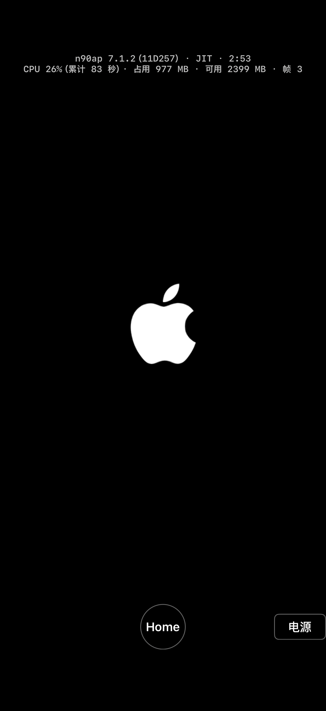
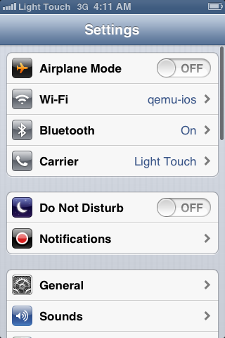

# M1 step 4: booting the iPhone 4's iOS 7.1.2 on the iPhone 18 Pro with StikDebug JIT

- Date: 2026-11-01
- Execution session: M1 execution session (continuing from stages 1 to 3). Scope: using the iPhone 4 built in M0 (n90ap-11D257) and its golden state, on the iPhone 18 Pro (iOS 27.2), with JIT from StikDebug, a 256 MB code region and host GL off (stub), do one cold boot round, then after reaching the home screen open Settings and press Home.
- Not done: did not turn on EAGL host GL (that belongs to M2), did not test the interpreter build, did not touch the iPhone 14 Pro, did not commit or push, did not file issues or PRs with any upstream. The iPhone 4 device files on the phone were kept, not deleted, as requested.

## 0. Conclusions

1. **iOS 7.1.2 does not reach the lock screen; it stops at the white Apple logo on black.** The reason is that iOS 7's SpringBoard crashes as soon as it initializes OpenGL ES, and after each crash launchd restarts it: it was launched 29 times in 179 seconds (about once every 5.5 seconds). As agreed, this step kept host GL off, so every GL call is rejected. As agreed, I stopped when it could not reach the home screen and did not force a workaround.
2. **It has nothing to do with the phone, JIT or the USB keyboard.** Reproduced in the iOS Simulator on the Mac with the same stub build: 150 seconds each without and with the USB keyboard attached, SpringBoard was launched 25 times in both, and both stopped at the Apple logo. In M0 on the Mac (with host GL on), the same device with the same golden state reached the lock screen in 40 seconds.
3. **Everything before SpringBoard works normally:**

   | Item | Number |
   |---|---|
   | Device pack upload (AFC, USB) | 2.4 GB, 65 seconds (about 37 MB/s) |
   | App unpacking | 2.3 seconds |
   | StikDebug preparing the 256 MB code region | 0.77 seconds |
   | QEMU screen on (first frame with backlight) | 1.1 seconds (CPU 3.2 seconds) |
   | Lock screen, home screen | Not reached |
   | CPU (one core = 100%) | 124% for the first 15 seconds, 54% from 15 to 60 seconds, 36% from 60 to 178 seconds (the cost of SpringBoard repeatedly crashing and restarting) |
   | App footprint | Peak 1015 MB |
   | Available memory | Minimum 2361 MB |

   For comparison, the iPhone 4 with JIT on the Mac in M0: lock screen at 40.2 seconds, 25% idle on the home screen, 1.85 seconds from tapping Settings to it being in the foreground. None of these can be compared on the phone yet.
4. **Why iOS 6 is fine:** in stage 3, iOS 6.1.6 on the 3GS has the same GL front end installed, and it also handshook with the host and was also rejected by the stub, but its compositing can fall back to software, so it still reached the home screen. iOS 7 cannot fall back.
5. **Touch and the Home button were not verified on iOS 7** (it cannot reach the home screen). The newly written "open Settings, then press Home" automation works on the simulator's 3GS iOS 6: 2.5 seconds after tapping the icon the Settings page was recognized, and 1.6 seconds after pressing Home the home screen was recognized again. Once iOS 7 reaches the home screen, this part can be used directly.
6. **Blocker: iOS 7 cannot do without host GL.** To boot iOS 7 on the phone, one of the routes in section 5 below has to be done first, and all of them need a decision from the decision session.

## 1. Preparation

- **Device files**: APFS-cloned from M0's `work/devices/n90ap-11D257` (2.2 GB) and `work/states/n90ap-11D257/state` (119 MB, first-time setup completed) to `work/ios/devices/n90ap-11D257` and `n90ap-11D257-golden`; M0's directories are read-only. Packed into `work/ios/packs/n90ap-11D257.ctpack` (2291 MB of data, packed in 2.4 seconds), transferred over AFC to the App's `Documents/import/`, size checked and matching. The App unpacks it at launch and then deletes the pack.
- **USB keyboard: not attached.** After unlocking, iOS 7 shows "Cannot Use Device / QEMU USB Keyboard", which blocks touch (M0 report section 7). `DeviceProfile.boot` gets a new `usbKeyboard` parameter; the keyboard is attached only with the App's `-usbkbd YES` (or `"usbkbd": true` in autostart.json), and is not attached by default; the App does not send key presses to the guest right now anyway. This round on the phone used `usbkbd=false`. Per the brief, if "it cannot boot once the keyboard is removed", the fix is to attach it and tap OK automatically; this boot failure has nothing to do with the keyboard (the simulator behaves the same with it attached, section 3), so I did not run another round on the phone with the keyboard attached.
- **Host GL**: still the stub (`-Dhost_gles=disabled`), unchanged.
- **App build**: both the device and simulator builds were rebuilt and reinstalled. The dylibs did not change (the four from stage 3).

## 2. The round on device

Command: `STIK=1 IDLE=40 TBSIZE=256 OPENSETTINGS=1 scripts/ios/device-boot.sh n90ap-11D257 jit 900`. Run directory `work/ios/runs/device/20261101-225949-n90ap-11D257-jit/`. Mac load around 2.9; the iPhone Mirroring app's process was running, but the phone stayed unlocked throughout and was not being mirrored (the same was true for the 9 rounds in stage 3).

events.log:

```
0.0 boot ... backend=jit ... debugger=true bootrom=placeholder-b-self.bin usbkbd=false
1.4 first_frame 640x960
3.0 backlight_on level=1601
179.0 control quit
179.0 qemu_exit status=0
```

- Around minute 2 the user reported "still on the white Apple screen". Checking the serial log confirmed a crash loop; at second 179 `quit` was sent, QEMU exited normally, the script then terminated the App, and no processes were left on the phone.
- The guest screen never changed after second 14 (the frame number stayed at 3), and only 3 guest screenshots were saved.



In the serial log (`serial-0.log`, 505 lines), boot goes normally all the way: kernel, IOKit, NAND, joining Wi-Fi, launchd coming up. After that, every time SpringBoard reaches these lines, nothing more follows, and it starts over with a new PID:

```
SpringBoard[64:1b07] Loaded logger: SBWorkspaceLogging
SpringBoard[64:1b07] *** error reading settings archive file: <SBRootSettings: .../RootSettings.plist>
[gles] OpenGLES front end (contrib/gles-public): 508 gl exports, ... host protocol 1; ES 1.1 + 2.0 (GLEngine.bundle); IOSurface
SpringBoard[99:1b07] Loaded logger: SBAppInstallationLog
...
```

The last one is SpringBoard[154], guest time 04:00:04 to 04:02:42, 29 times in total. `qemu.log` only has the JIT preparation, the screen coming on and `[gles] shim hello: protocol 1 ... (host: 1, ...)`, with no errors on the QEMU side. "error reading settings archive" also appears in the normal boot on the Mac in M0, so it is not the cause.

## 3. Reproduction in the simulator (without occupying the phone)

Same device and golden state, simulator JIT dylib (also the stub), `scripts/ios/sim-boot.sh n90ap-11D257 jit 150`:

| Round | USB keyboard | SpringBoard launches in 150 seconds | Lock screen |
|---|---|---|---|
| 20261101-230439 | Not attached | 25 | Not reached |
| 20261101-230714 | Attached (`USBKBD=1`) | 25 | Not reached |

Conclusion: the phone, TXM, StikDebug and the USB keyboard can all be ruled out.

## 4. Cause

- The device was built by FirmwareKit following Light Touch's recipe, with `ca_ogl` on: the OpenGLES.framework in the guest is replaced entirely by the upstream GL front end `contrib/gles-public`, and CoreAnimation on iOS 6 and 7 forwards GL calls through it to the host (this is how the 7.1.2 result in upstream's `docs/n90/README.md` was achieved).
- When we turn host GL off, QEMU uses `hw/arm/gles-host-stub.c`, which returns -1 for every call. The front end fails to create a context (`fe_new_gc`), and `-[EAGLContext initWithAPI:...]` returns nil.
- The upstream stub's comment says "the guest falls back to its own software rendering after the probe fails". iOS 6 does this: the 3GS round handshook the same way, was rejected the same way, and still reached the home screen. iOS 7.1.2's SpringBoard crashes as soon as it gets a nil context (inference: the crash reports are in the guest's `/var/mobile/Library/Logs/CrashReporter`, and were not pulled out this time).
- Stage 1 turned host GL off to verify "can it boot" separately from "is GL correct". That split holds for iOS 3 and 6, but not for iOS 7.

## 5. Options (all need a decision from the decision session)

1. **Move EAGL host GL up to now (originally M2).** Upstream's `hw/arm/gles-host-eagl.c` is still on the main branch and ran on an A19 device on 2026-08-04; our build compiles it in as long as `-Dhost_gles=disabled` is not passed. This is the most direct route, and it is the one iOS 7 will have to take sooner or later to be "playable". Cost: M0 report section 3 says the EAGL backend blocks snapshots while a GL context is alive, so "instant snapshot switching" needs separate work; GL must be stopped before the App goes to the background (`qemu_ios_set_foreground` already exists).
2. **Rebuild an iPhone 4 with `ca_ogl` off (software CoreAnimation).** Upstream did this for iOS 6.0 beta and 7.0 beta (`docs/n81/README.md` item 12, `docs/n90/README.md`); it boots normally but has no GL apps. It requires rebuilding the device with M0's FirmwareKit and going through first-time setup again (a few minutes on the Mac); whether 7.1.2 can boot under software compositing, and whether it would be slower (iOS 7's blur and animations all rely on compositing), has not been verified. The upside is that it does not touch host GL, and snapshots are unaffected.
3. **Make the stub implement GLES in software on the host instead of returning -1.** The most work; not recommended.

Suggestion: first try option 1 in the simulator on the Mac (the simulator SDK also has OpenGLES, and it does not occupy the phone), and once it works, run one round on device; option 2 can serve as a comparison if we do not want to touch GL.

## 6. What was left on the phone

- The App's `Documents/devices/n90ap-11D257/`: the device itself (2.2 GB), `golden-state/` (119 MB), and this round's `state/` (a clone, only the pages written are extra). Free space on the phone went from 252.64 GB before the upload to 250.08 GB, about **2.56 GB** in total (including this round's logs). Not deleted, as requested.
- `Documents/autostart.json` now points to n90ap-11D257. The script rewrites it before StikDebug next brings up the App.

## 7. Changes

- `app/ClassicTouch/DeviceProfile.swift`: `boot(...)` gets `usbKeyboard`; models with a USB host port no longer attach the USB keyboard by default.
- `app/ClassicTouch/EmulatorViewController.swift`: new launch arguments `-usbkbd`, `-opensettings`; `settingsTrip()` (records `idle_end` when idle ends, after recognizing the word "Settings" on the home screen taps the icon 0.06 above it, after recognizing the Settings page saves `settings-*.png`, presses Home 2 seconds later, after recognizing the home screen again saves `home-back-*.png`, exits 5 seconds later; each step retries after 20 seconds without a response, up to 3 times, with a 150-second timeout for the whole sequence); the `boot` event records `usbkbd=`.
- `app/ClassicTouch/GuestText.swift`: recognition results include the positions of the requested words (`GuestReading.places`); new `isSettingsScreen`; `isHomeScreen` excludes the Settings page (its title is also "Settings").
- `scripts/ios/device-boot.sh`: `OPENSETTINGS=1`, `USBKBD=1`; fetches `argv.json`, `guest-*`, `settings-*`, `home-back-*`, `import.log`; the summary records the seconds to open Settings and to get back to the home screen; sends `quit` if it has not exited by the time limit; terminates the App process after testing.
- `scripts/ios/sim-boot.sh`: `USBKBD=1`.
- `scripts/ios/summarize-run.py`, `scripts/ios/check-idle.py`: the idle segment is also cut off at `idle_end`.

Simulator verification (3GS iOS 6.1.6, JIT, `-autodrive YES -opensettings YES -idle 10`):

```
19.6 lock_seen 19.6
39.6 home_seen 39.6
50.0 idle_end
50.6 settings_label 0.855,0.762
51.0 tap_settings 1 at 0.855,0.702
53.5 settings_seen 53.5
56.0 home_press 1
57.6 home_back 57.6
63.0 auto_quit
```



## 8. Reproduction

```bash
cp -c -R work/devices/n90ap-11D257 work/ios/devices/
cp -c -R work/states/n90ap-11D257 work/ios/devices/n90ap-11D257-golden
python3 scripts/ios/pack-device.py work/ios/packs/n90ap-11D257.ctpack \
  work/ios/devices/n90ap-11D257=devices/n90ap-11D257 \
  work/ios/devices/n90ap-11D257-golden/state=devices/n90ap-11D257/golden-state
work/ios/tools/idevice-tools-0.1.68/bin/idevice-tools --udid <phone> afc --documents org.classictouch.app \
  upload work/ios/packs/n90ap-11D257.ctpack /Documents/import/n90ap-11D257.ctpack
# phone unlocked, cable plugged in, LocalDevVPN on, mirroring off
STIK=1 IDLE=40 TBSIZE=256 OPENSETTINGS=1 scripts/ios/device-boot.sh n90ap-11D257 jit 900
# reproduce in the simulator (clone the device into Documents/devices/ in the simulator App's container first)
scripts/ios/sim-boot.sh n90ap-11D257 jit 150
USBKBD=1 scripts/ios/sim-boot.sh n90ap-11D257 jit 150
```

Logs: `work/ios/runs/device/20261101-225949-n90ap-11D257-jit/` (events, stats, qemu.log, serial-0.log, screenshots, import.log, summary), `work/logs/stage4-*.log`; each simulator round is under `Documents/logs/` in the simulator App's container.
