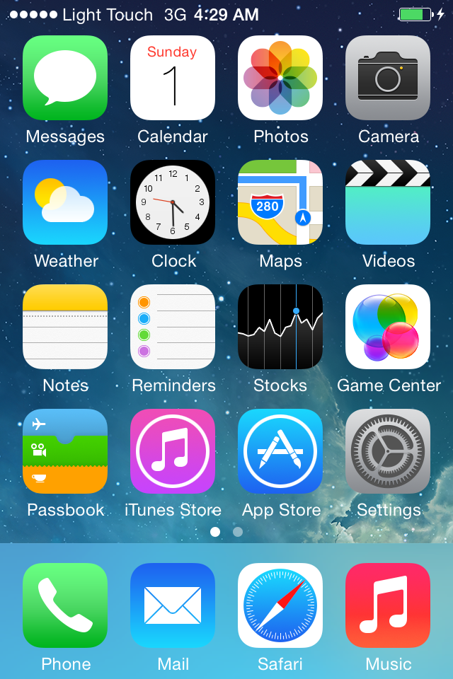
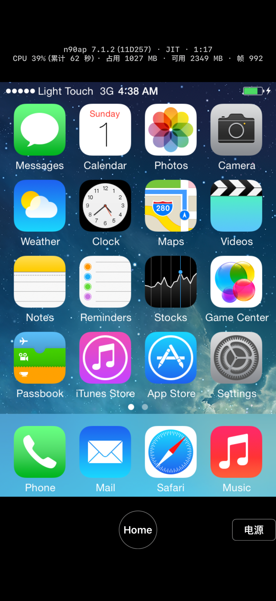
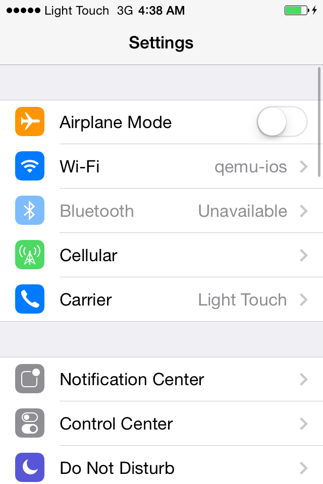

# M2 item 1: host GL on the phone (adding OpenGL ES 2.0 to EAGL)

- Date: 2026-11-01
- Execution session: m2-gl-eagl. Scope: add ES 2.0 to the iOS host's EAGL backend so that iPhone 4 iOS 7.1.2 boots to the home screen with graphics acceleration on the iPhone 18 Pro, with no regression on iOS 3.1.3 and 6.1.6.
- Not done: no changes to `upstream/`, no commit, no push, no issue or PR filed with any upstream, no download of ANGLE or other dependencies, no use of the iPhone 14 Pro. No background test on the real device (the brief only asked for the simulator, see section 5).

## 0. Conclusions

1. **iOS 7.1.2 boots to the home screen with host GL on the iPhone 18 Pro.** StikDebug JIT, 256 MB code region, one run: lock screen at 29 seconds, home screen at 37 seconds; home screen idle CPU 44% (one core, 37 seconds untouched); App footprint 1027 to 1109 MB, minimum free memory 2267 MB. Automatically opening Settings: the Settings page was recognized after 2.1 seconds; pressing Home returned to the home screen after 1.1 seconds; touch and buttons both work. GL runs on the phone's A20 Pro GPU ("OpenGL ES 3.0 Metal - 105"), CoreAnimation composites through the host the whole time, zero refusals. In M1 step 4, with host GL off, the same device got stuck at the Apple logo and SpringBoard crashed 29 times in 179 seconds.
2. **No regression on iOS 3.1.3 and 6.1.6.** Boot times and idle CPU match or beat M1 stage 3 (stub, software compositing):

   | Device | Lock screen | Home screen | Home screen idle CPU | Compared with M1 stage 3 (stub) |
   |---|---|---|---|---|
   | iPhone 3GS 6.1.6 | 15 s | 23 s | 12% | 14 s, 22 s, 16% |
   | iPod touch 2nd gen 3.1.3 | 10 s | 18 s | 19% | 10 s, 18 s, 19% |

   The idle segment of the first iPod run was disturbed ("Weather" opened at second 27 with no action in the event log, which looks like the phone screen was touched). Per the rules, one more run was done; the table shows the numbers from that rerun (section 4.3).
3. **Approach**: instead of writing a separate path, the iOS EAGL build takes upstream ANGLE's path of "one host ES context per guest context". Only context creation, switching and release are replaced with EAGL. The ES adaptation (framebuffer names, rectangle textures, ES 1.1 row length, submitting GLSL unchanged) reuses the ANGLE layer directly. Patch: `patches/ios-eagl-es2.patch`. `build-qemu.sh` enables host GL by default; `HOST_GLES=disabled` builds the stub for comparison.
4. **Background**: `qemu_ios_set_foreground(false)` now waits for the GL call in progress to finish before returning; all later calls are refused and counted. Verified in the simulator: switching to the system Settings app for 15 seconds while on the home screen refused 4716 GL calls during the background period (the App was suspended by the system after about 6 seconds); after switching back, the guest drew frames normally and SpringBoard did not restart. The simulator does not kill processes for using GL in the background, so "not killed on the real device" rests only on the code; it was not tested on the phone.
5. **Blockers: none.** No wall from missing capabilities in the system OpenGLES. Two things worth following up (section 6): iOS 7 home screen idle at 44% is higher than the 25% on the Mac, and the readback cost has not been analyzed; while in the background the VM keeps running (only GL is refused), and it should be paused at the same time.

## 1. Plan before starting (written first, then done)

### 1.1 Current state: what the EAGL backend lacks

Judgment after reading `hw/arm/gles-host.c` (8258 lines), `gles-host-eagl.c` (296 lines), `gles-host-angle.c.inc` and `gles-host-stub.c`:

1. **The whole process has a single ES 1.1 context.** `gles-host-eagl.c` uses one static `gles_ctx` with `initWithAPI:1`, and ignores guest contexts and share groups. All the "one host context per guest context" code in `gles-host.c` (`gles_context_operation`, `gles_contexts`, `GLESGroup.root`, `GLESHost.cgl`) sits inside `#if !defined(GLES_HOST_EAGL) || defined(GLES_HOST_ANGLE)` and is built only for CGL and ANGLE; a pure EAGL build answers `GLES_OP_NEW_CONTEXT` with 0 ("legacy EAGL backend, no native-context handles"). CoreAnimation from iOS 4 on (in backboardd on iOS 6 and 7) creates API 2 contexts and runs shaders, which an ES 1.1 context cannot execute.
2. **The pure EAGL build no longer compiles on current main.** Tested by turning on `-Dhost_gles` for a simulator build: 20 errors in `gles-host.c`, using `GL_UNPACK_ROW_LENGTH`, `GL_TEXTURE_CUBE_MAP_*` and others that the ES 1.1 headers lack. After upstream switched to the Mac in August, only the ANGLE branch of the iOS path is still maintained (the ANGLE build also defines `GLES_HOST_EAGL`).
3. **The ANGLE backend already does what iOS 7 needs** (upstream `docs/research/angle-evaluation.md` sections 10-21; n90ap 11D257 on the Mac composites through ANGLE the whole time, zero refusals):
   - a guest API 2 context gets a host ES 2.0 context (ANGLE actually gives ES 3.0); API 0 and 1 get ES 1.1;
   - framebuffer object names use the OES or core version depending on the current context;
   - guest GLSL is handed to the host compiler unchanged (no rewrite to desktop 1.20);
   - ES requires the internal format to match the data format, so `glTexImage2D` changes the internal format;
   - ES 1.1 has no `GL_UNPACK_ROW_LENGTH`, so the context records it itself and packs rows tightly before upload;
   - CoreAnimation on 3.x uses `GL_TEXTURE_RECTANGLE`, which ES lacks, so it is treated as a 2D texture (each texture unit records its own binding and enable state, and at draw time the texture matrix is multiplied by 1/width, 1/height);
   - APPLE_fence is replaced with NV_fence.
4. **How the compositing result reaches the App's display**: CoreAnimation on iOS 6 and 7 draws layers into an IOSurface in guest memory (on the host side, a texture attached to an FBO). `gles_surface_writeback` reads it back with `glReadPixels` and writes it into the guest memory pages. The guest's display controller scans out from there, QEMU's display device draws it into the console, and the App fetches a BGRA frame with `qemu_ios_ui_frame` on every screen refresh. Host GL only "draws into guest memory" and never touches the App's display directly. The IOSurface color attachment in the old EAGL backend was only used for the full-screen framebuffer (`gles_present_to_panel`), and there was one for the whole process; the ANGLE backend does not use it at all (everything goes through readback).

### 1.2 The change

Instead of writing a separate path, **the iOS EAGL build takes ANGLE's path of "one host ES context per guest context"**, and only context creation, switching and release are replaced with EAGL:

1. `gles-host.c`: add a macro `GLES_HOST_ES_CONTEXTS` (defined by both ANGLE and iOS EAGL), and change the "ES host" branches currently written as `!defined(GLES_HOST_EAGL) || defined(GLES_HOST_ANGLE)` and `defined(GLES_HOST_ANGLE)` to test this macro; on iOS include both the `OpenGLES/ES1` and `ES3` headers.
2. New file `gles-host-eagl.c.inc`: the EAGL context struct (`EAGLContext`, API version, and the few state items the ANGLE adaptation needs) plus creation, switching and release; then include the EGL-independent ES adaptation from `gles-host-angle.c.inc`. `gles-host-angle.c.inc` only gets conditional compilation: the EGL parts are for ANGLE only; APPLE_fence on iOS has no NV_fence to borrow, so it becomes "every fence is already complete" (guest data is copied into the host on every call, the same semantics as ANGLE); BGRA textures on iOS use an RGBA internal format per `APPLE_texture_format_BGRA8888`.
3. Rewrite `gles-host-eagl.c` as pure C Objective-C runtime calls (the original file explains why it cannot be a .m), providing: create an `EAGLContext` by API (guest API 2 gets ES 3.0, falling back to ES 2.0 on failure; API 0 and 1 get ES 1.1; contexts in the same group use the root context's `sharegroup`), make current, and release. The current context is tracked in a thread-local variable instead of asking the system each time; context creation is wrapped in an autorelease pool.
4. Apple requires contexts in the same sharegroup to have the same API version (ANGLE does not care). The guest is under the same rule on real iOS and should not mix them; if the host refuses anyway, log it and fail that guest context, rather than silently falling back to no sharing.
5. The full-screen framebuffer goes through readback for now, as in ANGLE; add per-context IOSurfaces later if needed.
6. Background: iOS kills processes that submit GPU commands in the background. The existing `qemu_ios_set_foreground(false)` makes later GL calls return -1 (the guest front end just ignores -1 for ordinary calls). Need to check when the App calls it and whether the call in progress can cross that point; verify in the simulator if possible.
7. Build: `build-qemu.sh` defaults to `HOST_GLES=enabled`; `HOST_GLES=disabled` builds the stub into `build-qemu-<platform>-<backend>-stub` for comparison.

Verification order: n90ap 11D257 boots to the home screen in the simulator, with no regression on n88ap 10B500 and n72ap 7E18; then on the iPhone 18 Pro.

## 2. Implementation

### 2.1 Patch `patches/ios-eagl-es2.patch` (939 lines, based on b225694505)

| File | Change |
|---|---|
| `hw/arm/gles-host.c` | New macro `GLES_HOST_ES_CONTEXTS` (defined by both ANGLE and iOS EAGL). The 15 places previously written as `!defined(GLES_HOST_EAGL) \|\| defined(GLES_HOST_ANGLE)` (per-context state, `gles_context_operation`, rectangle textures, NV12, APPLE_fence, clip plane queries) and the 3 places written as `defined(GLES_HOST_ANGLE)` (PVRTC stored as RGBA, GLSL submitted unchanged, snapshots not registered) now test it; on iOS both the OpenGLES ES1 and ES3 headers are included, plus the new `gles-host-eagl.c.inc`; the context creation code is shared by ANGLE and EAGL and logs `[gles-eagl] context api=… renderer=…`; the old single-context branch is removed. Background: see section 5 |
| `hw/arm/gles-host-eagl.c.inc` (new) | EAGL context struct (EAGLContext, API, the row length and rectangle texture state the ANGLE adaptation needs, fence table), creation, make current, reference counting and release; guest API 2 gets ES 3.0, API 0 and 1 get ES 1.1, the same group uses the root context's EAGLSharegroup; APPLE_fence is tracked locally (iOS has no NV_fence); finally includes `gles-host-angle.c.inc` |
| `hw/arm/gles-host-angle.c.inc` | The EGL lifecycle and NV_fence sections are built only for ANGLE; BGRA textures use an RGBA internal format on iOS. ANGLE build behavior is unchanged |
| `hw/arm/gles-host-eagl.c` | Reduced to three pure C functions (create a context by API, make current, release), still going through the Objective-C runtime (the original file explains why it cannot be a .m), each wrapped in an autorelease pool (the vCPU thread has no pool of its own); the IOSurface color attachment, usable by only one context, is removed |

Why a guest ES 2.0 context gets a host ES 3.0 context: ANGLE does the same (a request for 2 gets 3.0), and that is the combination upstream verified on the Mac; ES 3.0 compiles the guest's `#version 100` shaders unchanged, and it has `GL_UNPACK_ROW_LENGTH`, which ES 2.0 lacks and which `gles-host.c` needs for texture uploads. Item 3 of the plan, "fall back to ES 2.0 if ES 3.0 cannot be created", was not done in the end: falling back to ES 2.0 would also need a row length adaptation, and both the simulator and the iPhone 18 Pro can create ES 3.0; if creation fails, that guest context fails and the log says so.

The full-screen framebuffer goes through `glReadPixels` readback, as in ANGLE. From iOS 4 on, what is on screen is CoreAnimation's own IOSurface, which `gles_surface_writeback` already reads back; the old IOSurface attachment only covered the full-screen framebuffer, which none of the three devices use.

The patch applies to unmodified upstream: `git -C upstream/qemu-ios apply --check patches/ios-eagl-es2.patch` passes (check only, `upstream/` not modified). After changing the work tree, re-export the patch:

```bash
cd work/ios/qemu-ios
{ awk '/^diff --git/{exit} {print}' ../../../patches/ios-eagl-es2.patch
  git diff -- hw/arm/gles-host.c hw/arm/gles-host-angle.c.inc hw/arm/gles-host-eagl.c
  git diff --no-index -- /dev/null hw/arm/gles-host-eagl.c.inc; } > ../eagl-es2.patch.new \
  && mv ../eagl-es2.patch.new ../../../patches/ios-eagl-es2.patch
```

### 2.2 Build switch

- `scripts/ios/build-qemu.sh`, `make-dylib.sh`: `HOST_GLES=enabled` (default) builds the host GL version into the existing `work/ios/build-qemu-<platform>-<backend>/`; `HOST_GLES=disabled` builds the stub into `build-qemu-<platform>-<backend>-stub/`. `build-qemu.sh` already applied `patches/ios-*.patch` automatically (skipping ones already applied).
- All four dylibs (device and simulator, each with JIT and interpreter) were rebuilt as GL versions. All link OpenGLES and libobjc, each is about 34 MB, and the 58 exported functions are unchanged. The interpreter versions were only built, not tested.
- One copy of each of M1's four stub dylibs is kept in `work/ios/stub-dylibs/`; for comparison you can also rebuild with `HOST_GLES=disabled`.
- The App was rebuilt and reinstalled on the simulator and the phone; the App's Swift code was not changed this time.

### 2.3 What came up while compiling

Upstream's pure EAGL build does not compile on main (section 1.1 item 2). After switching to the ES context path it compiled on the first try; the GL files have only three warnings that upstream already had (`gles_es2_glsl` unused and so on; the ANGLE build has them too).

## 3. Simulator verification (iPhone 18 Pro simulator on an M4 Max, iOS 27.2, JIT 256 MB)

Note: OpenGLES in the simulator is the "Apple Software Renderer". GL is computed on the CPU, inside our process, so simulator idle CPU is higher than with the stub, and the speed does not represent the phone.

| Device | QEMU screen on | Lock screen | CPU to lock screen | Home screen | Home screen idle CPU (16 s) | Max footprint | Compared with M1 stage 1 simulator (stub) |
|---|---|---|---|---|---|---|---|
| iPhone 4 7.1.2 | 1.4 s | 32 s | 37.3 s | 41 s | 46% | 996 MB | Never reached the lock screen (M1 step 4: SpringBoard launched 25 times in 150 seconds) |
| iPhone 3GS 6.1.6 | 16.2 s | 17 s | 18.3 s | 45 s | 17% | 790 MB | Screen on 18.2, lock screen 19, home screen 49 s, 10%, 789 MB |
| iPod touch 2nd gen 3.1.3 | 8.7 s | 9 s | 8.6 s | 18 s | 23% | 713 MB | Screen on 7.0, lock screen 10, home screen 19 s, 17%, 704 MB |

- All three `qemu.log` files have "CoreAnimation composites through the host", and the refusal count is 0 for all. Host contexts: iOS 7 and 6 have one ES 1.1 context (API 0: the old-style creation in the guest that reports no API version, `[mbxshim] GLESCreateGC`) plus one or two ES 3.0 contexts (CoreAnimation's API 2); iOS 3.1.3 has two ES 1.1 contexts (API 0 and 1) and goes through the rectangle texture adaptation layer.
- These three runs used a build from before the section 5 background change (differing only in the `gles_host_set_allowed` part, which does not touch the GL path); the section 5 simulator background test and all section 4 device runs used the final build.
- The lock screen and home screen screenshots of all three were checked, and the images are complete (iOS 7's frosted glass Dock, iOS 6's glass Dock and iOS 3's Dock reflection are all there).



Other screenshots: `img/m2gl-sim-n90ap-7.1.2-jit-lock.png`, `img/m2gl-sim-n88ap-6.1.6-jit-home.png`, `img/m2gl-sim-n72ap-3.1.3-jit-home.png`.

## 4. iPhone 18 Pro real device (iOS 27.2 24B119, StikDebug JIT, 256 MB, USB)

Commands (one run per device, phone unlocked, cable plugged in, no mirroring; Mac 1-minute load 4 to 5):

```bash
STIK=1 IDLE=40 TBSIZE=256 OPENSETTINGS=1 scripts/ios/device-boot.sh n90ap-11D257 jit 600
STIK=1 IDLE=40 TBSIZE=256 scripts/ios/device-boot.sh n88ap-10B500 jit 600
STIK=1 IDLE=40 TBSIZE=256 scripts/ios/device-boot.sh n72ap-7E18 jit 600
```

The device files were all already on the phone (not re-uploaded), and each run cold-booted from the golden state with `-resetstate`. After each run the script ended the App, and no process was left on the phone.

### 4.1 Results

| Device | Code region setup | QEMU screen on | Lock screen | CPU to lock screen | Home screen | Home screen idle CPU | Footprint | Free memory (minimum) |
|---|---|---|---|---|---|---|---|---|
| **iPhone 4 7.1.2** | 0.48 s | 1.1 s | **29 s** | 33.2 s | **37 s** | **44%** | 1027 to 1109 MB | 2267 MB |
| &emsp;Compared with M1 step 4 (stub) | 0.77 s | 1.1 s | Not reached | | | | Max 1015 MB | 2361 MB |
| &emsp;Compared with M0 Mac (CGL, JIT) | | | 40.2 s | | | 25% | | |
| **iPhone 3GS 6.1.6** | 0.79 s | 13.4 s | **15 s** | 14.5 s | **23 s** | **12%** | 822 to 914 MB | 2462 MB |
| &emsp;Compared with M1 stage 3 (stub) | 0.76 s | 12.2 s | 14 s | 14.0 s | 22 s | 16% | 791 to 892 MB | 2484 MB |
| **iPod touch 2nd gen 3.1.3** (rerun) | 0.78 s | 8.0 s | **10 s** | 7.0 s | **18 s** | **19%** | 741 to 801 MB | 2575 MB |
| &emsp;First run (idle segment disturbed, discarded) | 0.78 s | 7.9 s | 10 s | 7.9 s | 18 s | ~~38%~~ | 744 to 797 MB | 2579 MB |
| &emsp;Compared with M1 stage 3 (stub) | 0.68 s | 7.7 s | 10 s | 6.9 s | 18 s | 19% | 751 to 775 MB | 2601 MB |

- Same measurement method as M1 stage 3: lock screen and home screen are the times when the App itself recognized them with Vision, counted from when the App calls `qemu_ios_main`; CPU is all threads of this process, counted as one core; the idle segment runs from 3 seconds after the home screen to `idle_end`/`auto_quit`.
- GL on all three ran on the "Apple A20 Pro GPU": ES 1.1 is "OpenGL ES-CM 1.1 Metal - 105", ES 3.0 is "OpenGL ES 3.0 Metal - 105". The refusal count is 0 for all, and "EAGL refused to create a context" never appeared (the share group risk in section 6 was not hit this time).
- Idle segment check (`check-idle.py`): iPhone 4 from 41 to 78 seconds, no events, frame number +371 (about 10 frames per second. The second hand of the "Clock" icon on the iOS 7 home screen keeps moving, so idle is not static to begin with; M0 measured about 30 frame changes per second for the idle iOS 7 home screen on the Mac, and the phone gets only a third of that; the reason was not investigated); 3GS from 27 to 63 seconds, +2; iPod rerun from 22 to 58 seconds, +1.
- Footprint is a few dozen MB more than with the stub (host GL contexts and textures).

### 4.2 iPhone 4: open Settings, then press Home

`OPENSETTINGS=1`: after the idle segment the App recognizes the word "Settings" on the home screen and taps the icon above it; the tap happened at 79.0 seconds, the Settings page was recognized at 81.1 seconds (2.1 seconds, including the delay of recognizing once per second), Home was pressed at 84.0 seconds, and the home screen was recognized again at 85.1 seconds (1.1 seconds). On the Mac, M0 took 1.85 seconds from tapping Settings to it being in the foreground.





The other two: `img/m2gl-device-n88ap-6.1.6-stikdebug-jit256-home.png`, `img/m2gl-device-n72ap-3.1.3-stikdebug-jit256-home.png`.

### 4.3 Why the first iPod run was discarded

In the first run (`20261101-234131`) boot, lock screen and home screen times were all normal, but idle CPU was 38% and the frame number kept rising at 16 frames per second. The guest screenshots show "Weather" was opened between seconds 26 and 27, after which it kept showing the "Updating..." spinner (`img/m2gl-device-n72ap-3.1.3-disturbed-weather.png`). `events.log` has no script action in that period; the App does not record finger touches, so, as with the 3GS in M1 stage 1, the judgment is that the phone screen was touched. Per the rules, one more run was done (`20261101-234337`): idle 19%, frame number changed by only 1, the same as with the stub.

## 5. Background: no more GL calls when the App is not in the foreground

### 5.1 Mechanism

- The App calls `qemu_ios_set_foreground(false)` in `sceneWillResignActive` and `(true)` in `sceneDidBecomeActive` (already there in M1; the upstream header requires turning it off at willResignActive, not didEnterBackground).
- Before, `gles_host_set_allowed(false)` only changed a flag: the GL call in progress on the vCPU thread (which read the flag before it changed) would run to completion and could cross the moment the App went into the background.
- The patch changes this: each GL call first marks itself "in a call" and then reads the flag; the side turning it off first changes the flag and then waits for the mark to clear (at most 1 second, logging on timeout), with a memory barrier on each side, so after `set_foreground(false)` returns no GL call can reach the system GL. Refused calls are counted, and on returning to the foreground it logs `[gles] foreground again: N GL calls refused while away`. The guest front end just ignores -1 for ordinary calls.

### 5.2 Simulator verification

New script `scripts/ios/sim-background.sh`: boot iPhone 4 7.1.2 to the home screen, wait 10 seconds, bring the system Settings app to the foreground with `simctl launch com.apple.Preferences`, after 15 seconds `simctl launch` our App again (still running, so it does not restart), and quit 10 seconds later.

```
Before background: second 55.0, frame number 942
15 s after background: second 61.0, frame number 1002      ← the App was suspended by the system about 6 s after going into the background; stats stop at second 61
10 s after foreground: second 81.0, frame number 1102
[gles] foreground again: 4716 GL calls refused while away
SpringBoard only PID 64 (no restart); only one run directory (the App did not restart)
```

In the screenshot after returning to the foreground, the status bar time and the Clock icon's hands are moving, and the image is complete (`img/m2gl-sim-n90ap-7.1.2-jit-after-background.png`).

### 5.3 Not verified

- **"Killed for using GL in the background" was not tested on the real device.** The simulator does not enforce this rule, so the simulator can only show that GL calls were in fact blocked during the background period (4716 of them), not that the phone will not kill the App. On the real device, one test could use `devicectl` to launch the system Settings app, sending the App to the background, and then switch back; about 1 minute, not done (the brief only asked for the simulator).
- Pulling down Control Center or Notification Center also triggers willResignActive. The App is still visible then, but the guest's GL is refused, so the picture freezes and recovers on return. This is upstream's tradeoff.
- On guest restart (`gles_host_reset`), GL objects are released on the main loop thread; if that happens to occur in the background, it touches GL. Rare, not handled.
- In the roughly 6 seconds between going into the background and being suspended by the system, the VM keeps running, and iOS 7's CoreAnimation keeps issuing GL calls, all refused. See section 6.

## 6. Risks and next steps

1. **iOS 7 home screen idle at 44%**, higher than CGL's 25% on the Mac and much higher than iOS 6's 12%; frame changes are also only a third of the Mac's. The cause was not analyzed. One guess: the iOS 7 home screen keeps redrawing (the clock icon), and every compositing pass has to be read back into guest memory with `glReadPixels`; on a tile-based GPU like the phone's, readback has to wait for the pipeline to drain. Worth one look with `IT_GLES_PROF=1` at where the GL bridge spends its time: if it is mostly readback, CoreAnimation's surfaces could get per-context IOSurfaces (the old code only used one for the full-screen framebuffer, and only one for the whole process).
2. **Pause the VM when the App goes into the background.** `qemu_ios_ui_pause`/`resume` (QMP stop/cont) already exist; not running the guest in the background saves power and also avoids a big jump in the virtual clock on resume. This belongs to the App lifecycle design in the M2 "version list cold boot" part.
3. **Mixed APIs in a share group**: Apple requires contexts in the same sharegroup to share one API, and ANGLE does not care. The guest is under the same limit on real iOS, and none of the three devices hit it this time; if some App mixes them, the host will refuse to create the context and log "[gles-eagl] EAGL refused an ES n context in its share group", and that App's GL will fail.
4. **Only the home screen, lock screen and Settings were tested**; no 3D games or third-party Apps.
5. OpenGLES has been deprecated since iOS 12 and still works on iOS 27.2 (tested this time). If it is removed in the future, the fallback is still ANGLE (upstream's ANGLE build is not affected by this patch).
6. Snapshots are still blocked by GL (`gles_begin_context` installs a migration blocker); per the existing decision, not done.

## 7. Files

- In the repository (not committed):
  - `patches/ios-eagl-es2.patch` (new)
  - `scripts/ios/build-qemu.sh`, `scripts/ios/make-dylib.sh` (`HOST_GLES` switch, on by default)
  - `scripts/ios/sim-background.sh` (new)
  - This report and `docs/reports/img/m2gl-*.png` (10 images, all checked)
- In `work/` (not committed):
  - `work/ios/qemu-ios` (work tree, new patch applied); the four `build-qemu-*` rebuilt as GL versions
  - `work/ios/stub-dylibs/` (M1's four stub dylibs)
  - `work/ios/runs/device/20261101-233707-n90ap-11D257-jit`, `-233957-n88ap-10B500-jit`, `-234131-n72ap-7E18-jit` (discarded), `-234337-n72ap-7E18-jit`, each with a `.summary`
  - `work/ios/runs/sim/` (copies of the run directories of the four simulator runs)
  - `work/logs/m2gl-*.log` (output of the builds and each run)
- On the phone: the App was replaced with the GL version (data container untouched, all three devices still there); StikDebug untouched.
