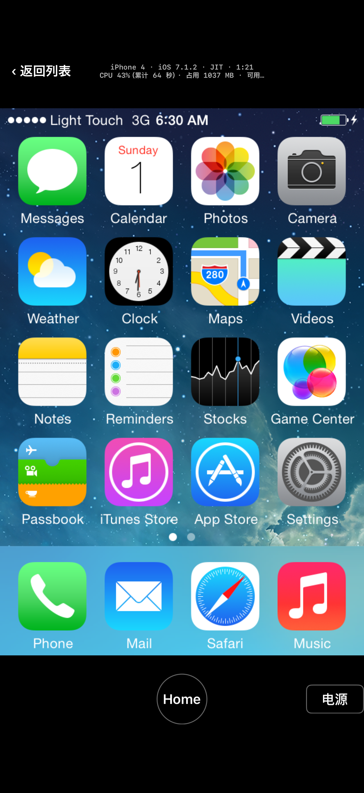

# M2：iOS 7 锁屏和主屏卡顿

- 日期：2026-11-02
- 执行会话：m2-gl-eagl（接着 EAGL 补 ES 2.0 做）。范围：弄清 iPhone 4 iOS 7.1.2 在 iPhone 18 Pro 上锁屏滑动、主屏翻页卡的原因并改，iOS 3.1.3、6.1.6 不退步。
- 没做的：没改 `upstream/`，没 commit、没 push，没给上游提 issue 或 PR，没碰 iPhone 14 Pro，没下载任何东西。

## 0. 结论

1. **瓶颈：每帧把整屏读回客体内存十几到二十几次。** iOS 7 的 CoreAnimation 画一帧时，在显示表面和一个离屏目标之间来回切换，每次在离屏目标上调 `glFlush`。GL 桥的 `glFlush` 会把所有「已渲染、还没写回」的表面写回客体内存，于是还没画完的整屏显示表面（640×960，2.3 MB）每帧被 `glReadPixels` 读回：锁屏 2 到 12 次，主屏按住拖 21 到 25 次。真正有用的只有帧末那一次。手机上一次读回要 6.5 到 14 毫秒，几乎全是 CPU 时间，vCPU 线程九成时间耗在这上面。
2. **改了什么：** `glFlush` 时如果绑着的不是显示用的帧缓冲，只写回这个帧缓冲自己的表面，以及「脏」了 50 毫秒以上的表面；帧末（回到默认帧缓冲、`glFinish`、在显示帧缓冲上 flush）照旧全写。每帧的写回从十几二十次降到 1 次。补丁 `patches/ios-gles-perf.patch`，里面还有找原因用的统计（`IT_PERF=1` 才打开）。
3. **真机对照（同一套自动滑动测试，每项一轮）：**

   | 画面 | 改前 帧/秒 | 改后 帧/秒 | CPU（占一个核）改前 → 改后 |
   |---|---|---|---|
   | 锁屏来回拖动 | 25.8 | **59.7** | 96% → 99% |
   | 锁屏静止（「滑动解锁」微光） | 58.6 | 60.0 | 100% → 96% |
   | 主屏翻页（整段，含翻页之间的静止） | 4.5（比静止时的 10 帧还低） | 22.7；翻页动画本身 **36**（4 次：33、40、37、35；改前没有单独量） | 67% → 49% |
   | 主屏按住来回拖 | 5.4 | **49.0** | 91% → 74% |
   | 主屏静止 | 9.8 到 10 | 10 | 41% 到 54% → 41% 到 42% |

4. **静止 CPU 没降下来（41%），目标没达到。** 静止时 iOS 7 主屏每秒换帧 30 次、其中 10 帧有变化（时钟图标的秒针），每帧那一次读回 13 毫秒，合计约 13% 的核；客体自己约 20%；显示合成、发帧、App 界面约 7%。剩下这次读回慢在苹果的 GL 实现内部，换三种读回方式都一样（第 5 节），要再降就得改显示通路（第 7 节）。
5. **iOS 3.1.3 和 6.1.6 没有退步：** 锁屏 10 秒、14 秒，主屏静止 19%、15%，和以前一样；每帧也只写回 1 次。两台的翻页动画 42 帧和 40 帧，按住拖 40 帧和 54 帧。
6. 测试中出过一次黑屏：锁屏上「slide to unlock」的灰字加流动高光让 App 的文字识别 13 秒都没认出来，测试一直等，锁屏自己变暗熄了。已修（识别放宽，没认出锁屏时变暗就按 Home 叫醒），之后各轮都正常（第 8 节）。

## 1. 测法：可重复的滑动测试，不靠手

### 1.1 App 里的「滑动测试」

autodrive 加了 `swipetest`（`EmulatorViewController.swipeLock`、`swipeHome`），触摸用 `qemu_ios_ui_input_sequence` 按客体虚拟时间注入，每 16 毫秒一个点（像手指在 60 Hz 屏幕上）：

| 段 | 做什么 |
|---|---|
| 认出锁屏后 | 先按一下 Home（保持亮着），1.5 秒后开始 |
| `lock_drag` | 3 次在锁屏底部按住往右拖到 0.55 再拖回来松手，每次 1.6 秒（不解锁；iOS 7 整个锁屏跟着手走，3.x、6.x 是滑块） |
| `lock_static` | 静止 4 秒（iOS 7 的微光是连续动画）；3.x、6.x 只静止 2.5 秒，免得熄屏（iPod touch 2 代熄久了会深睡） |
| 解锁 | 0.7 秒滑过去 |
| `home_static` | 认出主屏 3 秒后静止 6 秒 |
| `home_swipe` | 6 次翻页，左右交替，每次 0.25 秒，间隔 1.5 秒；另记每次从按下到 0.6 秒后的帧数（翻页动画本身） |
| `home_drag` | 按住在 0.3 和 0.7 之间来回拖 4 秒（M0 的拖动测法） |
| `home_static2` | 松手 1 秒后静止 10 秒，之后照常待机 40 秒退出 |

每段起止在 `events.log` 记 `seg <名> begin|end serial= cpu=`。帧数是 QEMU 发给 App 的、和上一帧不同的画面数；段内不存截图（存 PNG 也算本进程 CPU）。用法：`STIK=1 SWIPETEST=1 PERF=1 scripts/ios/device-boot.sh <设备> jit`（真机），`scripts/ios/sim-swipe.sh <设备>`（模拟器），汇总 `scripts/ios/summarize-swipe.py <运行目录> [--markdown]`。

### 1.2 统计

- **App 按线程记 CPU**（`threads.csv`）：QEMU 的线程自己有名字，`CPU 0/TCG` 是模拟的 CPU（GL 转发也在它上面），`qemu` 是 QEMU 主循环（定时器、显示刷新、发帧），`app-main` 是 App 主线程。
- **QEMU 每秒一行**（`IT_PERF=1`，补丁里）：
  - `[perf] gl`：GL 调用数、宿主耗时和其中的 CPU 时间、最费时的 5 个槽位、表面上传、写回和其中的 `glReadPixels`、缓存没命中的重读；
  - `[perf] disp`：A4 显示的 VBL、换帧、合成耗时；
  - `[perf] ui`：发给 App 的帧和拷贝耗时。
  GL 桥原有的 `IT_GLES_PROF` 只统计 present，iOS 6、7 的 CoreAnimation 不走 present，读不到。
- **逐次追踪**（`IT_PERF_TRACE=起,止` 或 `IT_PERF_TRACE_EVERY=秒`）：每次写回、flush、切帧缓冲和显示换帧各一行。

模拟器的 OpenGLES 是 CPU 上的软件渲染，GL 的耗时和手机完全不同。所以模拟器只用来验证功能、看调用和写回的次数（这些两边一样），数字都以真机为准。

## 2. 时间花在哪

### 2.1 改前的真机基线（`20261102-010620`）

| 段 | 帧/秒 | CPU% | vCPU 线程 | GL 调用/秒 | GL 宿主 ms/秒 | 写回 次/秒 | 其中 `glReadPixels` ms/秒 |
|---|---|---|---|---|---|---|---|
| lock_drag | 25.8 | 96 | 93 | 5250 | 931 | 153 | 908 |
| lock_static | 58.6 | 100 | 94 | 7224 | 772 | 122 | 750 |
| home_static | 9.8 | 54 | 51 | 980 | 149 | 12.7 | 142 |
| home_swipe | 4.5 | 67 | 61 | 1986 | 586 | 85 | 571 |
| home_drag | 5.4 | 91 | 88 | 3224 | 910 | 139 | 889 |
| home_static2 | 10.0 | 41 | 34 | 820 | 148 | 10 | 139 |

拖动时 vCPU 线程每秒约 900 毫秒在 GL 桥里，几乎全是 `glReadPixels`。客体的 CPU、显示合成（每秒 2 到 25 毫秒）、App 界面（2% 到 3%）都不是瓶颈。

### 2.2 为什么一帧要读回那么多次（模拟器追踪）

主屏按住拖时的一帧（`IT_PERF_TRACE_EVERY=5`，fb 2 是显示表面所在的帧缓冲，fb 3 是离屏目标）：

```
swap 15177 ... ui0=0025a000(5f958000)       ← 上一帧上屏
bindfb 0 -> 2                               ← 开始画显示表面
bindfb 2 -> 3                               ← 去离屏目标画一个图层
flush fb=3
wb tex=3 640x960                            ← 把画了一半的显示表面整屏写回
bindfb 3 -> 2 / bindfb 2 -> 3 / flush fb=3 / wb tex=3 640x960
……（这样来回 24 次）
bindfb 2 -> 0
wb tex=3 640x960                            ← 帧末：这一次才有用
finish
swap ...                                     ← 约 12 毫秒后显示换帧，扫描的正是这块内存
```

锁屏是同一个模式（显示表面和 fb 5、fb 6 来回，每帧 10 到 12 次）。fb 3 本身不是客体的表面（不用写回），被写回的总是那个还没画完的显示表面：离开它时 `gles_sync_surface` 把它标成「脏」，在离屏目标上的 `glFlush` 就把所有脏表面写回了。三块显示表面轮流用，物理地址正好是显示换帧时扫描的三块。

## 3. 改了什么（`patches/ios-gles-perf.patch`）

- `gles_surface_flush_partial`：`glFlush` 时绑着的帧缓冲不是显示用的，只写回它自己的颜色附件对应的表面，加上已经脏了 `GLES_FLUSH_STALE_NS`（50 毫秒）的表面。绑着显示帧缓冲时、`glFinish`、回到默认帧缓冲，照旧全写。
- 别的上下文、别的进程或客体 CPU 要读的表面仍然会写回：
  - 在它自己的帧缓冲上 flush 时；
  - 帧结束时；
  - 本组把这块内存当纹理绑定时（`gles_bind_surface` 原有的 `gles_surface_flush(cpu, base)`）；
  - 或者已经脏了 50 毫秒。
  后一条兜底的是「画完、切走、在别处 flush，指望另一个进程读」这种客户端。3.1.3 的 CoreAnimation 从不 flush（它的帧末是回到默认帧缓冲），不受影响。
- 统计和追踪：见第 1.2 节，环境变量不开时每次调用只多一个判断。
- 补丁在 `ios-eagl-es2.patch` 之后打（文件名排序就是这个顺序）。`scripts/ios/export-patch.sh` 从工作树导出补丁：取上游原样、先打前面的补丁、再比出差异。四个补丁按顺序打到干净的上游副本上，结果和工作树一字不差。
- `build-qemu.sh` 判断「补丁打没打」改成看整套：原来逐个反向检查，两个补丁改同一个文件时会误判。`SKIP_PATCHES=1` 用于工作树里还有没导出的改动时。

模拟器上验证：每帧正好 1 次写回（60 帧/秒对应每秒 60 次）；锁屏、解锁中、主屏的截图都正常。

## 4. 改后的真机结果

### 4.1 iPhone 4 iOS 7.1.2（`20261102-012908`，锁屏 26 秒、主屏 41 秒）

| 段 | 帧/秒 | CPU% | vCPU 线程 | GL 调用/秒 | GL 宿主 ms/秒 | 写回 次/秒 | `glReadPixels` ms/秒（其中 CPU） | 换帧/秒 |
|---|---|---|---|---|---|---|---|---|
| lock_drag | 59.7 | 99 | 89 | 15433 | 451 | 60.0 | 400（384） | 60.0 |
| lock_static | 60.0 | 96 | 85 | 7378 | 504 | 59.8 | 480（464） | 60.0 |
| home_static | 10.0 | 41 | 34 | 820 | 141 | 10.0 | 133（127） | 30.0 |
| home_swipe | 22.7 | 49 | 40 | 11230 | 258 | 25.4 | 205（198） | 34.3 |
| home_drag | 49.0 | 74 | 62 | 26405 | 443 | 46.6 | 339（329） | 53.4 |
| home_static2 | 10.0 | 42 | 34 | 800 | 147 | 10.0 | 137（130） | 30.1 |

- 翻页动画本身（按下到 0.6 秒后）：33、40、37、35 帧，平均 **36**。`home_swipe` 整段的 22.7 帧把翻页之间 1.2 秒的静止也平均进去了。
- 同一个修正前后跑了 4 轮（`011150`、`011633`、`012248`、`012908`），各段帧数差别在 1 帧以内：锁屏拖动 60.2 到 60.3，主屏按住拖 48.8 到 49.2，翻页动画 31 到 37。
- 占用 1055 到 1140 MB，可用内存最低 2236 MB，准备代码区 0.82 秒，和以前一样。
- GL 调用多了 2 到 8 倍：客体不再被读回卡住，画的帧多了。



### 4.2 静止时 41% 花在哪

`home_static2`（10 秒，没人碰）：

| 部分 | 占一个核 |
|---|---|
| vCPU 线程合计 | 34% |
| 　其中 GL 转发（CPU 时间） | 14%，几乎全是每秒 10 次读回（每次 13 毫秒） |
| 　其中客体代码（推算） | 约 20% |
| QEMU 主循环（显示合成 22 毫秒/秒、发帧） | 4% |
| App 主线程（每帧建图上屏） | 3% |

客体这边：iOS 7 主屏静止时每秒换帧 30 次、其中 10 帧有变化（「时钟」图标的秒针）。M0 在 Mac 上量到的也是每秒 30 次换帧。

## 5. 剩下这次读回为什么慢（两轮诊断）

1. **先 `glFinish` 再读**（`IT_GLES_WB_FINISH=1`，`20261102-011633`）：`glFinish` 每次只要 0.3 到 0.7 毫秒，之后的 `glReadPixels` 还要 6.4 到 13.5 毫秒。
2. **三种读回方式轮流用、分开计时**（`IT_GLES_WB_MODE=3`，`20261102-012248`）：

   | 段 | `glReadPixels` 读 BGRA | 读 RGBA 再在 CPU 上换字节 | GPU 拷进 IOSurface 做底的纹理，锁住后 `memcpy` |
   |---|---|---|---|
   | lock_drag | 6.46 ms | 6.61 ms | 6.45 ms |
   | home_drag | 7.39 ms | 7.63 ms | 7.45 ms |
   | home_static | 13.46 ms | 13.53 ms | 13.68 ms |

   三种一样慢。IOSurface 方式在模拟器里每次只要 0.5 毫秒，画面也对。
3. **最终版本里**读回的墙钟时间 96% 是 CPU 时间（例如静止时每秒 137 毫秒里 130 毫秒）。

结论：慢在苹果这套 GL（底下是 Metal）把渲染结果交给 CPU 的那一步，不在我们选的读回接口，而且是实打实的 CPU 工作，不是在等 GPU。静止时每次反而更慢（13 毫秒对拖动时 7 毫秒），像是 GPU 和 CPU 闲下来降了频。所以「异步读回」（不等结果先返回客体）能减少卡顿，但省不了 CPU。实验用的读回方式切换和 IOSurface 代码没留在补丁里。

## 6. iOS 3.1.3、6.1.6 回归（各一轮）

| 设备 | 锁屏 | 主屏静止 CPU | 翻页动画 | 按住拖 | 锁屏拖滑块 | 每次写回 |
|---|---|---|---|---|---|---|
| iPhone 3GS 6.1.6（`013103`） | **14 秒**（以前 14 到 15） | **15%**（以前 12% 到 16%） | 40 帧（6 次：33 到 50） | 53.7 帧 | 33.6 帧 | 约 1 次/帧，每次 2 到 3 ms |
| iPod touch 2 代 3.1.3（`013239`） | **10 秒**（以前 10） | **19%**（以前 19%） | 42 帧（4 次：30 到 51） | 39.8 帧 | 43.5 帧 | 约 1 次/帧，每次 2 到 3 ms |

- 两台的画面面积是 iOS 7 的四分之一（320×480），读回也便宜得多。
- M0 在 Mac 上（CGL）量到的主屏拖动是 iOS 6 52.5 帧、iOS 3 34.6 帧，这里相当或更好。没有这两台改前的滑动数据（滑动测试是这次新做的），所以「不退步」看的是锁屏时间、静止 CPU 和截图。
- 主屏时间比以前晚（27 秒、24 秒，以前 22、18 秒），是因为滑动测试在锁屏上先做了约 10 秒的拖动和静止才解锁，不是变慢。
- iPod 的 6 次翻页是左右交替，而 3.1.3 只有一页图标加左边的 Spotlight，最后停在了 Spotlight，键盘弹着、光标在闪，所以 iPod 的 `home_static2`（35%、22 帧）不算待机，以 `home_static` 为准（截图 `img/m2perf-device-n72ap-3.1.3-ends-on-spotlight.png`）。
- iOS 6 测试后的主屏截图：`img/m2perf-device-n88ap-6.1.6-after-swipetest.png`。
- 这轮 Mac 的 1 分钟负载在 iOS 6 那轮中途冲到 18（别的会话在编译）。真机测量只靠手机自己，Mac 每 3 秒取一次日志，不影响数字。

## 7. 剩下的瓶颈和可选路线（要决策会话定）

1. **IOSurface 做底的渲染目标（估计半天到一天，先要一轮诊断）。** 让 CoreAnimation 的显示表面一开始就渲染进以 IOSurface 为存储的纹理，写回就只是锁住加 `memcpy`，上传也是。第 5 节的 IOSurface 实验之所以没省，可能是「GPU 拷贝」那一步在苹果的实现里也走了 CPU，也可能是 IOSurface 的锁本身贵；先用一轮真机把拷贝、加锁、`memcpy` 分开计时，再决定做不做。做成的话，静止 CPU 能再降约 13 个点，锁屏微光那段能降一半。
2. **显示直通（估计好几天）。** 显示扫描的那块表面不再写回客体内存，App 直接显示宿主上的纹理或 IOSurface，彻底没有这次读回。要改 A4 显示模型、发帧接口和 App 的画面层，还要处理客体自己读这块内存（截图、快照）的情况。属于「重写显示通路」，按约定先停在这里。
3. **客体这边省电。** iOS 7 静止时每秒仍换帧 30 次。M0 建议过试「减少动态效果」，或者在 App 里检测到画面长时间不变时降低客体的显示刷新。属于产品取舍，和本次的 GL 无关。
4. 异步读回能让拖动更稳（vCPU 不必等那 7 毫秒），但读回本身是 CPU 工作，省不了电。

## 8. 测试中遇到的问题

| 问题 | 处理 |
|---|---|
| 第一轮基线手机上黑屏：锁屏其实已经出来，App 的文字识别 13 秒里一次都没认出来（灰字加流动高光，认成过「Slide to unlog.」「slide to umoax」），测试一直等着，锁屏变暗熄了 | 停掉那轮、结束 App。识别放宽（不看空格，认出「slide to un」或「slide」「unlock」分在两段都算）；还没认出锁屏时背光降到一半以下就按 Home 叫醒；等待期间每 5 秒把认到的文字记进 `events.log`。之后 6 轮都正常 |
| 模拟器一轮里文字识别晚了 6 秒，锁屏已经变暗，锁屏拖动段 0 帧 | 锁屏段改成先按 Home 叫醒、先拖后静止 |
| 统计行只在有 GL 调用的秒里打，iOS 6 主屏静止时没有 GL 调用，汇总脚本按有数据的秒平均算偏了 | 改成按段长平均，缺的秒算 0 |
| iPod 最后一段停在 Spotlight | 见第 6 节，不影响待机数（用第一段） |
| 中途手机自动锁了一次 | 请用户解锁后继续 |

另外有个会话在同时改 App 的界面文件（`EmulatorChromeView.swift`、`Theme.swift` 等）。我这次在 App 里只改了 `EmulatorViewController.swift`、`Engine.swift`、`GuestText.swift`、`LaunchOptions.swift`、`Stats.swift`，用的都是带上下文校验的替换，没有覆盖对方的文件。

## 9. 文件

- 仓库里（未 commit）：
  - `patches/ios-gles-perf.patch`（新，579 行）
  - `scripts/ios/build-qemu.sh`（整套判断补丁、`SKIP_PATCHES`）、`device-boot.sh`（`SWIPETEST`、`PERF`、`QEMUENV`、取回 `threads.csv`）
  - 新：`scripts/ios/sim-swipe.sh`、`summarize-swipe.py`、`export-patch.sh`
  - `app/ClassicTouch/`：
    - `EmulatorViewController.swift`：滑动测试、`-perf`、`-qemuenv`、`threads.csv`、`clock up0`、认锁屏的兜底；
    - `Engine.swift`：按折线拖动 `drag(path:)`；
    - `GuestText.swift`：认锁屏放宽；
    - `LaunchOptions.swift`：`environment(forKey:)`；
    - `Stats.swift`：`ThreadLog`。
  - 本报告和 `docs/reports/img/m2perf-*.png`（3 张，都核对过画面，没有个人信息）
- `work/` 里（不提交）：
  - 真机各轮：`work/ios/runs/device/20261102-010125`（黑屏那轮，作废）、`010620`（改前基线）、`011150`（修正后第一轮）、`011633`（`glFinish` 诊断）、`012248`（三种读回）、`012908`（最终 iOS 7）、`013103`（iOS 6）、`013239`（iOS 3），各有 `.summary`；
  - 模拟器各轮：`work/ios/runs/sim/20261102-0051*` 到 `0125*`；
  - `work/logs/m2perf-*.log`。
- 四份 dylib 都按全部补丁重编过（真机、模拟器各有 JIT 和解释器），手机上的 App 是最终版本，没在运行。

复现：

```bash
# 真机（手机解锁、插线、开 LocalDevVPN、不开镜像）
STIK=1 SWIPETEST=1 PERF=1 IDLE=40 TBSIZE=256 scripts/ios/device-boot.sh n90ap-11D257 jit 400
python3 scripts/ios/summarize-swipe.py work/ios/runs/device/<运行目录> --markdown
# 模拟器（加追踪）
QEMUENV="IT_PERF_TRACE_EVERY=5" scripts/ios/sim-swipe.sh n90ap-11D257
# 改完工作树后导出补丁
scripts/ios/export-patch.sh patches/ios-gles-perf.patch --base patches/ios-eagl-es2.patch \
  hw/arm/gles-host.c hw/arm/s5l8930_display.c contrib/ios-app/qemu-ios-ui.c
```
