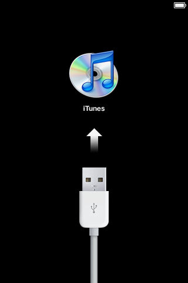
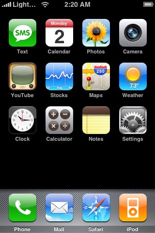
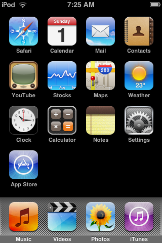
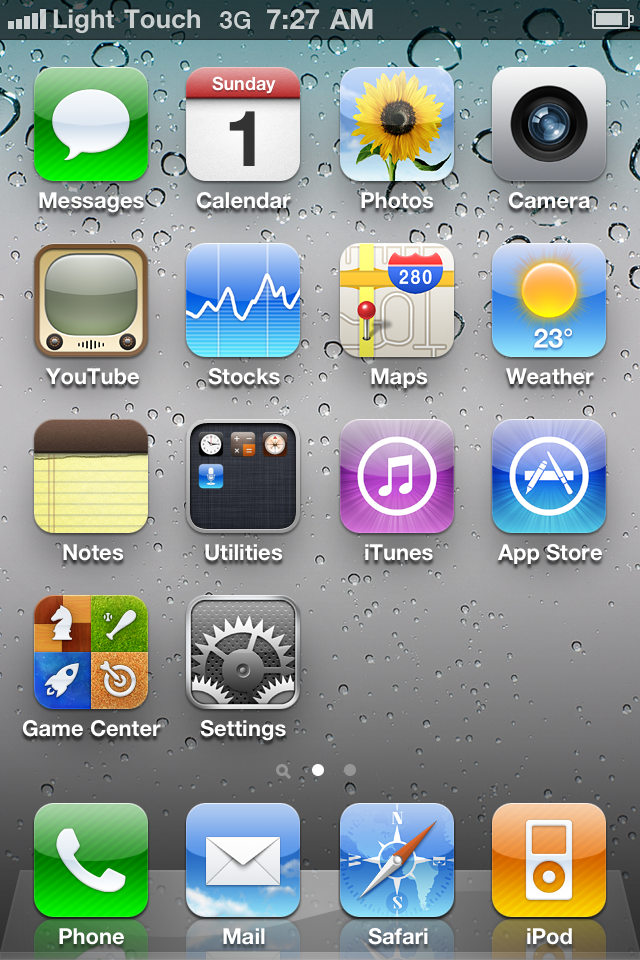
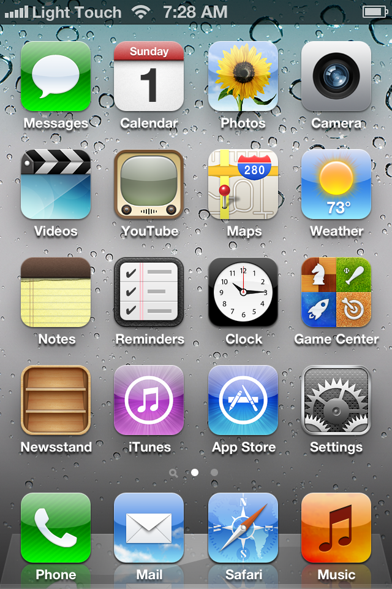
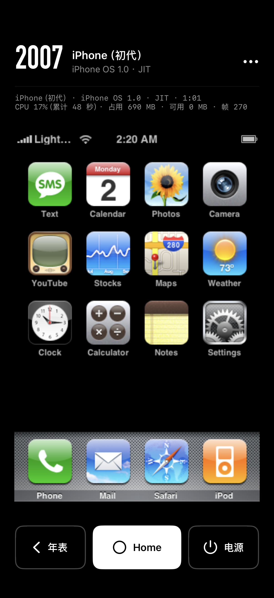
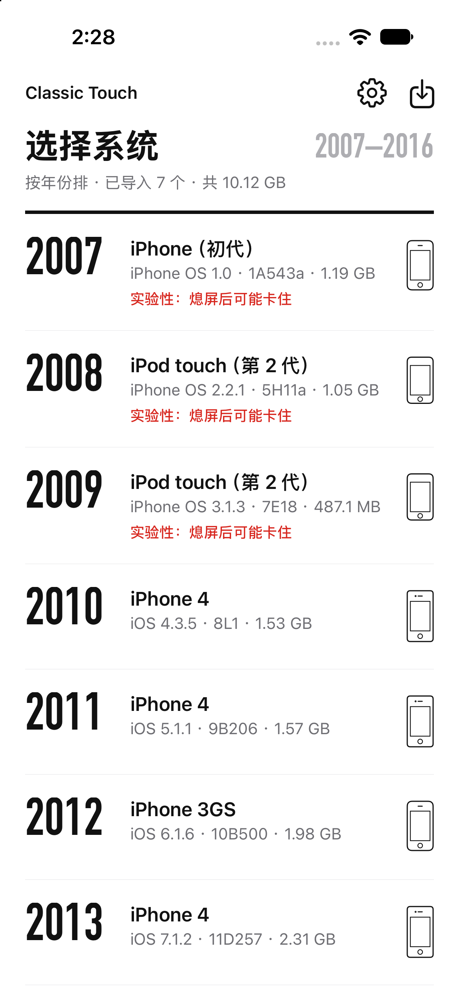
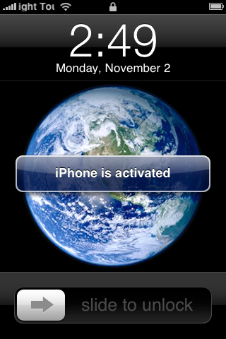

# M2 年表补全：四台新设备

- 日期：2026-11-02
- 执行会话：m2-timeline。范围：下载 4 个固件，做 4 台设备，在 Mac 上开机走首次设置、存黄金状态，打 `.ctpack`，在 iOS 模拟器里用我们的 App 开机计时，App 支持初代 iPhone 的开机方式，确认首页年表。
- 没做的：没碰手机；没改 `upstream/`（改动在 `work/` 的克隆里，补丁放 `patches/`）；没 commit、没 push，没给上游提 issue 或 PR；除简报里的 4 个固件外没下载任何东西；没改界面会话的文件（`Theme.swift`、`EmulatorViewController.swift` 等）。
- 本机：M4 Max，macOS 27，Xcode 27.2。qemu-ios b225694505，LightTouchMac b06012fa4c。

## 0. 结论

1. **4 台在 Mac 和 iOS 模拟器里都开到了主屏**，App 首页年表 2007 到 2013 连成一列（图见第 5 节）：

   | 年份 | 设备 | Mac（原生 QEMU，JIT） | 模拟器（App，JIT 256 MB） |
   |---|---|---|---|
   | 2007 | 初代 iPhone · iPhone OS 1.0（1A543a） | 锁屏 46 秒、主屏 51 秒，静止 4.5% | 直接到主屏 41 秒，静止 15% |
   | 2008 | iPod touch 2 代 · iPhone OS 2.2.1（5H11a） | 直接到主屏 8 秒，静止 11% | 直接到主屏 8 秒，静止 18% |
   | 2010 | iPhone 4 · iOS 4.3.5（8L1） | 锁屏 41 秒 | 锁屏 44 秒、主屏 52 秒，静止 20% |
   | 2011 | iPhone 4 · iOS 5.1.1（9B206） | 设置向导 22 秒出现，69 秒走完 | 锁屏 21 秒、主屏 30 秒，静止 22% |

2. **初代 iPhone 不需要苹果的 SecureROM**：qemu-ios 只把 S5L8900 的 ROM 放在 0x20000000 给 iBoot 查跳转表，iBoot 要调的两个槽（8900 映像校验、解密）机型自己指到桩上，所以一条「b .」的占位文件就能开机。App 加了第三种开机方式 `s5l8900`（pflash 的 NOR），只改了 `DeviceProfile.swift`。
3. **iPod touch 2 代的 2.2.1 原版做法开不起来，打了一个 FirmwareKit 补丁后能开**。原版 FirmwareKit 给 2.x 做的是「SecureROM → NOR 里的 LLB → iBoot」整条链，占位 ROM 下 CPU 停在地址 0；改成像 3.x 那样直接进解密过的 iBoot 后能到 SpringBoard，但停在「连接 iTunes」（lockdownd 的 brick state，iPod 上要配对过的主机经 USB 设一次时间才解除）。补丁 `patches/firmwarekit-n72-2x-direct-iboot.patch` 让 2.x 也输出 iBoot.bin、走直接进 iBoot，并像 1.x 的配方那样预写 `-BrickState = false`。详见第 3 节。**这是对 Light Touch 设备制作工具的改动，以后在手机上做设备（M3）也要带上。**
4. **设备语言**：FirmwareKit 默认取 Mac 当前的语言，这台 Mac 现在是简体中文，第一次做出来的 4 台都是中文。为了和 App 里已有的三台（M0 做的，en-AU）一致、也让脚本的英文 OCR 能用，我用 `--language en-AU` 重做了 4 台。中文版留在 `work/timeline/zh/`（4.3.5 中文主屏见第 6 节）。客体用什么语言要用户定。
5. **装手机前的准备已做完**（第 11 节，第二轮）：`Era.runnable` 改成 `1...7`；autodrive 能认「不经过锁屏直接到主屏」；真机版 App 编好了（没装）；一键装机脚本 `scripts/ios/device-install.sh` 写好、模拟器里能验的都验过。剩下的只有在手机上跑一次，约 10 到 15 分钟。

## 1. 固件和设备

| 设备 | 固件 | 来源 | sha1（与固件表一致） | 制作 |
|---|---|---|---|---|
| m68ap-1A543a | iPhone1,1_1.0_1A543a_Restore.ipsw（96 MB） | 苹果服务器 | fb8bb3ee2e9a997affbb97868599f2995c78209c | 11 秒 |
| n72ap-5H11a | iPod2,1_2.2.1_5H11a_Restore.ipsw（291 MB） | 苹果服务器 | 9af5625ea34acdd8abeb6fce71a72651d0c815d5 | 9 秒（打补丁的 FirmwareKit） |
| n90ap-8L1 | iPhone3,1_4.3.5_8L1_Restore.ipsw（699 MB） | 苹果服务器 | 7099307319c669356955e9aff11a3129d6b8d8b4 | 73 秒（含两次一次性开机） |
| n90ap-9B206 | iPhone3,1_5.1.1_9B206_Restore.ipsw（821 MB） | 苹果服务器 | a03a29c4dd2016edb3da72c3e26e30fbf0f42b2f | 72 秒 |

四个都从苹果服务器一次下完（共 1.9 GB，约 4 分钟），没用到镜像。固件在 `work/firmware/`，设备在 `work/devices/`，黄金状态在 `work/states/`。

各台的开机方式：

| 设备 | QEMU 机型 | 开机方式（lock 的 boot_strategy） | NAND |
|---|---|---|---|
| 初代 iPhone 1.0 | `iPhone-2G` | 没写（FirmwareKit 给 1.x 不写），App 按机型认作 `s5l8900`：`bootrom=占位,iboot=iBoot.bin`，NOR 用 `-drive if=pflash` | 镜像库（nand-xor-blank-v2），就地写 state/nand |
| iPod touch 2 代 2.2.1 | `iPod-Touch` | `iboot`（补丁后；原版是 `bootrom`） | 镜像库，就地写 state/nand |
| iPhone 4 4.3.5、5.1.1 | `iPhone-4` | `kboot`，和 7.1.2 一样 | 页覆盖层 state/overlay |

## 2. 初代 iPhone（iPhone OS 1.0）

### 2.1 开机方式

照 Light Touch 的 `BootRecipe.iPod1G` 和 qemu-ios `docs/m68/README.md`：

```
-M iPhone-2G,bootrom=<占位>,iboot=<设备>/iBoot.bin,nand=<state>/nand,imei=…,wifi-mac=…
-drive if=pflash,format=raw,file=<state>/nor.bin
-netdev user,id=wifi0,restrict=on,lan=off -netdev user,id=cell0,restrict=on,lan=off
```

不加 `-m`（机型默认 128 MB）。`imei`、`wifi-mac` 来自 lock 的 `machine`。

**SecureROM**：`hw/arm/ipod_touch_1g.c` 的注释写得很清楚，公开的 S5L8900 ROM 本来就缺那两段代码，机型把 ROM 放进 0x20000000 只是为了 iBoot 查跳转表，校验和解密两个槽每次复位都改指到 LLB 窗口里的桩（`n45_stage_boot_chain`）。实测用 4 字节的「b .」就能开到主屏，Mac 和模拟器都一样。App 里的 `s5l8900Bootrom(beside:)`：`Documents/bootrom/bootrom_s5l8900` 存在就用它，否则写一个 `placeholder-s5l8900-b-self.bin`。苹果的 ROM 不进仓库、不打包。

**深睡**：上游没模拟 S5L8900 的深睡唤醒（`docs/ipod1g/README.md` 欠账 9，与 ROM 无关），所以列表里给它也标了「实验性：熄屏后可能卡住」，和 iPod touch 2 代一样。没做长待机测试。

### 2.2 App 改动（只改 `app/ClassicTouch/DeviceProfile.swift`）

- `isS5L8900`（m68ap、n45ap）；lock 没有 `boot_strategy` 时，这两个机型认作 `s5l8900`，其余照旧默认 `kboot`。
- `boot()` 加 `case "s5l8900"`，拼上面的参数。
- `writesNANDInPlace` 从「`bootStrategy == "iboot"`」改成「iPod touch 2 代或 S5L8900」：两者的 NAND 都是 QEMU 就地写的镜像库，第一次开机把本体的 chip 文件克隆到 `state/nand`。kboot 机型不变。
- `experimentalNote` 也给 S5L8900 标上。
- 没加新的界面文字（复用已有的「实验性：熄屏后可能卡住」）。`EmulatorViewController` 的开机日志里 `bootrom=` 记的仍是 iPod 2 代那个占位文件名，初代 iPhone 实际用的文件在 `argv.json` 里能看到；那个文件归界面会话，我没动。

### 2.3 观察

- Mac 上第一次开机：46 秒出锁屏（「slide to unlock」），解锁后有一个「iPhone is activated」提示（上游说明里提过，只在第一次），51 秒到主屏；主屏静止 4.5%；`system_powerdown` 29 秒正常关机，之后从这份黄金状态冷启动正常。
- 模拟器里从黄金状态冷启动，不出锁屏，第 41 秒直接是主屏（QEMU 自己记的亮屏也是 40.9 秒）。为此给 `sim-boot.sh` 加了「没经过锁屏直接认出三个以上主屏图标名也算到主屏」。这一轮测量是在改脚本之前跑的，脚本没认出主屏、跑满 300 秒，数字是从这一轮 App 的每秒统计（`stats.csv`）算的：主屏 41 秒，主屏后 30 秒平均 15%（60 到 300 秒平均 13%），占用约 700 MB。没补测。
- 1.0 的 SpringBoard 图标名就是 `.app` 目录名，主屏和运行画面见第 5 节。

## 3. iPod touch 2 代 · iPhone OS 2.2.1

### 3.1 原版做法卡在 SecureROM

FirmwareKit 的 N72 配方（`N72Recipe.swift`）：3.x 输出解密过的 iBoot.bin，直接进 iBoot（`boot_strategy iboot`）；2.x 不输出 iBoot.bin，走「SecureROM → NOR 里的 LLB → iBoot」（`boot_strategy bootrom`）。我们只有占位 ROM，原版做的 2.2.1 一开机就停在 ROM 的死循环里：60 秒黑屏、串口没有一个字、客体主核吃满一个核，寄存器 R15=0（`work/timeline/try/n72ap-5H11a-rom/setup.json`）。

### 3.2 直接进 iBoot：到 SpringBoard，停在「连接 iTunes」

QEMU 的 iPod 2 代机型支持 `direct-iboot=`（3.x 就是这么开的），iBoot 用 IPSW 里解密过的那份（FirmwareKit 的解密缓存里就有）。实测 iBoot-385.49 照常读 NOR 里的 DeviceTree、加载内核，SpringBoard 起来、GL 上下文建好，但画面是「连接 iTunes」：



原因见 qemu-ios `docs/ipod/from-ipsw.md`「2.1.1 home screen: lockdownd's brick state」：2.x 的 lockdownd 第一次开机打开 BrickState，iPod 上只有配对过的主机设 `TimeIntervalSince1970`（iTunes 连上时做的事）才会关；SpringBoard 只在唤醒时重读。Light Touch 的做法是开机后经它的 USB 桥（usbmuxd 的 qemu 分支加 libimobiledevice）设一次时间（`LightTouchServices/Lockdown/lockdown-tz.c`）。我们没有这一套，也不该为此下载。实测每隔 15 秒按 Home 叫醒、滑动，每次都是「连接 iTunes」然后熄屏。

### 3.3 补丁：FirmwareKit 给 2.x 输出 iBoot.bin，并预写 BrickState

FirmwareKit 给 1.x（N45Recipe）本来就在卷上预写 `private/var/root/Library/Lockdown/data_ark.plist` 的 `-BrickState = false`（「1G 还没有主机 USB」），2.x 没写。补丁 `patches/firmwarekit-n72-2x-direct-iboot.patch` 只改 `N72Recipe.swift`：

- 2.x 也写出 iBoot.bin，lock 记 `boot_strategy iboot`、`direct_iboot true`；
- 2.x 在卷上预写同样的 `-BrickState = false`（属主 root）。

做法：`cp -c -R upstream/LightTouchMac work/timeline/fk-src`，打补丁，`swift build -c release`（约 1 分钟），用 `work/timeline/fk-build/release/firmwarekit` 做设备。`upstream/` 没动，补丁能干净地 `git apply --check` 到上游。

结果：第一次开机第 8 秒就是主屏（iPod 激活后第一次开机不经过锁屏），没再出现「连接 iTunes」；主屏静止 11%；`system_powerdown` 16 秒正常关机。从黄金状态再开也是直接到主屏（模拟器 8 秒）。上游文档说 2.x 的 hold 键没接上（关机手势完成不了），这次 `system_powerdown` 却到了 shutdown，没细究。

App 不用为它改代码：lock 写的是 `iboot`，和 3.1.3 走同一条路（这台的 2.x lock 只有用打过补丁的 FirmwareKit 才做得出来，原版做的 `bootrom` 设备 App 仍会报「还不支持 boot_strategy=bootrom」）。深睡唤醒要走 ROM，和 3.1.3 一样会卡，列表里本来就标着「实验性」。

原版 FirmwareKit 做的 2.2.1（英文）留在 `work/timeline/stock/`。

## 4. iPhone 4 · iOS 4.3.5、5.1.1

- 和 7.1.2 一样是 kboot，App 和 M0 的 `bench.py` 都不用改。
- **bench.py 的一个 bug**：它的 `setup` 对 iPhone 4 这种「nand-xor-ff-v2」NAND 也在覆盖层目录里建了一份 NAND 克隆，QEMU 要求 v2 覆盖层是空的，直接拒绝启动（「v2 requires an empty or explicitly v2 overlay」）。M0 当时的黄金状态里没有这个目录，说明这段条件是后来写宽的。改成只对 iPod 2 代那种 blank-v2 镜像库建克隆（`tools/m0/bench.py`，7 行，先写新文件再改名）。
- 4.3.5：没有设置向导（4.x 的激活靠 iTunes，FirmwareKit 已写好），开机就是锁屏，滑开即主屏。Mac 上 41 秒出锁屏（负载约 6；`bench.py` 靠 guest agent 每秒问一次前台，粒度约 1 秒）。中间有一段我新建的模拟器第一次开机，把负载冲到 138，那时跑的是中文版（48 秒），不计。模拟器里锁屏 44 秒、主屏 52 秒，比 5.1.1 慢一倍：开机中间有两段（第 12 到 16 秒、第 23 到 37 秒）CPU 掉到 20% 左右，客体在等什么，约 20 秒，原因没查。
- 5.1.1：有完整的设置向导，`bench.py` 照 OCR 走完（English、United States、关定位、跳过 Wi-Fi、新 iPhone、同意条款、不发诊断，69 秒），没遇到 Apple ID 页卡住（网络是 restrict=on）。模拟器里锁屏 21 秒、主屏 30 秒。
- 两台的 `system_powerdown` 都停在「滑动来关机」，120 秒后 QMP 退出，和 M0 的 iOS 7 一样（黄金状态相当于拔电池，HFS+ 有日志，之后开机都正常）。
- 模拟器里 App 默认不挂 usb-kbd，没看到 iOS 7 那种「Cannot Use Device」提示。Mac 上 bench.py 照 Light Touch 挂了 usb-kbd，两台设置过程的 OCR 记录里也没有这个提示（iOS 4、5 有没有类似问题，没专门测）。

## 5. iOS 模拟器里的 App

专用模拟器「ClassicTouch Timeline」（iPhone 18 Pro，iOS 27.2，UDID 在 `work/timeline/sim-udid`，已关机），App 用 `work/ios/DerivedData-tl` 单独编（Debug，含 `DeviceProfile.swift` 的改动和当时界面会话的最新代码，编译通过）。测量用 `SIM_UDID=… IDLE=30 scripts/ios/sim-boot.sh <id> jit 300`（`sim-boot.sh` 本来就有 `SIM_UDID` 覆盖，没加新的环境变量），一台接一台，每台一轮，开始时负载 3.4 到 5.4。

| 设备 | 锁屏 | 主屏 | QEMU 亮屏 | 主屏静止 CPU | 最大占用 |
|---|---:|---:|---:|---:|---:|
| 初代 iPhone 1.0 | 不出锁屏 | 41 秒 | 40.9 秒 | 15%（30 秒） | 709 MB |
| iPod touch 2 代 2.2.1 | 不出锁屏 | 8 秒 | 7.4 秒 | 18%（26 秒） | 577 MB |
| iPhone 4 4.3.5 | 44 秒 | 52 秒 | 0.8 秒 | 20%（26 秒） | 785 MB |
| iPhone 4 5.1.1 | 21 秒 | 30 秒 | 0.8 秒 | 22%（26 秒） | 860 MB |

参照（以前的报告，同一类模拟器、JIT 256 MB）：iPod 3.1.3 锁屏 10 秒、主屏 19 秒、静止 17%；3GS 6.1.6 锁屏 16 到 18 秒、主屏 45 秒、静止 13% 到 14%。初代 iPhone 开机慢主要是系统本身（上游说明里 SpringBoard 约在客体时间 100 秒起来）。

主屏（模拟器里 App 存的客体画面）：

| 初代 iPhone · 1.0 | iPod touch 2 代 · 2.2.1 | iPhone 4 · 4.3.5 | iPhone 4 · 5.1.1 |
|---|---|---|---|
|  |  |  |  |

App 运行画面（界面会话的新外观已接上，顶上显示「2007 · iPhone（初代）· iPhone OS 1.0 · JIT」）和首页年表（模拟器里放了 7 台，正常打开 App 不带测试参数）：

| 运行画面 | 首页年表 |
|---|---|
|  |  |

年表按年份排对了：2007 初代 iPhone、2008 iPod 2.2.1、2009 iPod 3.1.3、2010 iPhone 4 4.3.5、2011 iPhone 4 5.1.1、2012 3GS、2013 iPhone 4 7.1.2；1.0、2.2.1、3.1.3 三行带「实验性」。导入了初代 iPhone 的设备后 2007 照常显示成一行；`Era.runnable = 2...7` 只影响「没导入时」那一格的标签（现在 2007 会标「以后」），**请决策会话转给界面会话改成 `1...7`**，`Theme.swift` 里那段注释（「iPhone OS 1 … 要 pflash，还没做」）也要跟着改。

Mac 上的主屏（`work/states/<id>/home-after-setup.png` 的副本）：`img/tl-mac-m68ap-1A543a-home.png`、`tl-mac-n72ap-5H11a-home.png`、`tl-mac-n90ap-8L1-home.png`、`tl-mac-n90ap-9B206-home.png`。

## 6. 语言

FirmwareKit 的 `--language`、`--keyboards` 默认取 Mac 当前设置。M0 那时 Mac 是 en-AU，这次 Mac 已是 `zh-Hans-US`，第一次做出来的 4 台都是中文（4.3.5 的主屏是「短信、日历、照片……」，1.0 的日历显示「星期一」）。我用 `--language en-AU --keyboards com.apple.keylayout.US` 重做了 4 台，理由：和 App 里已有的三台一致；`sim-boot.sh` 和 `bench.py` 的 OCR 认的都是英文（「slide to unlock」「Settings」、设置向导的按钮名），中文版走不完 5.1.1 的设置向导。中文版留在 `work/timeline/zh/`（4.4 GB，不要可以删）。要中文客体的话，脚本得先加中文词表，这要用户定。

## 7. 包（留给以后装手机）

`work/ios/packs/`，每个包含设备本体和黄金状态（`golden-state/`，`-resetstate` 时用）：

| 包 | 大小 |
|---|---:|
| m68ap-1A543a.ctpack | 1.11 GB |
| n72ap-5H11a.ctpack | 1.02 GB |
| n90ap-8L1.ctpack | 1.49 GB |
| n90ap-9B206.ctpack | 1.53 GB |

1.0 和 2.2.1 的 NAND 是就地写的镜像库，黄金状态是一整份 NAND（APFS 克隆在 Mac 上不占空间，打进包里就是两份），所以包比只装本体大一倍；不带黄金状态的话各约 0.5 GB，用户从列表开机本来就从本体开（1.0 第一次开机会多一个「iPhone is activated」提示）。两个新机型的包在模拟器里用 App 的导入流程验过：放进 `Documents/import/`，打开 App 自动解开（1.3 秒、1.1 秒），黄金状态也在。

## 8. 装手机前还差什么

第二轮（第 11 节）已做完 1 到 3 的准备，剩下：

1. 在手机上跑一次 `scripts/ios/device-install.sh`（装 App、传 4 个包约 5.2 GB、每台开一次），见第 11.4 节。
2. 手机上都还没试过：1.0 和 2.2.1 用 JIT（StikDebug）开机、iOS 4/5 的 GL；按模拟器的数字，预计都能到主屏。
3. 1.0、2.2.1 熄屏进深睡后可能叫不醒（已标「实验性」），没做长待机测试。
4. 以后在手机上做设备（M3）时，2.x 要用打过 `firmwarekit-n72-2x-direct-iboot.patch` 的 FirmwareKit。
5. 要用户定的：客体语言（第 6 节）。

## 9. 复现

```bash
# 固件（URL 和 sha1 取自 upstream/LightTouchMac/LightTouchMac/Resources/firmware-catalog.json，下到 work/firmware/）
# FirmwareKit（原版）做 1.0、4.3.5、5.1.1
for id in m68ap-1A543a:iPhone1,1_1.0_1A543a n90ap-8L1:iPhone3,1_4.3.5_8L1 n90ap-9B206:iPhone3,1_5.1.1_9B206; do
  dev=${id%%:*}; ipsw=${id#*:}
  work/build-firmwarekit/release/firmwarekit create \
    --catalog upstream/LightTouchMac/LightTouchMac/Resources/firmware-catalog.json --id $dev \
    --ipsw work/firmware/${ipsw}_Restore.ipsw --out work/devices/$dev \
    --helper work/tools/helper-shim/LightTouchDevice --cache work/cache \
    --guest-tools work/guest-artifacts/ipad-guest-tools \
    --language en-AU --keyboards com.apple.keylayout.US \
    > work/devices/create-$dev.jsonl 2> work/devices/create-$dev.err
done
# 打过补丁的 FirmwareKit 做 2.2.1
cp -c -R upstream/LightTouchMac work/timeline/fk-src
(cd work/timeline/fk-src && git apply ../../../patches/firmwarekit-n72-2x-direct-iboot.patch)
swift build -c release -j 6 --package-path work/timeline/fk-src/Packages/FirmwareKit --scratch-path work/timeline/fk-build
work/timeline/fk-build/release/firmwarekit create … --id n72ap-5H11a --ipsw work/firmware/iPod2,1_2.2.1_5H11a_Restore.ipsw …（同上）

# Mac 上首次开机、黄金状态（1.x、2.x 用 tl.py；iOS 4、5 用 M0 的 bench.py）
python3 tools/timeline/tl.py setup --device work/devices/m68ap-1A543a --golden work/states/m68ap-1A543a
python3 tools/timeline/tl.py setup --device work/devices/n72ap-5H11a --golden work/states/n72ap-5H11a --wake-after 40 --powerdown 30
python3 tools/m0/bench.py setup --device work/devices/n90ap-8L1 --golden work/states/n90ap-8L1
python3 tools/m0/bench.py setup --device work/devices/n90ap-9B206 --golden work/states/n90ap-9B206

# 模拟器（设备和黄金状态先克隆进 work/ios/devices/<id>、<id>-golden/state 和 App 容器的 Documents/devices/）
SIM_UDID=$(cat work/timeline/sim-udid) IDLE=30 scripts/ios/sim-boot.sh m68ap-1A543a jit 300

# 包
python3 -I scripts/ios/pack-device.py work/ios/packs/m68ap-1A543a.ctpack \
  work/ios/devices/m68ap-1A543a=devices/m68ap-1A543a work/ios/devices/m68ap-1A543a-golden/state=devices/m68ap-1A543a/golden-state
```

`tools/timeline/tl.py`：给没有 guest agent 的 1.x、2.x 用，每秒 screendump 加 OCR 判锁屏和主屏（也认「直接到主屏」），机器控制复用 `bench.py` 的 `Machine`；`--direct-iboot`、`--wake-after`、`--reuse-state` 是排查 2.2.1 时加的。

## 10. 改动和产物

- 仓库里（未 commit）：
  - `app/ClassicTouch/DeviceProfile.swift`：`s5l8900` 开机方式、`s5l8900Bootrom`、就地写 NAND 的判断、实验性标注（第 2.2 节）
  - `patches/firmwarekit-n72-2x-direct-iboot.patch`（新）
  - `tools/timeline/tl.py`（新）
  - `tools/m0/bench.py`：NAND 克隆的条件（第 4 节）
  - `scripts/ios/sim-boot.sh`：认「没经过锁屏直接到主屏」（默认行为不变，先写新文件再改名）
  - 本报告和 `docs/reports/img/tl-*.png`（11 张，画面都核对过）
- `work/` 里（不提交）：`work/firmware/` 4 个 IPSW 和下载日志；`work/devices/` 4 台；`work/states/` 4 份黄金状态（含 setup-run 截图和日志）；`work/ios/devices/` 克隆；`work/ios/packs/` 4 个包；`work/timeline/`（`logs/` 各步日志，`zh/` 中文版设备，`stock/` 原版 2.2.1，`try/` 2.2.1 排查记录，`fk-src/`、`fk-build/` 打补丁的 FirmwareKit，`placeholder/` 占位 ROM）。
- 模拟器「ClassicTouch Timeline」（已关机），App 容器里有 7 台设备的克隆和各轮记录（`Documents/logs/`）。

## 11. 第二轮：装手机前不要手机的准备（2026-11-02）

决策会话转来的任务（用户已批准，这一轮不碰手机）。

### 11.1 改动

| 文件 | 改了什么 |
|---|---|
| `app/ClassicTouch/Theme.swift` | `Era.runnable` 从 `2...7` 改成 `1...7`，上面那段注释改准（iPhone OS 1 走 DeviceProfile 的 s5l8900）。只动这几行 |
| `app/ClassicTouch/GuestText.swift` | 主屏图标名抽成 `homeMarks`，加 `homeMarkCount`（认出几个不同的图标名）；`isHomeScreen` 行为不变 |
| `app/ClassicTouch/EmulatorViewController.swift` | autodrive 认主屏的条件：原来必须先认出锁屏；现在没认出锁屏时，认出三个以上主屏图标名也算到主屏（只记 `home_seen`，没有 `lock_seen`）。3 行，别的没动 |
| `scripts/ios/device-boot.sh` | 非 STIK 分支（Mac 端 OCR）加同样的「直接到主屏」判断；STIK 分支本来就从 events.log 取 `lock_seen`、`home_seen`，没有锁屏时打印「锁屏：未到达」。先写新文件再改名 |
| `scripts/ios/device-install.sh` | 新：一键装机（11.3 节） |

后两个 App 文件归界面会话，这次是决策会话派的，改动只为 autodrive，已在模拟器里验证（11.2）。

### 11.2 模拟器里验证了什么（ClassicTouch Timeline，新编的模拟器版）

| 项 | 结果 |
|---|---|
| 用 App 的导入流程一次导入 4 个包 | 放进 `Documents/import/`，打开 App 12 秒全部解完（`import.log`：2.4、1.2、2.1、2.2 秒），黄金状态都在 |
| 首页，没导入初代 iPhone 时 | 2007 那格是「iPhone OS 1 · 还没导入」，2014–16 才是「以后」（`img/tl-sim-library-no-1x.png`） |
| autodrive 开 1.0（`-resetstate YES`，从黄金状态，同真机 STIK 模式的参数） | 43.6 秒 `home_seen`（没有 `lock_seen`），待机 20 秒后 `auto_quit`，QEMU 正常退出 |
| autodrive 开 2.2.1 | 9.7 秒 `home_seen`，待机后 `auto_quit` |
| 列表路径：`-fakejit on -select m68ap-1A543a`，先删掉 state（等于刚导入，从本体第一次开机），加 autodrive | `boot config=list`，43.5 秒认出锁屏、自动解锁，51.6 秒到主屏，待机后退出 |

这几轮跑的时候另一个会话在编 QEMU，负载 20 到 44，只看功能，时间不算数。

**「iPhone is activated」**：只在从本体第一次开机时出现，是锁屏上的一条横幅，没有按钮（下图），滑动解锁后就没了，不挡 autodrive 也不用点。真机测量用 `-resetstate` 从黄金状态开，根本不会出现。



### 11.3 真机版 App

`xcodebuild … -sdk iphoneos -destination 'generic/platform=iOS' -derivedDataPath work/ios/DerivedData-tl -allowProvisioningUpdates DEVELOPMENT_TEAM=<团队 ID>`：**BUILD SUCCEEDED**，签名校验通过。团队 ID 是编译时从上次签好的 App（`codesign -dv`）读进命令行变量的，没写进任何文件。产物 `work/ios/DerivedData-tl/Build/Products/Debug-iphoneos/ClassicTouch.app`，内含两个 QEMU 库（`work/ios/build-qemu-iphoneos-{jit,interp}`，带 iOS 7 优化补丁，含 `iPhone-2G` 机型）。代码是此刻的全部：界面会话的新外观、iOS 7 优化、`DeviceProfile.swift`、本轮的 autodrive。没装。

### 11.4 一键装机

```bash
scripts/ios/device-install.sh
```

它依次做：

1. 检查 App 签名、4 个包在，AFC 能连上手机，手机剩余空间够（包总大小加 2 GB，约 7.2 GB）；连不上或不够就停。
2. `devicectl device install app` 覆盖安装（同一个 bundle ID，Documents 留着，手机上原有的三台不动、不重传）。
3. 经 AFC 把 4 个包传进 App 的 `Documents/import/`（顺序 2.2.1、1.0、4.3.5、5.1.1）。
4. 打开 App，等 `import.log` 里每个包都有结果；有「失败」就停。手机锁着打不开 App 时每 5 秒重试 2 分钟。
5. 每台 `STIK=1 IDLE=30 scripts/ios/device-boot.sh <id> jit 600`：StikDebug 给 JIT，App 从黄金状态冷启动，autodrive 认锁屏和主屏、解锁、待机 30 秒、退出；截图（客体每 5 秒一张、App 窗口）和统计取回 `work/ios/runs/device/<运行>/`。
6. 每台的锁屏、主屏、静止 CPU 打到屏幕和 `work/ios/runs/device/install-<时间>/install.log`。

用假 UDID 试过检查那一步（连不上就停下）；后面几步要手机，没跑过。可以用 `SKIP_INSTALL=1`、`SKIP_UPLOAD=1`、`SKIP_BOOT=1` 只跑其中几步，或在命令后面给包的路径只装某几个。

**预计时间**：装 App 半分钟；传包按以前 AFC 约 34 MB/s 算 2.5 到 3 分钟；导入半分钟内；开机四台各 1 到 2 分钟（StikDebug 交接约 10 秒，到主屏 10 到 50 秒，待机 30 秒，取文件十几秒）。**合计约 10 到 15 分钟。**

**到时候用户要做的**：

- 插上数据线（AFC 走 USB），手机解锁并一直亮着；传包那 3 分钟里 App 不在前台，手机可能自动锁屏，脚本要打开 App 时会等，看到锁了就解锁（只解锁，别点 App 里的东西）。
- 打开 LocalDevVPN（StikDebug 给 JIT 要用）。
- 不开 iPhone 镜像（开着时 devicectl 启动会被拒）。
- 手机剩余空间至少约 7.2 GB。
- 开机那几分钟别碰屏幕。

**手机上会看到**：App 图标刷新（装新版）；App 打开在首页，顶上显示「正在导入」，随后年表里多出 2007、2008、2010、2011 四行；然后四次：StikDebug 闪一下，回到 App，屏幕上是老系统开机（黑屏或苹果标志，1.0 要 40 秒左右），iPhone 4 的两台会自己滑开锁屏，1.0 和 2.2.1 直接到主屏，停 30 秒，App 自己关掉，接着下一台。最后手机停在主屏（App 已结束）。
